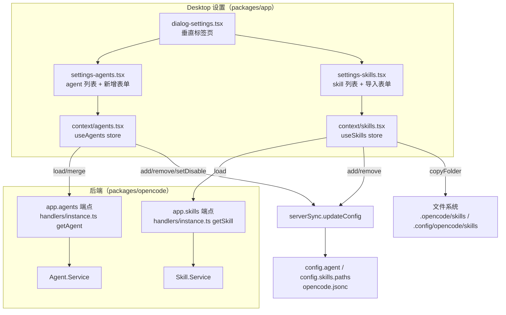
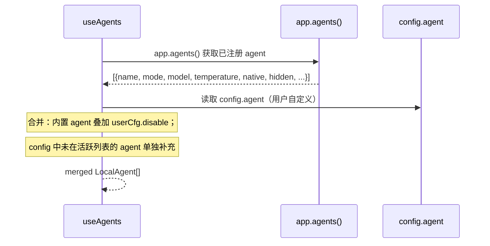
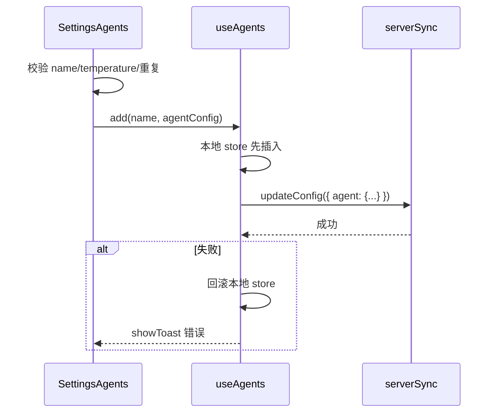
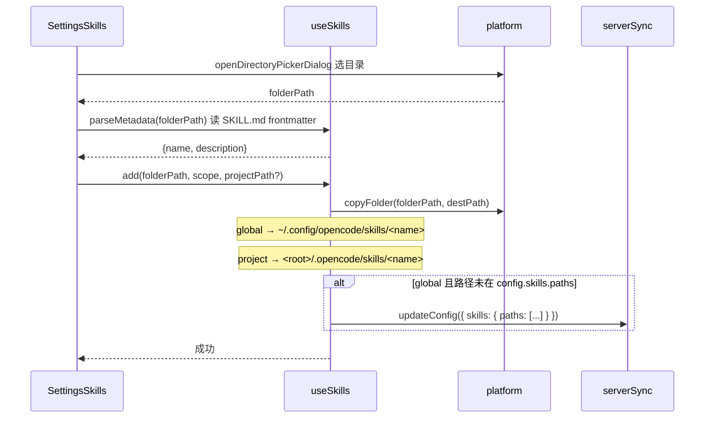

# Desktop 设置中的 Skill/Agent 配置 特性描述

> 本文档分析 opencode（opencode fork，分支 `user/donghe/dev`）中 **Desktop 设置里的 Skill / Agent 配置** 特性。
> 定位：在 Desktop 的设置对话框（`DialogSettings`）里提供 "Agent" 与 "Skill" 两个标签页，
> 让用户可视化地管理自定义 agent（增/删/禁用、配置模型/温度/prompt/工具权限）与 skill
> （从本地目录导入、按 project/global 作用域安装、解析 SKILL.md 元数据）。

## 目录

1. [背景与动机](#1-背景与动机)
2. [高层设计](#2-高层设计)
3. [模块分解](#3-模块分解)
4. [核心流程](#4-核心流程)
5. [数据模型](#5-数据模型)
6. [接口定义](#6-接口定义)
7. [非功能性](#7-非功能性)
8. [测试策略](#8-测试策略)
9. [使用指南](#9-使用指南)

---

## 1. 背景与动机

### 痛点

自定义 agent 与 skill 原本只能手写 `opencode.jsonc` 配置或直接创建目录/文件：

- agent 的字段（mode/model/temperature/prompt/工具权限）散落且易写错；
- skill 的导入需要手动拷贝目录到正确的 `.opencode/skills` / `.config/opencode/skills` 路径；
- 没有可视化界面核对"哪些 agent/skill 已生效"。

### 目标

| 问题 | 表现 | 对应模块 |
|------|------|----------|
| agent 配置繁琐易错 | 手写 JSON | `settings-agents.tsx` |
| skill 导入路径不直观 | 手动拷贝目录 | `settings-skills.tsx` |
| 无法查看/管理已安装 | 无列表界面 | `useAgents` / `useSkills` context |
| 权限配置难 | 工具 allow/deny 手写 | agent 表单的工具开关 |

一句话：**把 agent 与 skill 的增删改查做成桌面设置里的可视化面板。**

### 定位

- **被谁依赖**：Desktop 设置对话框（`dialog-settings.tsx` 的 "Agent" 分组）。
- **依赖谁**：后端 `app.agents` / `app.skills` 端点（`Agent.Service` / `Skill.Service`）、
  `config.agent` / `config.skills` 配置、`serverSync.updateConfig`、`platform.copyFolder/openDirectoryPickerDialog`。
- **范围声明**：本特性只负责**配置管理 UI**，agent/skill 的实际执行仍由后端 `Agent`/`Skill` 服务负责。

---

## 2. 高层设计

### 2.1 架构图

```text
Desktop 设置（packages/app）
  dialog-settings.tsx（垂直标签页）
    ├─ settings-agents.tsx（agent 列表 + 新增表单）
    │     └─ context/agents.tsx（useAgents store）
    └─ settings-skills.tsx（skill 列表 + 导入表单）
          └─ context/skills.tsx（useSkills store）

后端（packages/opencode）
  app.agents 端点（getAgent）→ Agent.Service
  app.skills 端点（getSkill）→ Skill.Service

数据流：
  useAgents ──load/merge──────────────▶ app.agents 端点
  useSkills ──load────────────────────▶ app.skills 端点
  useAgents ──add/remove/setDisable──▶ serverSync.updateConfig ──▶ config.agent
  useSkills ──add/remove──────────────▶ serverSync.updateConfig ──▶ config.skills.paths
  useSkills ──copyFolder──────────────▶ 文件系统（.opencode/skills / .config/opencode/skills）
```



关键架构思想：

1. **两套 context 各司其职**：`useAgents` 与 `useSkills` 是两个独立的 `createSimpleContext`，
   分别维护列表 store 与增删改方法，UI 只消费 context。
2. **列表 = 后端发现 ∪ 本地配置**：agent 列表由 `app.agents()`（内置 + 已注册）与 `config.agent`
   （用户自定义）合并而成；skill 列表由 `app.skills()` 按作用域过滤。
3. **乐观更新 + 回滚**：增/删/禁用都是先改本地 store，再 `updateConfig` 持久化，失败则回滚
   （`agents.tsx:97-172`）。

### 2.2 核心设计模式

| 模式 | 说明 | 落点 |
|------|------|------|
| **SolidJS context + store** | `createSimpleContext` + `createStore` | `agents.tsx`, `skills.tsx` |
| **乐观更新 + 回滚** | 先本地后持久化，失败回滚 | `agents.tsx:97-172` |
| **表单 + 校验** | agent 名称正则/温度范围/重复校验 | `settings-agents.tsx:201-235` |
| **元数据解析** | 解析 SKILL.md frontmatter | `skills.tsx:61-91` |
| **作用域分治** | project（`.opencode/skills`）/ global（`.config/opencode/skills`） | `skills.tsx:85-86` |

### 2.3 文件职责矩阵

| 文件 | 行数 | 职责 |
|------|------|------|
| `packages/app/src/components/settings-agents.tsx` | 496 | agent 列表 + 新增表单 + 校验 |
| `packages/app/src/components/settings-skills.tsx` | 295 | skill 列表 + 导入表单 |
| `packages/app/src/context/agents.tsx` | 188 | `useAgents`：load/merge/add/remove/setDisable |
| `packages/app/src/context/skills.tsx` | 220 | `useSkills`：load/add/remove/parseMetadata |
| `packages/app/src/components/dialog-settings.tsx` | 139 | 设置对话框（注册 agents/skills 标签页） |
| `packages/app/src/components/settings-list.tsx` | 5 | 设置列表容器 |
| `packages/opencode/src/server/routes/instance/httpapi/groups/instance.ts` | — | `app.agents` / `app.skills` 端点声明 |
| `packages/opencode/src/server/routes/instance/httpapi/handlers/instance.ts` | 80-106 | getAgent / getSkill handler |

### 2.4 设置对话框结构

`dialog-settings.tsx:71-83` 中 "Agent" 分组包含两个标签页：

```
设置 → (Agent 分组)
  ├── agents  → SettingsAgents
  └── skills  → SettingsSkills
```

---

## 3. 模块分解

### 3.1 目录结构

```
packages/app/src/
├── components/
│   ├── dialog-settings.tsx       # 设置对话框容器
│   ├── settings-agents.tsx       # agent 配置面板
│   ├── settings-skills.tsx       # skill 配置面板
│   ├── settings-list.tsx         # 列表容器
│   ├── generic-selector.tsx      # 通用下拉选择器（agent 表单用）
│   ├── form-model-selector.tsx   # 模型选择器
│   └── delete-confirm-dialog.tsx # 删除确认框
└── context/
    ├── agents.tsx                # useAgents context
    └── skills.tsx                # useSkills context

packages/opencode/src/server/routes/instance/httpapi/
├── groups/instance.ts            # app.agents / app.skills 端点
└── handlers/instance.ts          # getAgent / getSkill handler
```

### 3.2 类/模块单一职责清单

| 模块 | 单一职责 | 关键点 |
|------|----------|--------|
| `useAgents` | agent 列表的加载/合并/增删/禁用 | `load`（合并内置+配置）、`add`、`remove`、`setDisable` |
| `useSkills` | skill 列表的加载/导入/删除 | `load`（按作用域）、`add`（copyFolder+改配置）、`remove`、`parseMetadata` |
| `SettingsAgents` | agent 配置表单与卡片渲染 | `AgentCard`、`AgentSection`、`saveAgent`、`validateAgentName` |
| `SettingsSkills` | skill 导入表单与卡片渲染 | `SkillCard`、`openAddDialog`、`addSkill` |
| `getAgent` / `getSkill` | 后端 agent/skill 列表查询 | `handlers/instance.ts:80-106` |

---

## 4. 核心流程

### 4.1 Agent 列表加载与合并

```text
useAgents ── app.agents() ──▶ 后端
useAgents ◀── [{name, mode, model, temperature, native, hidden, ...}]
useAgents ── 读取 config.agent（用户自定义）

useAgents 合并（agents.tsx:54-82）：
  ① 遍历活跃 agent，叠加 config.agent[name].disable
  ② config 中不在活跃列表的条目（用户自定义）追加为 native:false

useAgents ◀── merged LocalAgent[]
```



合并逻辑（`agents.tsx:54-82`）：先遍历活跃 agent 叠加 `config.agent[name]` 的 `disable`，
再把 `config.agent` 中不在活跃列表里的条目（用户自定义 agent）追加为 `native:false`。

### 4.2 Agent 新增 / 禁用 / 删除（乐观更新）

```text
SettingsAgents ── 校验 name/temperature/重复 ──▶ 本地
SettingsAgents ── add(name, agentConfig) ──▶ useAgents
useAgents ── 本地 store 先插入（乐观更新）
useAgents ── updateConfig({ agent: {...} }) ──▶ serverSync
  成功 → 完成（showToast 成功）
  失败 → 回滚本地 store + showToast 错误
```



### 4.3 Skill 导入

```text
SettingsSkills ── openDirectoryPickerDialog 选目录 ──▶ platform
SettingsSkills ◀── folderPath
SettingsSkills ── parseMetadata(folderPath) 读 SKILL.md frontmatter ──▶ useSkills
SettingsSkills ◀── {name, description}
SettingsSkills ── add(folderPath, scope, projectPath?) ──▶ useSkills
useSkills ── copyFolder(folderPath, destPath) ──▶ platform
   global  → ~/.config/opencode/skills/<name>
   project → <root>/.opencode/skills/<name>
useSkills ── global 且路径未在 config.skills.paths → updateConfig 追加 ──▶ serverSync
```



---

## 5. 数据模型

### 5.1 agent 配置结构（config.agent）

```jsonc
// opencode.jsonc
{
  "agent": {
    "my-agent": {
      "description": "...",
      "mode": "subagent",       // subagent | primary | all
      "model": "provider/model",
      "temperature": 0.7,
      "prompt": "系统提示词文本 或 {file:路径}",
      "permission": { "write": "deny", "edit": "allow", ... },
      "disable": false
    }
  }
}
```

### 5.2 skill 配置结构（config.skills）

```jsonc
{
  "skills": {
    "paths": ["~/.config/opencode/skills", "…"]
  }
}
```

### 5.3 skill 作用域与目录

| 作用域 | 目录 | 说明 |
|--------|------|------|
| `project` | `<项目根>/.opencode/skills/` | 项目级 skill |
| `global` | `~/.config/opencode/skills/` | 全局 skill |

（`skills.tsx:25-26, 85-86`）

### 5.4 SKILL.md frontmatter

`parseMetadata`（`skills.tsx:61-91`）解析：

```markdown
---
name: my-skill
description: 一句话描述
---
```

仅提取 `name` 与 `description` 两个字段（其余 frontmatter 忽略）。

---

## 6. 接口定义

### 6.1 后端端点

| 端点 | identifier | 说明 |
|------|-----------|------|
| `GET app/agents` | `app.agents` | 列出所有可用 agent（`groups/instance.ts:151-156`） |
| `GET app/skills` | `app.skills` | 列出所有可用 skill（`groups/instance.ts:161-166`） |

### 6.2 useAgents 接口

| 方法 | 说明 |
|------|------|
| `list()` | 当前 agent 列表 |
| `load()` / `refresh()` | 加载/刷新 |
| `add(name, config)` | 新增 agent |
| `remove(name)` | 删除 agent |
| `setDisable(name, disable)` | 启用/禁用 |

### 6.3 useSkills 接口

| 方法 | 说明 |
|------|------|
| `list()` | 当前 skill 列表 |
| `load()` / `refresh()` | 加载/刷新 |
| `add(folderPath, scope, projectPath?)` | 导入 skill |
| `remove(skill)` | 删除 skill |
| `parseMetadata(folderPath, projectRoot?)` | 解析 SKILL.md 元数据 |

### 6.4 agent 表单字段

| 字段 | 类型 | 校验 |
|------|------|------|
| `name` | string | `^[a-zA-Z0-9_-]+$`、≤64 字符、不含 `../` |
| `description` | string | — |
| `mode` | subagent/primary/all | — |
| `model` | provider/model | 需已连接 provider 且有模型 |
| `temperature` | number | 0-1 |
| `prompt` | none/text/file | text 内联，file 存 `{file:路径}` |
| `tools` | 8 个布尔开关 | write/edit/bash/glob/grep/list/task/skill → allow/deny |

---

## 7. 非功能性

### 7.1 性能

- **惰性加载**：`onMount` 时加载（`agents.tsx:175` / `skills.tsx:216`）。
- **防重入**：`load` 用 `store.loading` 标志防并发（`agents.tsx:45` / `skills.tsx:94`）。
- **分作用域并行加载**：skills 用 `Promise.all` 并行拉多个目录（`skills.tsx:113-116`）。

### 7.2 一致性

- **乐观更新 + 回滚**：增/删/禁用失败时恢复本地 store（`agents.tsx:111-116, 144-150, 166-171`）。
- **skill 删除仅改配置路径**：`remove` 只从 `config.skills.paths` 移除，不删磁盘文件（`skills.tsx:197-205`）。

### 7.3 错误处理

- **无 provider/模型时拦截**：新增 agent 前检查（`settings-agents.tsx:170-186`）。
- **skill 目录解析失败**：`parseMetadata` 抛错 → toast 提示（`skills.tsx:214-216`）。
- **平台能力缺失**：无 `copyFolder`/`openDirectoryPickerDialog` 时 toast 提示（`skills.tsx:148-150, 192-195`）。

### 7.4 已发现的缺口 / 不一致（客观记录）

1. **skill 删除未落地**：`settings-skills.tsx:39-44` 的删除按钮被注释（"暂时不开放删除按钮"），
   但 `useSkills.remove` 与 `SkillCard` 的 `onDelete` 仍在——UI 未接线。
2. **agent 删除仅 `showDelete=false`**：`settings-agents.tsx:471, 479` 两处 `showDelete={false}`，
   即 UI 层未暴露删除按钮，`deleteAgent` 逻辑存在但不可达。
3. **skill 作用域判断依赖目录**：`app.skills()` 返回的 location 用 `<built-in>` 过滤内置 skill，
   其余按"所在目录属于哪个 project root"归类（`skills.tsx:99-116`），路径约定耦合。

---

## 8. 测试策略

### 8.1 现状

`settings-agents.tsx` / `settings-skills.tsx` / `agents.tsx` / `skills.tsx` 均**无测试**。
仓库内 `wsl/settings-model.test.ts` 与 skill/agent 配置无关（是 WSL 设置模型）。

### 8.2 单元测试（建议）

| 被测对象 | 测什么 |
|----------|--------|
| `validateAgentName` | 正则/长度/前后缀/路径穿越 |
| `parseMetadata` | SKILL.md frontmatter 解析、缺 name、空文件 |
| `useAgents.load` 合并逻辑 | 内置叠加 disable、config 补充、去重 |
| `useAgents.add/remove/setDisable` | 乐观更新失败回滚 |

### 8.3 边界场景（清单）

- [ ] 无 provider / 无模型时新增 agent
- [ ] agent 名称重复 / 含路径穿越 `../`
- [ ] temperature 越界（<0 或 >1）
- [ ] skill 目录无 SKILL.md 或 frontmatter 缺失
- [ ] global skill 目录已在 config.skills.paths（不重复添加）
- [ ] 平台无 copyFolder 能力（Web 端）
- [ ] `app.skills()` 返回 `<built-in>` skill 被过滤

---

## 9. 使用指南

### 9.1 解决什么问题（一句话版）

**Skill/Agent 配置**：在桌面设置里可视化地管理自定义 agent 与 skill，无需手写 JSON 或手动拷目录。

### 9.2 如何开启

Desktop → 打开设置对话框 → "Agent" 分组下的 "Agents" / "Skills" 标签页（无需额外开关）。

### 9.3 自动行为

| 动作 | 触发时机 |
|------|----------|
| 加载 agent/skill 列表 | 设置面板打开时（`onMount`） |
| 合并内置与自定义 agent | 列表加载时 |
| 过滤 `<built-in>` skill | skill 列表加载时 |

### 9.4 手动操作

**Agents 面板**：

- 新增 agent：填名称/描述/mode/模型/温度/prompt/工具权限
- 禁用/启用：用户自定义 agent 卡片上的 Switch
- 刷新：Refresh 按钮

**Skills 面板**：

- 导入 skill：选目录 → 选作用域（project/global）→ Add
- 查看：按 project/global 分区列出

### 9.5 使用示例

> **示例 1：新增一个"代码审查" subagent**
> 用户在 Agents 面板点 Add → 填 name=`code-reviewer`、mode=`subagent`、model=`anthropic/claude-sonnet`、
> 勾选 read/grep 工具 → Add → 列表出现该 agent，可在会话中通过 task 工具调用。

> **示例 2：禁用内置 agent**
> 用户找到某内置 agent，关闭其 Switch → `config.agent[name].disable=true` → 该 agent 在会话选择中隐藏。

> **示例 3：导入全局 skill**
> 用户在 Skills 面板点 Add → 选择本地 skill 目录 → 选 global → Add →
> 目录被拷贝到 `~/.config/opencode/skills/<name>` 且 `config.skills.paths` 自动更新。

> **示例 4：导入项目 skill**
> 选 project 作用域 + 指定项目根 → skill 拷贝到 `<root>/.opencode/skills/<name>`。

---

## 附录：关键常量速查表

| 常量/字段 | 值/位置 | 说明 |
|------|-----|------|
| global skill 目录 | `.config/opencode/skills` | `skills.tsx:25` |
| project skill 目录 | `.opencode/skills` | `skills.tsx:26` |
| agent 名正则 | `^[a-zA-Z0-9_-]+$` | `settings-agents.tsx:205` |
| agent 名最大长度 | 64 | `settings-agents.tsx:204` |
| agent mode | subagent/primary/all | `agents.tsx:9` |
| 默认温度 | 0.7 | `settings-agents.tsx:151` |
| 默认工具权限 | edit/glob/grep/list/task 允许，其余拒绝 | `settings-agents.tsx:155` |
| 内置 skill 标记 | `<built-in>` | `skills.tsx:103` |
| 端点 identifier | `app.agents` / `app.skills` | `groups/instance.ts:154, 164` |
