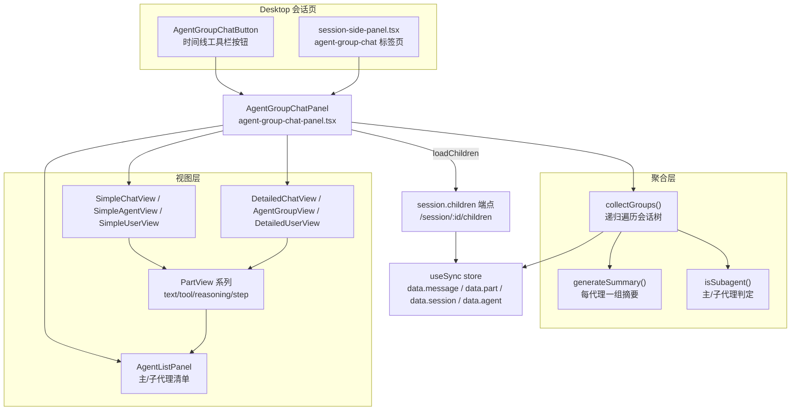
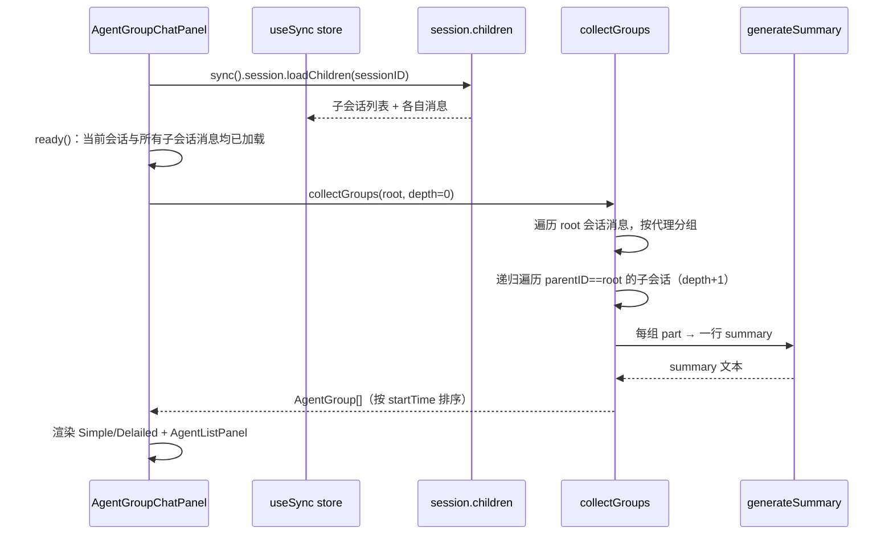
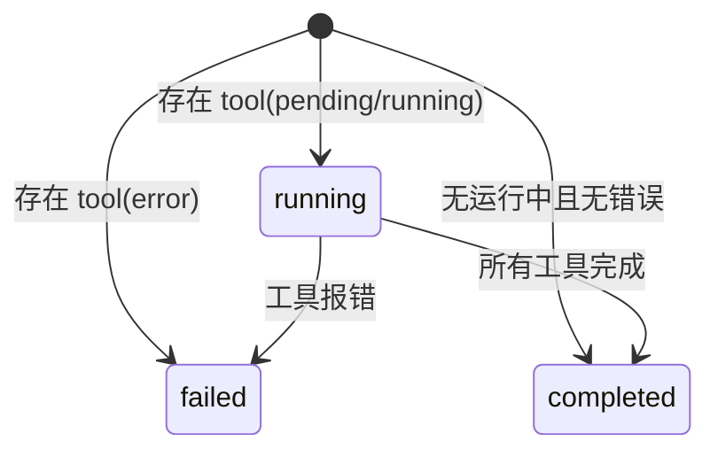

# Agent Group Chat 特性描述

> 本文档分析 opencode（opencode fork，分支 `user/donghe/dev`）中 **Agent Group Chat（代理群聊）** 特性的实现。
> 定位：在 Desktop 会话侧栏中，把**主会话 + 它派生的所有子会话（sub-agent）**按"每个代理一组消息"重新聚合，
> 渲染成一个群聊时间线——用户能看到主代理与每个子代理各自的发言、工具调用、推理与完成状态，
> 并可在"简洁/详细"两种视图间切换。

## 目录

1. [背景与动机](#1-背景与动机)
2. [高层设计](#2-高层设计)
3. [模块分解](#3-模块分解)
4. [核心流程](#4-核心流程)
5. [数据模型](#5-数据模型)
6. [接口定义](#6-接口定义)
7. [非功能性](#7-非功能性)
8. [测试策略](#8-测试策略)
9. [使用指南](#9-使用指南)

---

## 1. 背景与动机

### 痛点

主 agent 通过 `task` 工具 / Dynamic Workflow 派生出多个子代理（sub-session）时：

- 子代理的对话散落在各自的子会话里，主会话时间线看不到"谁在并行干什么"；
- 用户难以理解一次任务里主代理与子代理的分工与先后关系；
- 每个子代理的工具调用、推理过程、完成/失败状态缺乏一个聚合视图。

### 目标

| 问题 | 表现 | 对应模块/子系统 |
|------|------|-----------------|
| 多代理协作不可见 | 子代理对话散落各子会话 | `collectGroups`（递归聚合） |
| 分不清主/子代理 | 无身份标识 | `isSubagent` + `AgentListPanel` |
| 无法快速掌握进度 | 需逐条翻工具/推理 | `generateSummary`（每组一行摘要） |
| 视图单一 | 详情太冗长 | `ViewToggle`（simple/detailed） |

一句话：**把一棵"会话-子会话"树拍平成按代理分组的群聊时间线，简洁视图看摘要、详细视图看全量。**

### 定位

- **被谁依赖**：Desktop 会话侧栏（`session-side-panel.tsx` 的 `agent-group-chat` 标签页）、
  消息时间线工具栏（`message-timeline.tsx:1365` 的按钮）。
- **依赖谁**：`useSync`（消息/会话/代理的同步 store）、`session.children` HTTP 端点、SDK v2 类型。
- **范围声明**：纯**前端展示**特性，不改动后端消息/会话模型；子代理的产生由 `task` 工具
  （`tool/task.ts:145` 设 `parentID`）或 Dynamic Workflow（子会话）负责。

---

## 2. 高层设计

### 2.1 架构图

```text
Desktop 会话页
  AgentGroupChatButton（时间线工具栏按钮）
  session-side-panel.tsx（agent-group-chat 标签页）
        │
        ▼
AgentGroupChatPanel（agent-group-chat-panel.tsx）
  ├─ 聚合层
  │    collectGroups()（递归遍历会话树，visited 防环）
  │    generateSummary()（每代理一组一行摘要）
  │    isSubagent()（主/子代理判定，agent.mode === "subagent"）
  ├─ 视图层
  │    SimpleChatView / DetailedChatView（简洁/详细双视图）
  │    AgentListPanel（主/子代理清单）
  │    PartView 系列（text/tool/reasoning/step）
  └─ 数据源
       useSync store（data.message / data.part / data.session / data.agent）
       session.children 端点（/session/:id/children）
```



关键架构思想：

1. **递归树拍平**：`collectGroups` 以 `sessionID` 为起点，递归遍历 `parentID === sessionID` 的子会话，
   每层 `depth+1`，用 `visited` 集合防环（`agent-group-chat-panel.tsx:964-1085`）。
2. **每代理一组**：把同一会话里同一代理的所有消息 part 归并成一个 `AgentGroup`（含 `parts` 时间线 +
   一行 `summary`），用户按"代理"而非"消息"阅读。
3. **简洁/详细双视图**：simple 视图只渲染每组一行摘要气泡；detailed 视图渲染完整 part（文本/工具/推理/step）。
4. **工具调用规则化摘要**：`summarizeToolCall` 针对 `bash/read/write/edit/glob/grep/lsp/webfetch/task`
   等工具做中文/英文可读摘要，无需 LLM（`agent-group-chat-panel.tsx:585-722`）。

### 2.2 核心设计模式

| 模式 | 说明 | 落点 |
|------|------|------|
| **递归聚合** | DFS 遍历会话-子会话树，深度缩进 | `collectGroups`（964-1085） |
| **按实体分组** | 以"代理"为分组键，归并消息 part | `AgentGroup`（40-51） |
| **规则化摘要（非 LLM）** | 用 switch-case 把工具调用转成人话 | `summarizeToolCall`（585-722） |
| **双视图策略** | simple/detailed 两种渲染密度 | `ViewToggle` + 两套 View 组件 |
| **SolidJS 响应式** | `createMemo`/`createSignal`/`on` 驱动 | 全文 |

### 2.3 文件职责矩阵

| 文件 | 行数 | 职责 |
|------|------|------|
| `packages/app/src/components/agent-group-chat-panel.tsx` | 1190 | 主面板：聚合、摘要、双视图、代理清单 |
| `packages/app/src/components/agent-group-chat-button.tsx` | 46 | 时间线工具栏的开关按钮 |
| `packages/app/src/pages/session/session-side-panel.tsx` | ~430 | 侧栏标签页注册与渲染 |
| `packages/app/src/pages/session/timeline/message-timeline.tsx` | 1365 行处 | 按钮挂载点 |
| `packages/app/src/pages/session/helpers.ts` | 31-76 | tab 状态派生（`agentGroupChatOpen`） |
| `packages/app/src/i18n/en.ts` / `zh.ts` | — | `agentGroupChat.*` 文案 |

### 2.4 后端支撑

- 子会话产生：`tool/task.ts:145`（`parentID: ctx.sessionID`）、Dynamic Workflow `runtime.ts:353`
  （`parent_id: input.sessionID`）。
- 子会话查询：`Session.children(parentID)`（`session/session.ts:595`）→ HTTP `GET /session/:id/children`
  （`groups/session.ts:149-158`）。
- 前端加载：`sync().session.loadChildren(sessionID)`（`agent-group-chat-panel.tsx:1103`）。

---

## 3. 模块分解

### 3.1 目录结构

```
packages/app/src/
├── components/
│   ├── agent-group-chat-panel.tsx   # 主面板（聚合 + 摘要 + 双视图 + 清单）
│   └── agent-group-chat-button.tsx  # 开关按钮
├── pages/session/
│   ├── session-side-panel.tsx       # 侧栏 tab 注册
│   ├── timeline/message-timeline.tsx# 按钮挂载
│   └── helpers.ts                   # tab 状态派生
└── i18n/{en,zh}.ts                  # agentGroupChat.* 文案
```

### 3.2 类/模块单一职责清单

| 模块 | 单一职责 | 位置（行） |
|------|----------|-----------|
| `collectGroups` | 递归遍历会话树，产出 `AgentGroup[]` | 964-1085 |
| `generateSummary` | 一组 part → 一行可读摘要 | 758-837 |
| `summarizeToolCall` | 单个工具调用 → `{action, result}` | 585-722 |
| `summarizeReasoning` / `extractKeyInfo` | 推理/文本的关键句提取 | 724-756 |
| `getAgentStatus` | 按工具状态判定代理 running/failed/completed | 496-506 |
| `AgentListPanel` | 主/子代理清单 | 219-295 |
| `SimpleChatView` / `DetailedChatView` | 两种渲染密度 | 934-962 |
| `PartView` 系列 | text/tool/reasoning/step-start/step-finish 渲染 | 332-494 |
| `ResizeHandle` | 拖拽调整清单宽度 | 179-217 |

---

## 4. 核心流程

### 4.1 聚合流程

```text
AgentGroupChatPanel ── loadChildren(sessionID) ──▶ session.children 端点
                                                 ──▶ useSync store（子会话 + 各自消息）
AgentGroupChatPanel ready()（当前会话与所有子会话消息均已加载）
AgentGroupChatPanel ── collectGroups(root, depth=0)
    ├─ 遍历 root 会话消息，按代理分组
    ├─ 递归遍历 parentID==root 的子会话（depth+1）
    └─ 每组 part → generateSummary → 一行 summary
AgentGroupChatPanel ◀── AgentGroup[]（按 startTime 排序）
AgentGroupChatPanel 渲染 Simple/Detailed + AgentListPanel
```



### 4.2 代理状态机（每组）

```text
[*] ──▶ running : 存在 tool(pending/running)
[*] ──▶ failed : 存在 tool(error)
[*] ──▶ completed : 无运行中且无错误
running ──▶ failed : 工具报错
running ──▶ completed : 所有工具完成
```



### 4.3 关键流程文字说明

- **子会话加载**：`createEffect(on(sessionID, ...))` 监听会话切换，调用 `loadChildren`
  （`agent-group-chat-panel.tsx:1099-1109`）。
- **ready 门控**：`ready()` 要求当前会话消息 + 所有子会话消息均已加载，否则显示 loading（`1111-1122`）。
- **分组键**：assistant 消息按 `msg.agent` 分组；user 消息单独成组（`isUser=true`）；
  子代理（`agent.mode === "subagent"` 或 `depth > 0`）标记 `isSub` 并在显示名后追加 "(subagent)"。
- **深度缩进**：`margin-left = depth * 16px`，子会话视觉上缩进（`523-525, 891-893`）。
- **防环**：`visited` 集合防止子会话循环引用（`972-973`）。

---

## 5. 数据模型

### 5.1 核心类型（前端）

`agent-group-chat-panel.tsx:29-51`：

```ts
type ChronologicalPart = {
  part: Part; time: number; messageID: string
  messageRole: "user" | "assistant"; messageAgent: string
  messageTime: number; depth: number; sessionID: string
}

type AgentGroup = {
  name: string           // 代理名（或 USER/用户）
  displayName: string    // 含 "(subagent)" 后缀
  sessionTitle?: string  // 子会话标题
  isSub: boolean         // 是否子代理
  isUser: boolean
  startTime: number
  parts: ChronologicalPart[]   // 该代理在该会话的所有 part
  depth: number          // 会话树深度
  sessionID: string
  summary: string        // 一行摘要
}
```

### 5.2 数据来源

- 消息/part：`sync().data.message[sessionID]` + `sync().data.part[msg.id]`（`975-979`）。
- 代理元数据：`sync().data.agent`（用于 `isSubagent` 与描述，`53-69`）。
- 子会话：`sync().data.session.filter(s => s.parentID === sessionID)`（`1078`）。

### 5.3 无后端新表

纯前端聚合，复用现有 `session`/`message`/`part`/`agent` 数据，不引入新表。

---

## 6. 接口定义

### 6.1 消费的 SDK/HTTP 接口

| 接口 | 用途 | 调用点 |
|------|------|--------|
| `sync().session.loadChildren(sessionID)` | 加载子会话 | `agent-group-chat-panel.tsx:1103` |
| `GET /session/:id/children` | 子会话列表（`loadChildren` 底层） | `groups/session.ts:149-158` |

### 6.2 组件接口

| 组件 | 关键 props |
|------|-----------|
| `AgentGroupChatPanel` | `{ sessionID: string }` |
| `AgentGroupChatButton` | 无（从 `useSessionLayout` 取 params） |
| `AgentGroupView` / `SimpleAgentView` | `{ group: AgentGroup }` |
| `AgentListPanel` | `{ groups: AgentGroup[], width: number }` |
| `ViewToggle` | `{ view, onChange }` |
| `ResizeHandle` | `{ onResize(delta) }` |

### 6.3 视图切换

| 视图 | 渲染组件 |
|------|----------|
| `simple` | `SimpleChatView`（用户气泡 + 代理摘要气泡） |
| `detailed` | `DetailedChatView`（完整 part 渲染） |

---

## 7. 非功能性

### 7.1 性能

- **memo 驱动**：`groups` 由 `createMemo` 派生，仅当消息/会话数据变化时重算（`1141-1154`）。
- **递归深度无上限**：`collectGroups` 无深度上限，极端嵌套会话树可能栈深/重复遍历（有 `visited` 防环）。
- **`messagesCount` 全树计数**：`ready` 前先递归统计全树消息数（`1124-1139`），与 `groups` 各自递归一次。

### 7.2 并发 / 一致性

- **加载中门控**：`childSessionsLoaded` 信号防止子会话未就绪时渲染不完整分组。
- **事件驱动更新**：`sync` store 随消息事件更新，`groups` 自动重算，无轮询。

### 7.3 错误处理

- `loadChildren` 失败 → `console.error` 并放行（`childSessionsLoaded=true`），面板显示空/部分数据
  （`agent-group-chat-panel.tsx:1105-1108`）。
- 无内容/加载中/空态均有占位 UI（`1165-1177`）。

### 7.4 已发现的缺口 / 不一致（客观记录）

1. **摘要为规则实现，非 LLM**：`generateSummary` 依赖 `summarizeToolCall` 的 switch-case 覆盖工具类型，
   `default` 分支只给 `Called <name> / completed`，未覆盖的新工具摘要信息量低（`708-718`）。
2. **递归深度无界**：嵌套子会话无深度限制（对比 workflow 的并发/总量上限）。
3. **面板宽高/尺寸**：`ResizeHandle` 宽度范围硬编码 150-400px（`1095`）。
4. **`isSubagent` 依赖 `agent.mode`**：若子代理在 `sync().data.agent` 中缺失，则退化为按 `depth > 0` 判定
   （`1033-1035` 有 `depth > 0 || isSub` 兜底）。
5. **无 TUI 对应实现**：Agent Group Chat 仅 Desktop 有，TUI 无对应视图。

---

## 8. 测试策略

### 8.1 现状

`agent-group-chat-panel.tsx` 及配套组件**无测试**。

### 8.2 单元测试（建议）

| 被测对象 | 测什么 |
|----------|--------|
| `collectGroups` | 会话树遍历、按代理分组、depth、visited 防环 |
| `generateSummary` | 各工具类型的 action/result 组合、>3 工具折叠、空 parts |
| `summarizeToolCall` | bash 输出错误检测、glob/grep 结果计数、default 分支 |
| `getAgentStatus` | running/failed/completed 判定 |
| `shouldCollapse` / `getLineCount` | 折叠阈值（>300 字符或 >3 行） |
| `formatTime` | today/yesterday/同年/跨年 四种分支 |

### 8.3 集成测试（建议）

- 构造一个主会话 + 若干子会话（含 tool/reasoning/text part），断言面板渲染出正确的组数与主/子分类。

### 8.4 边界场景（清单）

- [ ] 空会话 / 无子会话
- [ ] 循环引用的会话树（visited 防环）
- [ ] 深嵌套（>10 层）子会话
- [ ] 未知工具类型的摘要兜底
- [ ] 工具输出非 string（对象/数组）的 JSON 序列化
- [ ] 中英文切换（summary 文案随 locale）
- [ ] 子会话消息未加载时的 ready 门控

---

## 9. 使用指南

### 9.1 解决什么问题（一句话版）

**Agent Group Chat**：把主会话与它的子代理拍平成按代理分组的群聊时间线，简洁视图看摘要、详细视图看全量，
一眼看清多代理协作的分工与进度。

### 9.2 如何开启

无需配置，随 Desktop 会话页内置：

- 点击消息时间线工具栏的 `bubble-5` 图标按钮（`message-timeline.tsx:1365`）；
- 或从侧栏标签页切到 `agent-group-chat`。

### 9.3 自动行为

| 动作 | 触发时机 |
|------|----------|
| 加载子会话 | 面板挂载 / 切换 sessionID 时 |
| 递归聚合分组 | 消息/子会话数据变化时（memo 重算） |
| 生成每代理摘要 | 分组计算时 |
| 显示 loading | 子会话消息未就绪时 |

### 9.4 手动操作

| 操作 | 说明 |
|------|------|
| 切换 simple/detailed | 顶栏 `ViewToggle` |
| 折叠/展开内容 | 长文本/工具 I/O 的 `CollapsibleContent` |
| 折叠/展开某代理组 | 每组标题栏的 expand/collapse |
| 拖拽调整清单宽度 | 面板右侧 `ResizeHandle` |

### 9.5 使用示例

> **示例 1：查看一次 task 派发的协作**
> 主 agent 用 `task` 工具派了 3 个子代理并行改代码。
> → 用户打开 Agent Group Chat → 看到主代理一组 + 3 个子代理组（缩进显示、带 "(subagent)" 后缀）。
> → simple 视图下每代理一行摘要（如"编辑文件: x.ts, 修改完成"），快速了解分工。

> **示例 2：切换详细视图看过程**
> 用户切到 detailed → 展开某个子代理组 → 看到它的 `💭 推理`、`🛠️ bash`、`💬 文本`、`✅ step-finish`
> （含 token/cost）完整过程。

> **示例 3：定位失败的代理**
> 某子代理工具调用报错 → 该组标题显示 `circle-x`（红色）→ 用户展开看到具体 error 详情。

> **示例 4：代理清单**
> 用户看右侧清单 → 主代理与子代理分区列出，每个带名称与描述 → 快速了解本次任务动用了哪些代理。

---

## 附录：关键常量速查表

| 常量/字段 | 值/位置 | 说明 |
|------|-----|------|
| 分组键 | `msg.agent`（assistant）/ 固定 "USER"（user） | `agent-group-chat-panel.tsx:984, 1046` |
| 子代理判定 | `agent.mode === "subagent"` | `53-60` |
| 缩进步长 | `depth * 16px` | `523-525` |
| 折叠阈值 | >300 字符 或 >3 行 | `95-97` |
| 摘要工具数上限 | 3（超出显示 `+N more`） | `794, 822-824` |
| 面板宽度范围 | 150-400px | `1095` |
| 深度兜底 | `depth > 0 || isSub` | `1033-1035` |
| 子会话端点 | `GET /session/:id/children` | `groups/session.ts:149` |
