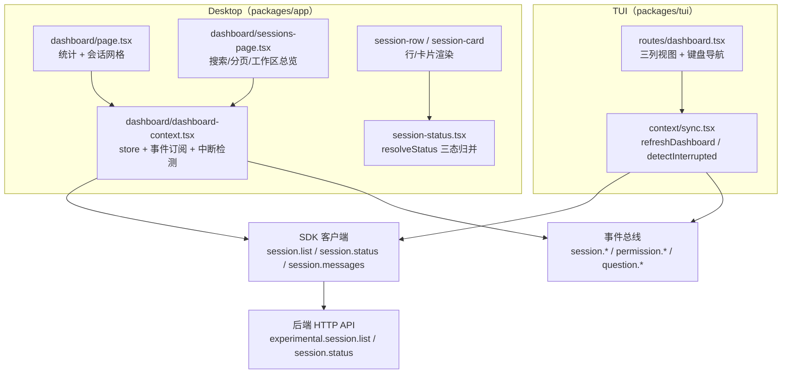
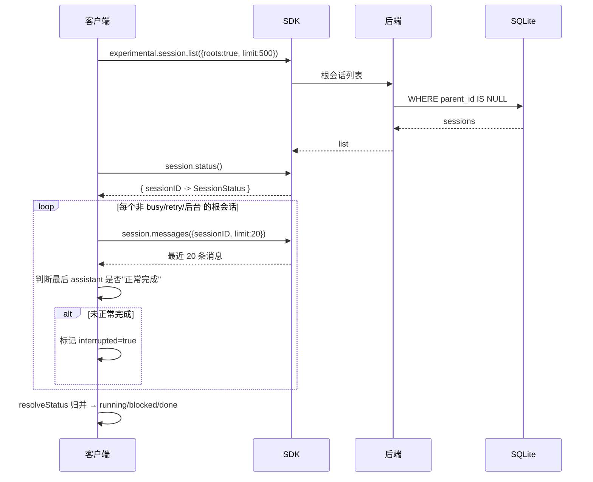
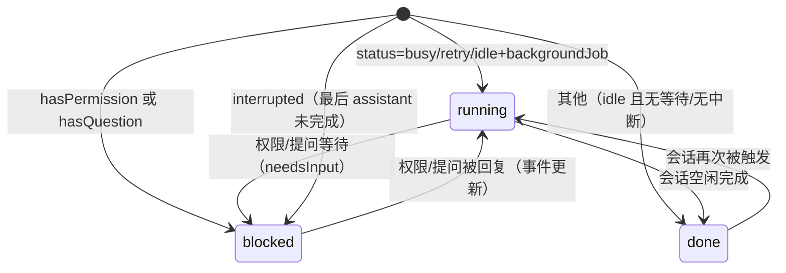

# Session Dashboard 特性描述（TUI + Desktop）

> 本文档分析 opencode（opencode fork，分支 `user/donghe/dev`）中 **Session Dashboard（会话仪表盘）** 特性的实现，
> 覆盖两个客户端形态：**TUI**（终端三列视图）与 **Desktop**（Web/桌面会话列表 + 工作区总览）。
> 定位：把当前项目的所有**根会话**按 `running / blocked / done` 三态聚合展示，
> 支持恢复被中断/被阻塞的会话、搜索、分页、导出，并按工作区（worktree）汇总。

## 目录

1. [背景与动机](#1-背景与动机)
2. [高层设计](#2-高层设计)
3. [模块分解](#3-模块分解)
4. [核心流程](#4-核心流程)
5. [数据模型](#5-数据模型)
6. [接口定义](#6-接口定义)
7. [非功能性](#7-非功能性)
8. [测试策略](#8-测试策略)
9. [使用指南](#9-使用指南)

---

## 1. 背景与动机

### 痛点

用户同时开着很多会话，散落在不同工作区，有的在跑、有的卡在权限/提问等待、有的已中断无人知晓：

- 无法一眼看出"哪些会话需要我介入"；
- 中断的会话（崩溃/被打断）无标记，容易被遗忘；
- 缺少跨工作区的会话聚合视图。

### 目标

| 问题 | 表现 | 对应模块 |
|------|------|----------|
| 状态不可见 | 不知哪些会话在跑/卡住/完成 | `session-status.tsx`（三态归并） |
| 中断会话难发现 | 崩溃会话无提示 | `detectInterrupted`（TUI sync + App context） |
| 无聚合视图 | 会话散落各工作区 | TUI `dashboard.tsx` / App `sessions-page.tsx` |
| 恢复/导出不便 | 需手动逐个操作 | `resume` / `exportSession` |

一句话：**用三态（running/blocked/done）把根会话聚合成一个可导航、可恢复、可导出的仪表盘。**

### 定位

- **被谁依赖**：TUI 主界面（`/dashboard` 路由）、Desktop 仪表盘页与全部会话页。
- **依赖谁**：SDK（`experimental.session.list` + `session.status` + `session.messages` + `session.prompt` + `session.delete`）、
  事件总线（`session.*`、`permission.*`、`question.*`）。
- **范围声明**：只展示**根会话**（`!parentID`），子会话（sub-agent）不在仪表盘显示
  （`dashboard.tsx:57`、`dashboard-context.tsx:67`）。

---

## 2. 高层设计

### 2.1 架构图

```text
TUI（packages/tui）                       Desktop（packages/app）
  routes/dashboard.tsx（三列视图+键盘导航）   dashboard-context.tsx（store+事件订阅+中断检测）
  context/sync.tsx（refreshDashboard/中断检测）dashboard/page.tsx（统计+网格）
        │                                     dashboard/sessions-page.tsx（搜索/分页/工作区）
        │                                     session-row / session-card（渲染）
        │                                     session-status.tsx（resolveStatus 三态归并）
        │                                              │
        └────────────── SDK 客户端 ─────────────────────┘
            （session.list / session.status / session.messages）
                             │
                     后端 HTTP API
            （experimental.session.list / session.status）
                             │
             事件总线（session.* / permission.* / question.*）
```



关键架构思想：

1. **三态归并统一**：两个客户端共用同一套状态判定逻辑（`session-status.tsx:17-28` 的 `resolveStatus` 与
   `dashboard.tsx:56-87` 的内联判定），输入为 `status + hasPermission + hasQuestion + interrupted`。
2. **中断检测是"读消息推断"**：没有专门的"中断"字段，而是拉最近 20 条消息，判断最后一条 assistant
   是否"正常完成"（`finish !== "tool-calls"` 且有 `time.completed`），否则标记 interrupted。
3. **事件驱动增量更新**：App 的 `dashboard-context` 订阅 `session.created/updated/deleted`、`session.status`、
   `permission.asked/replied`、`question.asked/replied/rejected`，实时更新 store，避免全量刷新。

### 2.2 核心设计模式

| 模式 | 说明 | 落点 |
|------|------|------|
| **三态状态机** | running/blocked/done 的归并判定 | `session-status.tsx:17-28` |
| **事件驱动 store** | 订阅事件增量更新 | `dashboard-context.tsx:134-227` |
| **SolidJS store + memo** | `createStore` + `createMemo` 派生视图 | `dashboard-context.tsx:22-63` |
| **键盘导航**（TUI） | ↑↓←→ 移动、Enter 打开、Space peek | `dashboard.tsx:173-252` |

### 2.3 文件职责矩阵

**TUI**：

| 文件 | 行数 | 职责 |
|------|------|------|
| `packages/tui/src/routes/dashboard.tsx` | 361 | 三列视图、键盘导航、peek/resume/delete |
| `packages/tui/src/context/sync.tsx` | 791 | `refreshDashboard`、`detectInterrupted`、`globalSession`/`session_status`/`permission`/`question`/`interrupted` store |

**Desktop**：

| 文件 | 行数 | 职责 |
|------|------|------|
| `packages/app/src/pages/dashboard/dashboard-context.tsx` | 243 | store、`load`、`detectInterrupted`、事件订阅 |
| `packages/app/src/pages/dashboard/session-status.tsx` | 67 | `resolveStatus`、状态图标/颜色 |
| `packages/app/src/pages/dashboard/page.tsx` | 65 | 仪表盘主页（统计 + 网格） |
| `packages/app/src/pages/dashboard/sessions-page.tsx` | 132 | 全部会话（搜索/分页/工作区总览） |
| `packages/app/src/pages/dashboard/session-card.tsx` | 76 | 网格卡片 |
| `packages/app/src/pages/dashboard/session-row.tsx` | 139 | 列表行（resume/export/attach） |
| `packages/app/src/pages/dashboard/session-grid.tsx` | 15 | 卡片网格容器 |
| `packages/app/src/pages/dashboard/stats-cards.tsx` | 40 | 四张统计卡 |
| `packages/app/src/pages/dashboard/worktree-overview.tsx` | 75 | 工作区聚合 |

### 2.4 状态判定（核心逻辑）

`resolveStatus`（`session-status.tsx:17-28`）：

```ts
if (hasPermission || hasQuestion) return { key: "blocked", reason: "permission"|"question" }
if (status.type === "retry")   return { key: "running", reason: status.message }
if (status.type === "busy")    return { key: "running" }
if (status.type === "idle" && status.hasBackgroundJob) return { key: "running" }
if (interrupted)               return { key: "blocked", reason: "interrupted" }
return { key: "done" }
```

TUI 的 `dashboard.tsx:56-87` 内联了同一套逻辑（因 TUI 无法复用 app 包）。

---

## 3. 模块分解

### 3.1 目录结构

```
packages/tui/src/
├── routes/dashboard.tsx        # TUI 三列仪表盘
└── context/sync.tsx            # TUI 同步（含 dashboard 数据 + 中断检测）

packages/app/src/pages/dashboard/
├── dashboard-context.tsx       # store + 加载 + 事件订阅 + 中断检测
├── page.tsx                    # 主页（统计 + 前 4 会话网格）
├── sessions-page.tsx           # 全部会话（搜索/分页/工作区总览）
├── session-status.tsx          # 三态归并 + 图标/颜色
├── session-grid.tsx            # 卡片网格
├── session-card.tsx            # 会话卡片
├── session-row.tsx             # 会话行（resume/export/attach）
├── stats-cards.tsx             # 统计卡
└── worktree-overview.tsx       # 工作区聚合
```

### 3.2 类/模块单一职责清单

| 模块 | 单一职责 | 关键点 |
|------|----------|--------|
| `resolveStatus` | 唯一的三态归并判定 | `session-status.tsx:17-28` |
| `detectInterrupted` | 推断哪些根会话被中断 | `dashboard-context.tsx:65-99` / `tui sync.tsx:627-658` |
| `createDashboardStore` | 会话/状态/权限/问题的 store 与事件订阅 | `dashboard-context.tsx:18-230` |
| `SessionRow` | 单会话的恢复/导出/跳转 | `session-row.tsx:22-48` |
| `WorktreeOverview` | 按 directory 聚合会话统计 | `worktree-overview.tsx:11-36` |
| TUI `Dashboard` | 三列视图 + 键盘导航 | `dashboard.tsx:33-361` |

> 客观指出：三态判定逻辑在 **TUI 与 App 各实现了一份**（`dashboard.tsx:56-87` 与 `session-status.tsx:17-28`），
> 逻辑重复、存在漂移风险（虽当前一致）。

---

## 4. 核心流程

### 4.1 数据加载与中断检测

```text
客户端 ── session.list({roots:true, limit:500}) ──▶ 后端 ── WHERE parent_id IS NULL ──▶ SQLite
客户端 ◀── 根会话列表 ◀──────────────────────────────── 后端 ◀── sessions
客户端 ── session.status() ──▶ 后端
客户端 ◀── { sessionID → SessionStatus }

for 每个非 busy/retry/后台 的根会话:
    客户端 ── session.messages({sessionID, limit:20}) ──▶ 后端
    客户端 ◀── 最近 20 条消息
    客户端 判断最后一条 assistant 是否"正常完成"
        └─ 未正常完成 → 标记 interrupted=true

客户端 resolveStatus 归并 → running / blocked / done
```



### 4.2 状态机：会话三态归并

```text
[*] ──▶ running : status=busy/retry/idle+backgroundJob
[*] ──▶ blocked : hasPermission 或 hasQuestion
running ──▶ blocked : 权限/提问等待（needsInput）
[*] ──▶ blocked : interrupted（最后 assistant 未完成）
blocked ──▶ running : 权限/提问被回复（事件更新）
[*] ──▶ done : 其他（idle 且无等待/无中断）
done ──▶ running : 会话再次被触发
running ──▶ done : 会话空闲完成
```



### 4.3 关键流程文字说明

- **中断判定算法**（`dashboard-context.tsx:76-91`）：取最后一条 user 与最后一条 assistant，
  `completed = lastAssistant.finish && finish !== "tool-calls" && lastAssistant.time.completed && lastUser.id < lastAssistant.id`；
  不满足即 `interrupted=true`。
- **resume**：对 blocked 会话发送一条 "Please continue from where you were interrupted." 的 prompt
  （`session-row.tsx:22-31`、`dashboard.tsx:120-126`）。
- **事件增量**（App）：`session.created` 时 unshift 到 order 头；`session.updated` 归档则移除；
  `permission.asked/replied`、`question.asked/replied` 用 `Binary.search` 维护有序数组（`dashboard-context.tsx:134-227`）。

---

## 5. 数据模型

### 5.1 客户端 store 结构

**App `dashboard-context.tsx:9-16`**：

```ts
Store = {
  sessions:    Record<sessionID, Session>      // 根会话
  statuses:    Record<sessionID, SessionStatus>
  order:       string[]                        // 有序 id 列表
  interrupted: Record<sessionID, true>
  perms:       Record<sessionID, PermissionRequest[]>
  questions:   Record<sessionID, QuestionRequest[]>
}
```

派生（`createMemo`）：`sessions`（按 updated 降序）、`results`（三态 Map）、`counts`（total/running/blocked/done）。

**TUI `sync.tsx`**：`globalSession`（`Session[]`）、`session_status`、`interrupted`、`permission`、`question`。

### 5.2 无后端新表

Dashboard 是纯前端聚合视图，复用现有会话/状态/权限/提问数据，不引入新表。

---

## 6. 接口定义

### 6.1 消费的 SDK 接口

| 接口 | 用途 | 调用点 |
|------|------|--------|
| `experimental.session.list({roots:true, limit:500})` | 根会话列表 | `dashboard-context.tsx:107` / `tui sync.tsx:662` |
| `session.status()` | 全量会话状态 | `dashboard-context.tsx:108` / `tui sync.tsx:664` |
| `session.messages({sessionID, limit:20})` | 中断检测 | `dashboard-context.tsx:73` / `tui sync.tsx:631` |
| `session.prompt({...})` | 恢复会话 | `session-row.tsx:24` / `dashboard.tsx:121` |
| `session.delete({sessionID})` | 删除会话 | `dashboard.tsx:168` |

### 6.2 TUI 键盘操作

| 键 | 动作 |
|----|------|
| `←→` / `h` `l` | 切换列（running/blocked/done） |
| `↑↓` / `k` `j` | 移动选择 |
| `Enter` | 打开会话 |
| `Space` | peek 预览最近 5 条消息 |
| `r` | 恢复（仅 interrupted） |
| `Shift+r` | 重命名 |
| `d` | 删除（二次确认） |
| `n` | 新建会话 |
| `Esc` | 返回 |

### 6.3 路由

| 路由 | 页面 |
|------|------|
| `/dashboard` | 仪表盘主页 |
| `/dashboard/sessions` | 全部会话（支持 `?status=running/blocked/done` 过滤） |

---

## 7. 非功能性

### 7.1 性能

- **增量事件更新**：App 不轮询，靠事件订阅更新 store（`dashboard-context.tsx:134-227`），
  只有初始 `load()` 拉全量。
- **中断检测代价**：对每个根会话额外一次 `messages(limit:20)` 调用（`dashboard-context.tsx:73`），
  会话多时是 O(N) 次请求，且 TUI/App 各自执行一遍。
- **列表上限**：`limit: 500` 根会话（`dashboard-context.tsx:107`），超出部分不展示。
- **工作区聚合**：`WorktreeOverview` 仅取前 6 个（`worktree-overview.tsx:35`）。

### 7.2 并发

- **中断检测无去重**：App 的 `detectInterrupted` 在 `load()` 里执行；TUI 在 `refreshDashboard` 里执行；
  两者是独立客户端，各自为政。
- **`load` 防重入**：`loading` 标志位防止并发 load（`dashboard-context.tsx:101-104`）。

### 7.3 错误处理

- **中断检测容错**：单会话 `messages` 失败只 `console.error`，不影响其他会话（`dashboard-context.tsx:94-96`）。
- **resume/export 失败**：`showToast` 报错（`session-row.tsx:28-30, 45-47`）。

### 7.4 监控埋点

- `console.log("[dashboard] loaded ...")` / `console.error("[dashboard] load failed ...")`
  （`dashboard-context.tsx:126-128`）。

**已发现的缺口 / 不一致（客观记录）**：

1. **三态判定逻辑重复**：TUI（`dashboard.tsx:56-87`）与 App（`session-status.tsx:17-28`）各写一份。
2. **中断检测重复且偏重**：两客户端各自对每个根会话发 `messages` 请求，无共享缓存。
3. **Desktop 无 recap 触发**（承接 recap 特性）：`session-card`/`session-row` 只读 `recap.text`，
   未发现 Desktop 主动生成 recap 的逻辑。
4. **`session-row.tsx:67` 的 `providers` 图标**：卡片底部 providers 图标区域为占位（无实际内容）。

---

## 8. 测试策略

### 8.1 现状

`dashboard.tsx`、`dashboard-context.tsx` 及 App dashboard 目录**无测试**。

### 8.2 单元测试（建议）

| 被测对象 | 测什么 |
|----------|--------|
| `resolveStatus` | 六条分支：permission/question/retry/busy/background/interrupted/default |
| `detectInterrupted` 的完成判定 | `finish`、`time.completed`、消息 id 顺序的边界 |
| `createDashboardStore` 派生 memo | `sessions` 排序、`counts` 计数 |
| 事件订阅更新 | `session.created/updated/deleted`、`permission.*`、`question.*` 对 store 的影响 |

### 8.3 边界场景（清单）

- [ ] 空会话列表（无根会话）
- [ ] 超 500 会话截断
- [ ] `session.messages` 失败的容错
- [ ] `status.type` 为未知值时的 `resolveStatus` 兜底
- [ ] 子会话（有 parentID）被正确过滤
- [ ] 归档会话（`time.archived`）被过滤
- [ ] `interrupted` 与 `status` 冲突时的优先级（当前 needsInput > 状态 > interrupted）

---

## 9. 使用指南

### 9.1 解决什么问题（一句话版）

**Session Dashboard**：把项目所有根会话按 `running/blocked/done` 三态聚合，一眼找到需要介入的会话并一键恢复。

### 9.2 如何开启

无需配置，随客户端内置：

- **TUI**：主界面导航到 Dashboard（`n` 新建会话 / `Esc` 返回）。
- **Desktop**：访问 `/dashboard` 或 `/dashboard/sessions`。

### 9.3 自动行为

| 动作 | 触发时机 |
|------|----------|
| 拉取根会话 + 状态 | 页面挂载 / `refresh()` |
| 推断中断会话 | 加载后对每个根会话读最近消息 |
| 事件增量更新 | `session.*` / `permission.*` / `question.*` 事件到达时 |
| 统计计数 | store 变化时由 memo 派生 |

### 9.4 手动操作

| 操作 | TUI | Desktop |
|------|-----|---------|
| 打开会话 | `Enter` | 点击卡片/行 |
| 恢复（blocked） | `r` | Resume 按钮 |
| 预览 | `Space`（peek） | — |
| 删除 | `d`（二次确认） | — |
| 重命名 | `Shift+r` | — |
| 导出 | — | Export 按钮 |
| 搜索/过滤 | — | 搜索框 + `?status=` 过滤 |

### 9.5 使用示例

> **示例 1：找到卡住的会话**
> 用户打开 Dashboard → BLOCKED 列显示一个会话标 `⚠`（等待权限）→ 按 `Enter` 进入 → 批准权限 → 会话继续。

> **示例 2：恢复中断会话**
> 上次崩溃的会话显示在 BLOCKED 列、标 `⚡`（interrupted）→ 用户按 `r` → 系统发送"Please continue"→ 会话恢复。

> **示例 3：Desktop 按状态过滤**
> 用户访问 `/dashboard/sessions?status=blocked` → 列表只显示需要介入的会话 → 点 Resume 逐个恢复。

> **示例 4：工作区总览**
> 用户在"全部会话"页底部看到 6 个工作区卡片，每个显示 running/blocked/done 计数与分支名，
> 快速定位"哪个项目有会话在跑"。

---

## 附录：关键常量速查表

| 常量/字段 | 值/位置 | 说明 |
|------|-----|------|
| 三态 | `running / blocked / done` | `session-status.tsx:3` |
| 根会话过滤 | `!s.parentID` | `dashboard.tsx:57` / `dashboard-context.tsx:67` |
| 会话列表上限 | 500 | `dashboard-context.tsx:107` |
| 中断检测消息数 | 20 | `dashboard-context.tsx:73` / `tui sync.tsx:631` |
| 工作区卡片数 | 6 | `worktree-overview.tsx:35` |
| 分页每页 | 10 | `sessions-page.tsx:23` |
| 恢复提示语 | "Please continue from where you were interrupted." | `session-row.tsx:26` / `dashboard.tsx:123` |
| 状态图标 | running◌ / blocked⚡⚠❓ / done✓ | `dashboard.tsx:308-310` |
