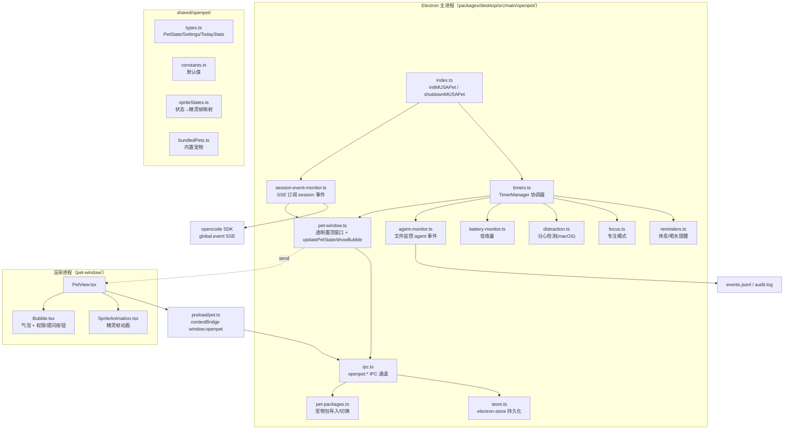
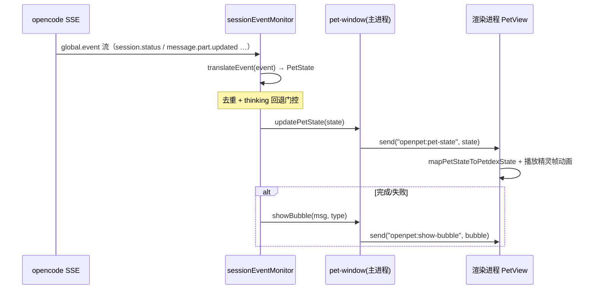
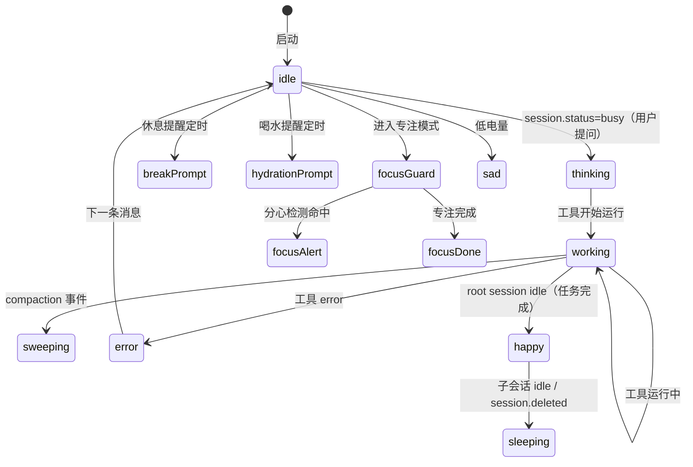

# Pet 系统（MUSAPet）特性描述

> 本文档分析 opencode（opencode fork，分支 `user/donghe/dev`）中 **Pet 系统（MUSAPet）** 特性的实现。
> 定位：一个悬浮在桌面上的**电子宠物**，通过透明无边框置顶窗口展示精灵动画，
> 把 opencode 的 session/agent 事件、权限/提问请求、专注模式、休息喝水提醒、电量状态
> "翻译"成宠物的表情与气泡消息，成为一个陪伴式的工作助手。

## 目录

1. [背景与动机](#1-背景与动机)
2. [高层设计](#2-高层设计)
3. [模块分解](#3-模块分解)
4. [核心流程](#4-核心流程)
5. [数据模型](#5-数据模型)
6. [接口定义](#6-接口定义)
7. [非功能性](#7-非功能性)
8. [测试策略](#8-测试策略)
9. [使用指南](#9-使用指南)

---

## 1. 背景与动机

### 痛点

纯文本的编码 agent 缺乏"情绪反馈"，长时间工作也缺少健康关怀：

- agent 在跑、在思考、出错时，用户感知不到（除非盯着终端）；
- 长时间编码忘记休息/喝水；
- 权限请求、提问请求需要用户及时响应，但容易被忽略。

### 目标

| 问题 | 表现 | 对应模块 |
|------|------|----------|
| 无情绪反馈 | agent 状态不可见 | `session-event-monitor` / `agent-monitor` |
| 忘记休息喝水 | 无健康提醒 | `reminders.ts` |
| 专注易被打断 | 无专注模式 | `focus.ts` / `distraction.ts` |
| 权限/提问易忽略 | 需在终端确认 | `session-event-monitor` + `Bubble` |
| 低电量无感 | 笔记本电池 | `battery-monitor.ts` |

一句话：**一个会把 opencode 状态"演"出来的桌面电子宠物，兼作健康提醒与交互入口。**

### 定位

- **被谁依赖**：Desktop 应用（Electron 主进程 + 独立渲染进程窗口）、Desktop 设置面板（`MUSAPetSettings`）。
- **依赖谁**：opencode SDK（SSE 全局事件）、Electron（BrowserWindow / powerMonitor / ipcMain）、
  `electron-store`（持久化）、系统命令（osascript / sysfs 读电量）。
- **范围声明**：纯 Desktop 特性（TUI/Web 无）；宠物只做**状态呈现与交互**，不参与 agent 执行逻辑。

---

## 2. 高层设计

### 2.1 架构图

```text
Electron 主进程（packages/desktop/src/main/openpet/）
  index.ts（initMUSAPet / shutdownMUSAPet）
    └─▶ timers.ts（TimerManager 协调器）
          ├─▶ reminders.ts（休息/喝水提醒）
          ├─▶ focus.ts（专注模式）
          ├─▶ distraction.ts（分心检测 macOS）
          ├─▶ battery-monitor.ts（低电量）
          └─▶ agent-monitor.ts（监控 events.jsonl / audit.log）
  session-event-monitor.ts（SSE 订阅）──▶ opencode SDK（global.event SSE）
  pet-window.ts（透明置顶窗口 + updatePetState/showBubble）
  pet-packages.ts（宠物包导入/切换）· store.ts（electron-store）· ipc.ts（openpet:* 通道）

渲染进程（pet-window/）
  PetView.tsx ──▶ SpriteAnimation.tsx（精灵帧动画）
               └─▶ Bubble.tsx（气泡 + 权限/提问按钮）

shared/openpet/：types.ts / constants.ts / spriteStates.ts（状态→精灵帧）/ bundledPets.ts
preload/pet.ts（contextBridge → window.openpet）

数据流：主进程 updatePetState/showBubble ──IPC──▶ 渲染进程
        渲染进程交互（点击/拖拽/权限回复）──IPC──▶ 主进程
```



关键架构思想：

1. **主进程监控 + 渲染进程呈现**：所有状态来源（事件/定时器/系统）在主进程汇聚成 `updatePetState(state)` +
   `showBubble(msg)`，通过 IPC 推给独立透明窗口，渲染进程只做动画与交互回传。
2. **事件 → 状态翻译**：`translateEvent`（`session-event-monitor.ts:50-109`）把 opencode 事件映射到
   `PetState`，`mapPetStateToPetdexState`（`spriteStates.ts:121-142`）再映射到精灵图的行/帧。
3. **协调器聚合**：`TimerManager` 统一启停提醒/专注/分心/agent/电池五个子系统（`timers.ts:21-58`）。

### 2.2 核心设计模式

| 模式 | 说明 | 落点 |
|------|------|------|
| **事件翻译** | opencode 事件 → PetState → PetdexState → 精灵帧 | `session-event-monitor.ts:50` + `spriteStates.ts:121` |
| **协调器（Facade）** | TimerManager 统一编排子系统 | `timers.ts:21` |
| **单例实例** | 各子系统导出模块级单例 | `agentMonitor`/`batteryMonitor`/`focusMode`/`distractionDetector`/`reminderSystem`/`timerManager` |
| **IPC 通道命名** | `openpet:*` 前缀 | `ipc.ts` + `constants.ts:80` |
| **上下文隔离** | `contextIsolation:true` + `contextBridge` | `pet-window.ts:35` + `preload/pet.ts` |

### 2.3 文件职责矩阵

**主进程（`main/openpet/`）**：

| 文件 | 行数 | 职责 |
|------|------|------|
| `index.ts` | 68 | 初始化/关闭入口，编排创建窗口、恢复位置、启动监控 |
| `timers.ts` | 157 | TimerManager 协调器，聚合各子系统 |
| `reminders.ts` | 224 | 休息/喝水提醒定时器 + snooze |
| `focus.ts` | 158 | 专注模式（计时 + 分心警告） |
| `distraction.ts` | 187 | macOS 分心检测（osascript 读活动窗口） |
| `battery-monitor.ts` | 193 | 低电量检测（Linux/Mac 系统命令） |
| `agent-monitor.ts` | 190 | 监控 `events.jsonl`/`audit.log` 文件 → agent 事件 |
| `session-event-monitor.ts` | 400 | SSE 订阅 session 事件 + 权限/提问处理 |
| `pet-window.ts` | 132 | 透明置顶窗口 + updatePetState/showBubble |
| `pet-packages.ts` | 356 | 宠物包导入（zip）/验证/切换/删除 |
| `store.ts` | 206 | electron-store 读写（settings/stats/位置/宠物） |
| `ipc.ts` | 316 | 所有 `openpet:*` IPC handler |
| `screen-block-window.ts` | 105 | 休息时的全屏挡屏窗口 |
| `locale.ts` | 17 | 语言检测 |

**共享（`shared/openpet/`）**：

| 文件 | 行数 | 职责 |
|------|------|------|
| `types.ts` | 280 | 共享类型（PetState/Settings/TodayStats/SpeechBubble…） |
| `constants.ts` | 95 | 默认设置与常量 |
| `spriteStates.ts` | 159 | PetState→精灵帧映射 + 帧位置计算 |
| `bundledPets.ts` | 41 | 内置宠物清单 |

**渲染进程 / preload**：

| 文件 | 行数 | 职责 |
|------|------|------|
| `renderer/pet-window/PetView.tsx` | 85 | 宠物视图（精灵 + 气泡） |
| `renderer/pet-window/Bubble.tsx` | 141 | 气泡（含权限/提问按钮） |
| `renderer/pet-window/SpriteAnimation.tsx` | 88 | 精灵帧动画 |
| `preload/pet.ts` | 73 | `window.openpet` API 桥 |
| `renderer/settings/MUSAPetSettings.tsx` | 206 | 独立设置窗口组件 |
| `app/src/components/settings-petassitant.tsx` | 245 | 桌面设置里的宠物助手 tab |
| `app/src/components/settings-petmanagement.tsx` | 353 | 桌面设置里的宠物管理 tab |

---

## 3. 模块分解

### 3.1 目录结构

```
packages/desktop/src/
├── main/openpet/           # 主进程逻辑
│   ├── index.ts            # 初始化入口
│   ├── timers.ts           # 协调器
│   ├── reminders.ts        # 休息/喝水提醒
│   ├── focus.ts            # 专注模式
│   ├── distraction.ts      # 分心检测
│   ├── battery-monitor.ts  # 电池监控
│   ├── agent-monitor.ts    # agent 文件监控
│   ├── session-event-monitor.ts  # session SSE 监控
│   ├── pet-window.ts       # 透明窗口
│   ├── pet-packages.ts     # 宠物包管理
│   ├── screen-block-window.ts # 挡屏窗口
│   ├── store.ts            # 持久化
│   ├── ipc.ts              # IPC
│   └── locale.ts
├── shared/openpet/         # 主/渲染进程共享
│   ├── types.ts / constants.ts / spriteStates.ts / bundledPets.ts / i18n/
├── renderer/
│   ├── pet-window/         # 宠物窗口渲染（PetView/Bubble/SpriteAnimation）
│   └── settings/           # 独立设置窗口（MUSAPetSettings/PetSelector/StatsChart）
└── preload/pet.ts          # contextBridge
```

### 3.2 类/模块单一职责清单

| 模块 | 单一职责 | 关键方法 |
|------|----------|----------|
| `TimerManager` | 聚合启停所有子系统 | `startAll/stopAll/startFocus/startBreak/drinkWater/handlePetClick` |
| `ReminderSystem` | 休息/喝水定时提醒 | `startBreakReminder/triggerBreakReminder/snoozeBreakReminder/startBreak` |
| `FocusMode` | 专注计时与分心告警 | `start/end/triggerDistractionAlert/resumeFocus` |
| `DistractionDetector` | macOS 活动窗口检测 | `checkActiveWindow/isDistracted` |
| `BatteryMonitor` | 电池状态检测 | `checkBattery/triggerLowBatteryWarning` |
| `AgentMonitor` | 监控 agent 事件文件 | `watchAgentFile/handleAgentEvent` |
| `sessionEventMonitor` | SSE 订阅 + 事件翻译 + 权限/提问回复 | `translateEvent/sendState/replyPermission/replyQuestion` |
| `PetPackageManager` | 宠物包导入/验证/切换 | `listAllPets/importPetPackage/validatePetPackage/selectPet` |

---

## 4. 核心流程

### 4.1 事件 → 宠物状态

```text
opencode SSE ── global.event 流（session.status / message.part.updated …）──▶ sessionEventMonitor
sessionEventMonitor ── translateEvent(event) → PetState（去重 + thinking 回退门控）
sessionEventMonitor ── updatePetState(state) ──▶ pet-window（主进程）
pet-window ── send("openpet:pet-state", state) ──▶ 渲染进程 PetView
PetView ── mapPetStateToPetdexState + 播放精灵帧动画

[完成/失败时]
  sessionEventMonitor ── showBubble(msg, type) ──▶ pet-window
  pet-window ── send("openpet:show-bubble", bubble) ──▶ PetView
```



### 4.2 状态机：PetState 生命周期

```text
[*] ──▶ idle : 启动
idle ──▶ thinking : session.status=busy（用户提问）
thinking ──▶ working : 工具开始运行
working ──▶ working : 工具运行中
working ──▶ sweeping : compaction 事件
working ──▶ error : 工具 error
working ──▶ happy : root session idle（任务完成）
happy ──▶ sleeping : 子会话 idle / session.deleted
idle ──▶ breakPrompt : 休息提醒定时
idle ──▶ hydrationPrompt : 喝水提醒定时
idle ──▶ focusGuard : 进入专注模式
focusGuard ──▶ focusAlert : 分心检测命中
focusGuard ──▶ focusDone : 专注完成
idle ──▶ sad : 低电量
error ──▶ idle : 下一条消息
```



### 4.3 权限/提问请求处理

`session-event-monitor.ts:152-211`：

- `permission.asked` → `showBubble(msg, "permission", [once/always/reject], requestId)`，
  用户点按钮 → `replyPermission(requestId, reply)` → `sdkClient.permission.reply(...)`。
- `question.asked` → `showBubble(msg, "question", options, requestId, multiple)`，
  用户选选项 → `replyQuestion(requestId, answers)`。

### 4.4 关键流程文字说明

- **thinking 回退门控**：`ACTIVE_STATES_BLOCKING_THINKING = {working, sweeping}` 阻止"工作/清理"状态被
  "thinking"回退覆盖（`session-event-monitor.ts:34-35, 117-121`）。
- **去重**：`lastState/lastSessionId/lastEventName` 三元组去重，避免重复动画（`session-event-monitor.ts:123-126`）。
- **启动 3s 静默**：`Stop`/`StopFailure` 事件在启动后 3s 内不弹气泡，避免历史事件刷屏（`138, 143`）。
- **休息挡屏**：`startBreak` 弹出全屏挡屏窗口，结束后恢复（`reminders.ts:178-185` + `screen-block-window.ts`）。

---

## 5. 数据模型

### 5.1 electron-store 结构（`MUSAPetStoreSchema`）

```jsonc
{
  "settings": {
    "breakReminder":      { "interval": 45, "enabled": true, "soundEnabled": true },
    "hydrationReminder":  { "interval": 30, "enabled": true, "soundEnabled": true },
    "focusDuration": 25,
    "blockedApps": [],
    "blockedKeywords": [],
    "selectedPetId": "openpet",
    "lowBatteryThreshold": 20
  },
  "stats": { "breaksCompleted": 0, "hydrationCount": 0, "focusMinutes": 0, "focusSessions": 0, "agentCompletions": 0 },
  "statsHistory": { "daily": [{ "date": "2026-08-13", "stats": {...} }] },
  "petPosition": { "x": 0, "y": 0 },
  "focusSession": { "startTime": 0, "plannedDuration": 0, "completed": false },
  "installedPets": [{ "id": "...", "displayName": "...", "path": "..." }]
}
```

存于 `electron-store`，key `openpet`（`store.ts:19-36`）；每日统计在 `resetTodayStats` 时归档到 history
（`store.ts:201-206`）。

### 5.2 宠物包

```
packages/desktop/resources/petdex_pets/openpet/
├── pet.json           # { id, displayName, description, author, spritesheet, version }
└── spritesheet.webp   # 1536x1872（8 列 x 9+ 行，每帧 192x208）
```

用户宠物目录：`<userData>/pets`、`~/.opencode/pets`、`~/.codex/pets`（`pet-packages.ts:53-58`）。

### 5.3 精灵状态映射

`PETDEX_STATES`（`spriteStates.ts:45-116`）定义每个 `PetdexState` 的行号/帧数/时长；
`mapPetStateToPetdexState`（`121-142`）做 PetState→PetdexState 映射（如 `working→playing`、`sweeping→eating`）。

---

## 6. 接口定义

### 6.1 IPC 通道（`openpet:*`）

| 通道 | 方向 | 说明 |
|------|------|------|
| `get-snapshot` | invoke | 返回 settings/stats/installedPets/位置/电池/专注状态 |
| `get-pet-spritesheet` | invoke | 返回精灵图 base64 data URL |
| `update-settings` | send | 更新设置 |
| `pet-clicked` / `pet-drag-*` / `move-window` | send | 交互与拖拽 |
| `start-break` / `end-break` / `drink-water` | send | 健康动作 |
| `start-focus` / `stop-focus` / `get-focus-status` | send/invoke | 专注模式 |
| `list-all-pets` / `get-pet-config` / `import-pet-package` / `delete-pet-package` / `select-pet` | invoke | 宠物包管理 |
| `reply-permission` / `reply-question` / `reject-question` | send | 权限/提问回复 |
| `get-blocked-lists` / `add-blocked-app` 等 | invoke/send | 分心屏蔽列表 |

完整清单见 `ipc.ts:32-272` 与 `unregisterMUSAPetIPC`（277-316）。

### 6.2 preload 暴露的 `window.openpet` API

`preload/pet.ts:8-71`：`getSnapshot`、`getPetSpritesheetUrl`、`petClicked`、`petDrag*`、
`onPetState/onShowBubble/onHideBubble/onSelectedPetChanged`、`startBreak/drinkWater/snoozeReminder`、
`replyPermission/replyQuestion/rejectQuestion` 等。

### 6.3 消费的 opencode SDK 接口

- `createOpencodeClient`（Basic auth）→ `global.event()` SSE 订阅（`session-event-monitor.ts:321-335`）。
- `permission.reply` / `question.reply` / `question.reject`（`216-302`）。

---

## 7. 非功能性

### 7.1 性能

- **事件驱动**：状态更新走 SSE 推送，无轮询开销。
- **精灵动画**：CSS background-position 帧动画，零额外渲染成本。
- **宠物包缓存**：`petCache` 缓存列表，避免重复读盘（`pet-packages.ts:50, 67-68`）。

### 7.2 并发 / 一致性

- **单例协调**：各子系统为模块级单例，`TimerManager` 统一启停，避免重复定时器。
- **去重门控**：事件翻译层三元组去重 + thinking 回退门控。

### 7.3 错误处理

- **系统命令容错**：电量/活动窗口读不到时返回 null，不抛异常（`battery-monitor.ts:139-142`、
  `distraction.ts:109-113`）。
- **SDK 未就绪**：权限回复前检查 `sdkClient`，null 则告警返回（`session-event-monitor.ts:217-220`）。
- **宠物包导入安全**：路径穿越防护（`isPathSafe`/`isZipEntrySafe`）+ 失败清理临时目录
  （`pet-packages.ts:23-42, 239-250`）。

### 7.4 已发现的缺口 / 不一致（客观记录）

1. **`playSound` 未实现**：`agent-monitor.ts:159-162`、`battery-monitor.ts:177-180`、
   `reminders.ts:215-218` 三处声音播放都只是 `console.log`（TODO）。
2. **平台局限**：分心检测仅 macOS（`distraction.ts:94`，osascript）；电量检测仅 Linux/Mac 且依赖
   `BAT0` 固定路径（`battery-monitor.ts:111-137`，未处理 `BAT1`）。
3. **agent-monitor 与 session-event-monitor 双通道**：两者都更新宠物状态，存在竞争（agent 文件监控 +
   SSE 事件），可能互相覆盖状态。
4. **统计历史无 UI**：`statsHistory` 有存储与归档，但设置面板只展示"今日统计"（`StatsChart`），无历史曲线。
5. **`snooze-reminder` 通道缺失**：`preload/pet.ts:59` 发送 `openpet:snooze-reminder`，但 `ipc.ts` 只注册了
   `snooze-break-reminder` / `snooze-hydration-reminder`，`snooze-reminder` 无对应 handler（不一致）。

---

## 8. 测试策略

### 8.1 现状

`packages/desktop/src/main/openpet/`、`renderer/pet-window/`、`shared/openpet/` 均**无测试**。

### 8.2 单元测试（建议）

| 被测对象 | 测什么 |
|----------|--------|
| `translateEvent` | 各事件类型 → PetState 映射、未知事件返回 null |
| `mapPetStateToPetdexState` | 全部 15 个 PetState 的映射（含 fallback idle） |
| `calculateSpritePosition` | 行/帧 → 像素坐标 |
| `isPathSafe` / `isZipEntrySafe` | 路径穿越防护 |
| `isDistracted` | 应用名/关键词匹配（大小写） |
| `store` 系列 | resetTodayStats 归档、increment* 统计 |

### 8.3 集成测试（建议）

- mock SSE 流，验证 `sendState` 的去重 + thinking 门控 + 3s 静默。
- mock SDK client，验证 `replyPermission`/`replyQuestion` 的 directory/workspace 解析。

### 8.4 边界场景（清单）

- [ ] thinking 回退被 working/sweeping 门控
- [ ] 重复事件去重
- [ ] 启动 3s 内 Stop 事件静默
- [ ] 低电量重复告警抑制（`lastWarningLevel`）
- [ ] 宠物包 zip 路径穿越 / 缺 pet.json / 缺精灵图
- [ ] 内置宠物不可删除
- [ ] 电量读取 BAT0 不存在（需回退 BAT1）
- [ ] 权限请求缺 requestId
- [ ] 专注模式下分心检测命中/恢复

---

## 9. 使用指南

### 9.1 解决什么问题（一句话版）

**MUSAPet**：一个悬浮桌面宠物，把 opencode 的工作状态演成表情动画，并兼作健康提醒、专注守护与权限确认入口。

### 9.2 如何开启

Desktop 应用启动时自动初始化（`initMUSAPet`，`index.ts:23-49`），宠物窗口出现在屏幕右下角。

### 9.3 自动行为

| 动作 | 触发时机 |
|------|----------|
| 状态动画（thinking/working/happy/error…） | session 事件流（busy/工具/compaction/idle/error） |
| 完成/失败气泡 + 统计 | root session idle / error |
| 休息提醒（默认 45 分钟） | 定时器触发 → breakPrompt 状态 + 气泡按钮 |
| 喝水提醒（默认 30 分钟） | 定时器触发 → hydrationPrompt 状态 |
| 低电量警告（默认 <20%） | 电量检测 |
| 权限/提问气泡 | `permission.asked` / `question.asked` 事件 |
| 分心告警 | 专注模式下检测到屏蔽应用/关键词 |

### 9.4 手动操作

- **点击宠物**：触发 happy 状态（`handlePetClick`）。
- **拖拽宠物**：移动窗口，位置自动保存。
- **气泡按钮**：开始休息 / 喝水 / 稍后 / 允许(一次/始终) / 拒绝 / 选选项。
- **设置面板**（Desktop 设置 → Pet 分组）：休息/喝水提醒开关与间隔、专注时长、宠物选择、今日统计。

### 9.5 使用示例

> **示例 1：观察 agent 工作**
> 用户发消息 → 宠物变 thinking → agent 开始跑工具变 working → 完成后 happy 并冒气泡"任务完成"。

> **示例 2：在宠物上确认权限**
> agent 要执行 bash → 宠物冒权限气泡（允许一次/始终/拒绝）→ 用户点"始终"→ 权限获批，无需切回终端。

> **示例 3：专注模式**
> 用户在设置里开 25 分钟专注 → 宠物进入 focusGuard → 切到被屏蔽的网站时宠物变 focusAlert 警告。

> **示例 4：休息提醒**
> 连续工作 45 分钟 → 宠物提醒休息 → 用户点"开始休息" → 全屏挡屏 5 分钟 → 结束后宠物 happy。

> **示例 5：导入新宠物**
> 用户在设置 → 宠物管理 → 导入 zip 宠物包 → 精灵图加载 → 点选切换为新宠物。

---

## 附录：关键常量速查表

| 常量/字段 | 值/位置 | 说明 |
|------|-----|------|
| PetState 数量 | 15 个状态 | `types.ts:9-24` |
| PetdexState 数量 | 14 个状态 | `types.ts:30-44` |
| 精灵帧尺寸 | 192x208 | `spriteStates.ts:26-29` |
| 精灵图尺寸 | 1536x1872 | `spriteStates.ts:34-37` |
| 窗口尺寸 | 240x280 | `constants.ts:43-46` |
| 休息提醒默认 | 45 分钟 | `constants.ts:13` |
| 喝水提醒默认 | 30 分钟 | `constants.ts:18` |
| 专注时长默认 | 25 分钟 | `constants.ts:22` |
| 低电量阈值默认 | 20% | `constants.ts:26` |
| 分心检测间隔 | 5s | `constants.ts:65` |
| 电池检测间隔 | 60s | `constants.ts:75` |
| 挡屏休息时长 | 300s（5 分钟） | `constants.ts:60` |
| IPC 前缀 | `openpet` | `constants.ts:80` |
| store key | `openpet` | `constants.ts:85` |
| 气泡自动隐藏 | 5s（非交互类型） | `Bubble.tsx:27-33` |
| 事件门控静默 | 启动后 3s | `session-event-monitor.ts:138` |
