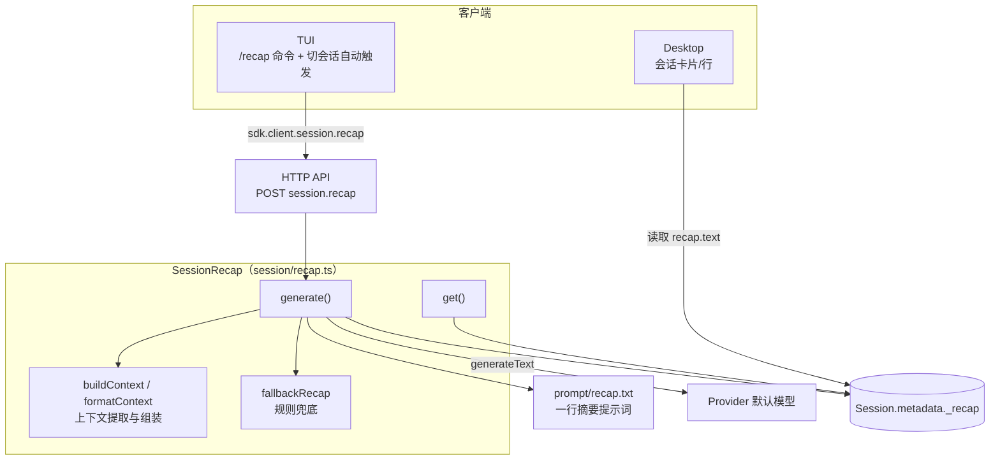
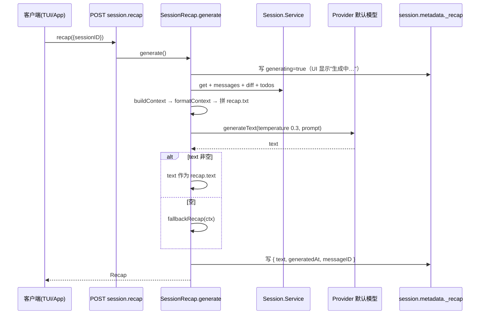

# Session Recap 特性描述

> 本文档分析 opencode（opencode fork，分支 `user/donghe/dev`）中 **Session Recap（会话回顾）** 特性的实现。
> 定位：当用户切回一个历史会话时，用 LLM 生成**一行**回顾摘要（做了啥 / 卡在哪 / 下一步），
> 帮助用户瞬间恢复上下文，显示在 TUI 会话页与 Desktop 会话列表卡片/行上。

## 目录

1. [背景与动机](#1-背景与动机)
2. [高层设计](#2-高层设计)
3. [模块分解](#3-模块分解)
4. [核心流程](#4-核心流程)
5. [数据模型](#5-数据模型)
6. [接口定义](#6-接口定义)
7. [非功能性](#7-非功能性)
8. [测试策略](#8-测试策略)
9. [使用指南](#9-使用指南)

---

## 1. 背景与动机

### 痛点

用户通常同时挂着多个会话。切换回一个几天前的会话时：

- 需要翻历史消息才能想起"我当时做到哪了"；
- 会话标题（title）只有一个短语，信息量不足以恢复上下文；
- 无法快速判断会话是"已完成"还是"卡在某个错误上"。

### 目标

| 问题 | 表现 | 对应模块/子系统 |
|------|------|-----------------|
| 上下文恢复慢 | 需翻历史消息 | `recap.ts`（LLM 摘要） |
| 标题信息量不足 | 一句话标题不够用 | 结构化上下文提取 `buildContext` |
| 无法判断卡点 | 不知道当前是否被阻塞 | `collectErrors` + `buildBlockers` |
| 无自动更新 | 切回会话无提示 | TUI 自动触发（`session/index.tsx`） |

一句话：**把一个会话的"最近动作 + 任务进度 + 错误 + 文件改动"压缩成一行可读回顾，随取随用。**

### 定位

- **被谁依赖**：HTTP API（`session.recap` 端点）、TUI（`/recap` 命令 + 切会话自动触发）、
  Desktop 会话列表（`session-card.tsx` / `session-row.tsx` 展示）。
- **依赖谁**：`Session`（消息/元数据/差异）、`Todo`（任务进度）、`Provider`（默认模型）、
  `Snapshot`（文件差异）。
- **范围声明**：Recap 只做**摘要生成与存储**，不参与会话的压缩/改写（那是 compaction/summary 的职责）。

---

## 2. 高层设计

### 2.1 架构图

```text
客户端
  TUI（/recap 命令 + 切会话自动触发）
  Desktop（会话卡片/行，只读 recap.text）
        │ sdk.client.session.recap
        ▼
HTTP API（POST session.recap）

SessionRecap（session/recap.ts）
  generate()
    ├─ buildContext / formatContext（上下文提取与组装）
    ├─ generateText ──▶ Provider 默认模型
    ├─ fallbackRecap（规则兜底，LLM 空返回时）
    └─▶ session.metadata._recap（元数据内嵌存储）
  get() ──▶ session.metadata._recap
  依赖 prompt/recap.txt（一行摘要提示词）
```



关键架构思想：

1. **元数据内嵌存储**：recap 不落独立表，而是存在 `session.metadata["_recap"]`（`recap.ts:24, 35-37`），
   随会话元数据一起读写，避免额外表与迁移。
2. **结构化上下文 + LLM 润色**：先用纯函数从消息/todo/diff 中抽取结构化事实（`buildContext`），
   再交给 LLM 按固定格式生成一行摘要；LLM 失败/空返回时用 `fallbackRecap` 规则兜底（`recap.ts:210`）。
3. **generating 标记**：生成前先写 `{ generating: true }` 到元数据，让 UI 显示"生成中…"（`recap.ts:186-190`）。

### 2.2 核心设计模式

| 模式 | 说明 | 落点 |
|------|------|------|
| **模板化提示词** | `recap.txt` 含 `{context}` 占位符，运行时替换 | `recap.ts:198` |
| **规则兜底** | LLM 空返回时回退到规则生成的摘要 | `recap.ts:149-162` |
| **元数据 JSON 存储** | recap 作为 session.metadata 的嵌套字段 | `recap.ts:24-37` |
| **Effect Service** | `@opencode/SessionRecap` 服务 + `LayerNode` | `recap.ts:169, 221` |

### 2.3 文件职责矩阵

| 文件 | 行数 | 职责 | 关键导出 |
|------|------|------|----------|
| `packages/opencode/src/session/recap.ts` | 222 | 摘要生成/读取服务 + 上下文抽取 + 兜底 | `SessionRecap`（`Service`, `layer`, `node`, `Recap` Schema） |
| `packages/opencode/src/session/prompt/recap.txt` | 22 | 一行摘要提示词模板 | 提示词文本 |
| `packages/opencode/src/server/routes/instance/httpapi/handlers/session.ts` | 296-301 | recap 端点 handler | — |
| `packages/opencode/src/server/routes/instance/httpapi/groups/session.ts` | 321-332 | POST `session.recap` 路由声明 | — |
| `packages/tui/src/routes/session/index.tsx` | 227-246, 566-579 | `/recap` 命令 + 自动触发 + 显示 | — |
| `packages/app/src/pages/dashboard/session-card.tsx` | 46 | 卡片显示 recap 文本 | — |
| `packages/app/src/pages/dashboard/session-row.tsx` | 83-84 | 列表行显示 recap 文本 | — |

### 2.4 提示词文件

`prompt/recap.txt` 定义了一行摘要的严格格式：

- **恰好 1 句话、<100 词**；
- 格式 `"[已完成]; [当前状态或阻塞点]; Next: [下一步]"`；
- 具体（文件名/行号/具体细节），有未解决错误则突出错误；
- 用过去时写已完成、现在时写当前状态（`recap.txt:5-11`）。

---

## 3. 模块分解

### 3.1 目录结构

```
packages/opencode/src/session/
├── recap.ts            # SessionRecap 服务（generate/get + 上下文抽取 + 兜底）
└── prompt/recap.txt    # 一行摘要提示词
```

配套：

```
packages/opencode/src/server/routes/instance/httpapi/{handlers,groups}/session.ts  # HTTP 端点
packages/tui/src/routes/session/index.tsx                                          # TUI 触发与显示
packages/app/src/pages/dashboard/{session-card,session-row}.tsx                    # Desktop 展示
```

### 3.2 类/模块单一职责清单

| 模块/类 | 单一职责 | 位置 | 关键方法 |
|----------|----------|------|----------|
| `SessionRecap.Service` | 生成与读取 recap | `recap.ts:169` | `generate`, `get` |
| `readRecap/toMeta` | recap 与 metadata 的序列化/反序列化 | `recap.ts:26-37` | — |
| `buildContext` | 从消息/todo/diff 抽取结构化上下文 | `recap.ts:124-133` | `findCompactionSummary`, `collectRecentTools`, `collectErrors`, `buildBlockers` |
| `formatContext` | 结构化上下文 → 提示词文本 | `recap.ts:135-147` | — |
| `fallbackRecap` | 无 LLM 时的规则兜底摘要 | `recap.ts:149-162` | — |

---

## 4. 核心流程

### 4.1 生成流程

```text
客户端(TUI/App) ── recap({sessionID}) ──▶ POST session.recap ──▶ SessionRecap.generate
                                                                      │
 ① 写 generating=true 到 _recap（UI 显示"生成中…"）
 ② Session.Service: get + messages + diff + todos
 ③ buildContext → formatContext → 拼 recap.txt
 ④ generateText(temperature 0.3, prompt) ──▶ Provider 默认模型
 ⑤ text 非空 ──▶ 作为 recap.text
     text 空   ──▶ fallbackRecap(ctx)（规则兜底）
 ⑥ 写 { text, generatedAt, messageID } 到 _recap
                                                                      ▼
                                                                返回 Recap
```



### 4.2 上下文提取细节

`buildContext`（`recap.ts:124-133`）从以下来源抽取事实：

| 来源 | 提取函数 | 产物 |
|------|----------|------|
| 最近一次 compaction 摘要 | `findCompactionSummary` | `summary` |
| 最近 10 条消息里的工具调用 | `collectRecentTools` | 最多 15 条 `✓ tool: title` |
| 最近一条用户消息 | `findLastUserMessage` | 前 200 字符 |
| todo 进度 | 直接读 `Todo.Info[]` | `{completed/total, pending}` |
| 最近 3 条错误 | `collectErrors` | 错误名/详情 |
| 文件差异 | `sessions.diff` | `{files, additions, deletions}` |

`formatContext`（`recap.ts:135-147`）把这些组装成带 `##` 标题的 markdown 文本，替换进 `recap.txt` 的 `{context}`。

### 4.3 关键流程文字说明

- **触发时机**：TUI 用户切到一个 **idle** 且**非子会话**的会话时自动触发（`session/index.tsx:230-246`）；
  也可手动 `/recap`（`session/index.tsx:566-579`）。
- **幂等性**：每次 generate 覆盖式重写 `_recap`，无副作用；`get` 只读不触发 LLM。
- **失败路径**：`generate` 用 `Effect.orDie` 包裹（`recap.ts:180-216`），内部 LLM 调用失败会向上抛。

---

## 5. 数据模型

### 5.1 存储位置

Recap **不建独立表**，存于 `session.metadata` 的 `_recap` 键（`recap.ts:24, 35-37`）：

```jsonc
// session.metadata
{
  "_recap": {
    "text": "Migrated 4 of 7 billing tables; invoices.ts FK failing on line 142. Next: fix foreign key.",
    "generatedAt": 1712345678901,   // 毫秒时间戳
    "messageID": "msg_xxx",          // 生成时最新一条消息 ID（可选）
    "generating": false              // 生成中标记（可选）
  }
}
```

### 5.2 序列化与校验

`readRecap`（`recap.ts:26-33`）做运行时校验：`text` 必须为 string、`generatedAt` 必须为 number，
否则返回 undefined；`messageID` 用 `MessageID.make` 归一化。

### 5.3 粒度策略

- 整个 recap 作为一个 JSON 对象整体存于 metadata，不拆分。
- `generating` 是瞬态标记，用于 UI 状态；生成完成后保留为 `false` 或省略。

---

## 6. 接口定义

### 6.1 HTTP API

| 方法 | 路径 | 入参 | 出参 | 说明 |
|------|------|------|------|------|
| `POST` | `/session/:sessionID/recap` | `{ sessionID }` | `SessionRecap.Recap` | 生成一行摘要 |

路由声明 `groups/session.ts:321-332`（identifier `session.recap`）；handler `handlers/session.ts:296-301`。

### 6.2 Effect 服务接口

`Interface`（`recap.ts:164-167`）：

```ts
interface Interface {
  generate(input: { sessionID }): Effect<Recap>
  get(sessionID: SessionID): Effect<Recap | undefined>
}
```

### 6.3 Recap Schema

`recap.ts:16-21`：

```ts
Recap = {
  text: string
  generatedAt: NonNegativeInt
  messageID?: MessageID
  generating?: boolean
}
```

### 6.4 客户端触发

| 客户端 | 触发方式 |
|--------|----------|
| TUI | `/recap` 命令；切到 idle 非子会话自动触发 |
| Desktop | 仅展示 `recap.text`，不主动触发（需后端/其他途径生成） |

> **缺口**：Desktop 的 `session-card.tsx:46` / `session-row.tsx:83-84` 只读 `recap?.text` 展示，
> 未在仓库中发现 Desktop 主动调用 `session.recap` 的触发逻辑——即 recap 主要由 TUI 侧产生。

---

## 7. 非功能性

### 7.1 性能

- **LLM 调用轻量**：`temperature: 0.3`、单条 user 消息、目标 <100 词，成本极低。
- **上下文裁剪**：工具列表截 15 条、错误截 3 条、用户消息截 200 字符（`recap.ts:68, 76, 100`），
  控制 prompt 规模。
- **纯函数抽取**：`buildContext`/`formatContext` 无副作用，便于测试与复用。

### 7.2 并发

- **无显式锁**：`generate` 覆盖写 `_recap`；并发触发（自动 + 手动）可能产生两次 LLM 调用，
  但结果幂等（最后一次写生效）。TUI 侧用 `recapGenerating` 信号做了前端去重提示。

### 7.3 错误处理

- **LLM 空返回兜底**：`text || fallbackRecap(ctx)`（`recap.ts:210`）。
- **兜底覆盖场景**：文件改动 / todo 进度 / 摘要 / "Session active" 逐级回退（`recap.ts:149-162`）。

### 7.4 监控埋点

无专门埋点；生成过程依赖 `Session` 元数据更新事件（`session.updated`）驱动 UI 刷新。

---

## 8. 测试策略

### 8.1 现状

`recap.ts` 及配套**无测试**。仓库内 `grep` 命中的 `revert-compact.test.ts` 等与 recap 无关。

### 8.2 单元测试（建议）

| 被测对象 | 测什么 |
|----------|--------|
| `readRecap` / `toMeta` | 序列化往返、缺失字段/类型错误返回 undefined |
| `findCompactionSummary` | 从 compaction 消息回溯到 assistant summary 文本 |
| `collectRecentTools` | 只取最近 10 条消息、最多 15 条、状态图标 |
| `collectErrors` | 最多 3 条、assistant error 与 tool error 两类 |
| `buildBlockers` | errors + pending todos 组装、最多 3 条 |
| `fallbackRecap` | 各分支（有文件改动/有 todo/只有 summary/空） |

### 8.3 集成测试（建议）

- 用真实 session（含 compaction、tool、todo）跑 `generate`，断言返回 `Recap` 结构且 `_recap` 已写入。
- 无消息的 session → `generate` 返回 `{ text: "", generatedAt }`（`recap.ts:194`）。

### 8.4 边界场景（清单）

- [ ] 空 session（无消息）→ 空 recap
- [ ] LLM 返回空 / 超长 / 非英文 → 兜底逻辑
- [ ] 无 todo / 无 diff / 无 error 的最小上下文
- [ ] 子会话触发 recap（TUI 已 `enabled: !parentID` 阻断，服务层无保护）
- [ ] 并发 generate 的覆盖写
- [ ] metadata 损坏（`_recap` 非对象）时 `readRecap` 返回 undefined

---

## 9. 使用指南

### 9.1 解决什么问题（一句话版）

**Session Recap**：把一个历史会话压缩成一行"已完成 / 卡点 / 下一步"摘要，切回会话时瞬间恢复上下文。

### 9.2 如何开启

无需配置，随会话功能内置。recap 通过 `/recap` 命令或切会话自动触发（TUI）。

### 9.3 自动行为

| 动作 | 触发时机 |
|------|----------|
| 自动生成 recap | TUI 切到一个 idle 且非子会话的会话时（`session/index.tsx:230-246`） |
| 显示"生成中…" | generate 写 `generating=true` 期间（`recap.ts:186-190`） |
| 列表/卡片展示 recap | Desktop 会话列表渲染时读取 `recap.text` |

### 9.4 手动命令

| 命令 | 说明 |
|------|------|
| `/recap` | 手动重新生成当前会话的一行摘要（`session/index.tsx:566-579`） |

### 9.5 使用示例

> **示例 1：切回历史会话自动回顾**
> 用户在 TUI 打开一个三天前的会话 → 系统检测到会话 idle，自动调用 recap 生成摘要
> → 顶部显示："Migrated 4 of 7 billing tables to v2 schema; invoices.ts FK constraint failing on line 142. Next: fix foreign key."
> → 用户一眼知道做到哪、卡在哪。

> **示例 2：手动刷新摘要**
> 用户刚做完一大步工作，输入 `/recap`
> → 系统重新抽取最近动作/todo/diff，生成新摘要覆盖旧值。

> **示例 3：Desktop 列表预览**
> 用户在 Desktop 会话列表看到每行标题下方的灰色小字（recap 摘要），
> 无需点进会话即可判断"这个会话是已完成还是卡住了"。

---

## 附录：关键常量速查表

| 常量/字段 | 值/位置 | 说明 |
|------|-----|------|
| metadata key | `_recap` | `recap.ts:24` |
| 摘要长度约束 | 1 句 / <100 词 | `recap.txt:5-6` |
| 摘要格式 | `[done]; [state/blocker]; Next: [step]` | `recap.txt:6` |
| temperature | 0.3 | `recap.ts:205` |
| 工具列表上限 | 15 | `recap.ts:68` |
| 错误条数上限 | 3 | `recap.ts:83, 100` |
| 用户消息截断 | 200 字符 | `recap.ts:76` |
| 路由 identifier | `session.recap` | `groups/session.ts:328` |
