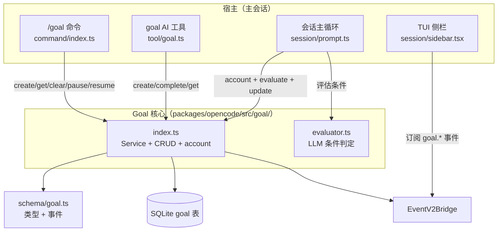
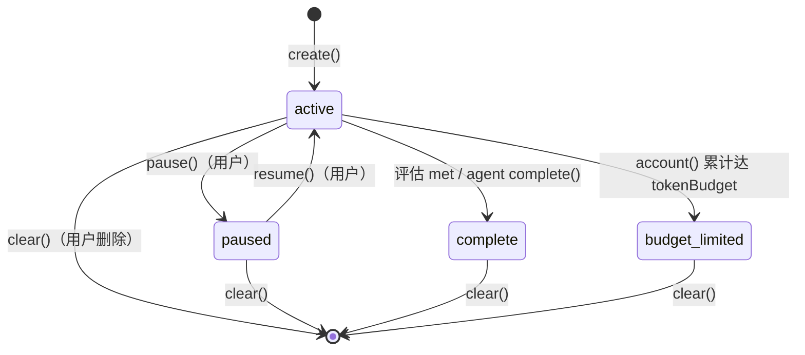

# Goal 特性描述

> 本文档分析 opencode（opencode fork，分支 `user/donghe/dev`）中 **Goal（目标）** 特性的实现。
> 定位：为长任务设立一个**可验证的完成条件**，由 LLM 在每轮结束后自动评估是否达成；
> 未达成则自动注入"继续推进"的续写，直到条件满足、达到 token 预算或用户手动暂停/清除。

## 目录

1. [背景与动机](#1-背景与动机)
2. [高层设计](#2-高层设计)
3. [模块分解](#3-模块分解)
4. [核心流程](#4-核心流程)
5. [数据模型](#5-数据模型)
6. [接口定义](#6-接口定义)
7. [非功能性](#7-非功能性)
8. [测试策略](#8-测试策略)
9. [使用指南](#9-使用指南)

---

## 1. 背景与动机

### 痛点

长任务（跨多轮、多文件、多工具的复杂开发）在普通 agent 会话里缺乏"终点判断"：

- 模型不知道"何时算做完"，容易过早收尾或无限循环；
- 用户难以量化进度（做了几轮、花了多少 token、离目标还有多远）；
- 没有一个可持久化的"目标"状态，换会话/重启后目标丢失。

### 目标

| 问题 | 表现 | 对应模块/子系统 |
|------|------|-----------------|
| 无终点判断 | 模型无法判断任务是否完成 | `evaluator.ts`（LLM 判定） |
| 任务容易中断 | 一轮结束就停下，需人工催 | 续写循环 `prompt.ts` |
| 进度不可量化 | 无法知道轮次/token 消耗 | `GoalTable` + `account()` |
| 目标不可持久化 | 目标随对话丢失 | `Goal` Service（落库） |
| 无预算控制 | 无限循环烧 token | `tokenBudget` → `budget_limited` |

一句话：**把"模糊的指令"细化成一个具体可验证的条件，挂到会话上，由 LLM 自动驱动"工作→评估→继续"循环，直到条件满足。**

### 定位

- **被谁依赖**：会话主循环 `session/prompt.ts`（评估与续写）、`goal` AI 工具、`/goal` 命令、
  TUI 会话侧栏（目标状态展示）。
- **依赖谁**：`Database`（`GoalTable`）、`EventV2Bridge`（事件发布）、`Provider`（评估用 LLM）、
  `Config`/`Flag`（开关与默认预算）。
- **范围声明**：Goal 只负责"条件 + 状态 + 记账"，不负责任务的**规划或执行**（那是 agent 的工作）；
  暂停/恢复/清除是**用户控制**的操作，AI 只能 create/complete（`tool/goal.ts:28`）。

---

## 2. 高层设计

### 2.1 架构图

```text
宿主（主会话）
  /goal 命令 · goal AI 工具 · 会话主循环 · TUI 侧栏

Goal 核心（packages/opencode/src/goal/）
  index.ts（Service + CRUD + account）
    ├─▶ schema/goal.ts（类型 + 事件定义）
    ├─▶ SQLite goal 表
    └─▶ EventV2Bridge（发布 goal.created/updated/completed/cleared）
  evaluator.ts（LLM 条件判定 generateObject）

调用关系：
  /goal 命令  ──create/get/clear/pause/resume──▶ index.ts
  goal AI 工具 ──create/complete/get──────────▶ index.ts
  会话主循环   ──account + evaluate + update──▶ index.ts
  会话主循环   ──评估条件──────────────────────▶ evaluator.ts
  TUI 侧栏    ◀──订阅 goal.* 事件── EventV2Bridge
```



关键架构思想：

1. **条件驱动 + LLM 判定**：完成条件的"是否达成"不靠规则匹配，而是每轮结束后用一个小模型调用
   `generateObject` 输出 `{ met, reason }`（`evaluator.ts:27-58`）。
2. **主循环内嵌续写**：目标激活时，主循环在每轮结束后评估；未达成就注入一条 synthetic 用户消息
   "Continue working toward your goal" 并 `continue`，形成自动循环（`prompt.ts:1300-1321`）。
3. **记账与状态机分离**：token 消耗、轮次递增是独立的 `account()`/`update()`，状态迁移（active/paused/
   complete/budget_limited）由状态字段承载。

### 2.2 核心设计模式

| 模式 | 说明 | 落点 |
|------|------|------|
| **Effect Service + Layer** | `Context.Service("@opencode/Goal")` + `LayerNode` | `index.ts:26, 30, 197` |
| **事件驱动** | 状态变化经 `EventV2Bridge` 发布 `goal.created/updated/completed/cleared` | `schema/goal.ts:25-56` |
| **LLM-as-judge** | 用结构化生成（`generateObject` + zod schema）判定条件 | `evaluator.ts:28-58` |
| **自动续写循环** | 未达成时注入 synthetic 消息并 `continue` | `prompt.ts:1300-1321` |
| **预算熔断** | token 累计达预算 → `budget_limited` 停止续写 | `index.ts:166-177` |

### 2.3 文件职责矩阵

| 文件 | 行数 | 职责 | 关键导出 |
|------|------|------|----------|
| `packages/opencode/src/goal/index.ts` | 271 | Goal 服务：CRUD、pause/resume、account、便捷 API | `Service`, `layer`, `defaultLayer`, `node`, `Goal` |
| `packages/opencode/src/goal/evaluator.ts` | 59 | LLM 条件判定（`generateObject`） | `evaluate` |
| `packages/opencode/src/tool/goal.ts` | 139 | `goal` AI 工具（create/complete/get） | `GoalTool` |
| `packages/schema/src/goal.ts` | 56 | Status/Info 类型 + 事件定义 | `Goal` |
| `packages/opencode/src/command/template/goal.txt` | 5 | `/goal` 命令模板提示词 | 模板文本 |
| `packages/core/src/database/migration/20260703142000_add_goal.ts` | 24 | `goal` 表建表迁移 | 迁移对象 |
| `packages/core/src/config.ts` | 106-110 | `goal.*` 配置 schema | `Info.goal` |

### 2.4 提示词 / 配置类文件

| 文件 | 用途 |
|------|------|
| `command/template/goal.txt` | `/goal` 命令展开成"用 goal 工具 create + 立即开始工作 + 完成后 complete"的指令 |
| `tool/goal.ts` 内联 description | 教模型如何写"具体可验证"的条件（`Good: 'all tests pass' / Bad: 'fix the bugs'`） |

---

## 3. 模块分解

### 3.1 目录结构

```
packages/opencode/src/goal/
├── index.ts        # Service：create/get/update/clear/pause/resume/account + 便捷 API
└── evaluator.ts    # 评估器：用 generateObject 判定条件是否满足

packages/schema/src/goal.ts            # 共享类型 + 事件
packages/opencode/src/tool/goal.ts     # goal AI 工具
packages/opencode/src/command/template/goal.txt  # /goal 命令模板
packages/core/src/database/migration/...add_goal.ts  # 建表迁移
```

### 3.2 类/模块单一职责清单

| 模块/类 | 单一职责 | 位置 | 关键方法 |
|----------|----------|------|----------|
| `Service` | 目标的持久化 CRUD 与状态迁移 | `goal/index.ts:26` | `isEnabled/create/update/clear/pause/resume/account/get` |
| `evaluate` | 只做"条件是否满足"的 LLM 判定 | `goal/evaluator.ts:21` | `transcript()`, `evaluate()` |
| `GoalTool` | 只暴露 AI 侧 create/complete/get | `tool/goal.ts:31` | `execute`（按 action 分发） |
| `Goal.Event` | 目标领域事件定义 | `schema/goal.ts:56` | `Created/Updated/Cleared/Completed` |

> 客观指出：`index.ts` 同时承担了服务实现、默认层装配、以及 8 个 `async` 便捷封装函数
> （`isEnabled/get/clear/pause/resume/account/update`），职责偏多但都是薄包装，可接受。

---

## 4. 核心流程

### 4.1 主流程：目标驱动的自动续写循环

```text
用户 ── /goal "让 packages/auth 所有测试通过" ──▶ 会话主循环
                                                    │ create(condition, budget?)
                                                    ▼
                                                  Goal Service ──▶ SQLite（insert goal, status=active）
                                                    │ 进入正常 agent 循环执行工作
                                                    │ account(tokensUsed) + update(turns+1)
                                                    ▼
                                                  evaluator ──▶ 评估 LLM（generateObject {met, reason}）
                                                    │
                              ┌─ {met:false} ──▶ update(reason) → 注入 synthetic "Continue working…"
                              │                  → continue（重新进入工作循环）──┐
                              │                                                   │
                              └─ {met:true} ──▶ update(status=complete) ──▶ SQLite │
                                                 │ break 结束循环                 │
                                                 ▼                                │
                                                用户 ◀── 目标达成                  │
                                                 └────────────────────────────────┘（循环）
```

```mermaid
sequenceDiagram
    participant U as 用户
    participant LOOP as session/prompt.ts
    participant G as Goal Service
    participant EVL as evaluator.ts
    participant DB as SQLite
    participant LLM as 评估 LLM

    U->>LOOP: /goal "让 packages/auth 所有测试通过"
    LOOP->>G: create(condition, budget?)
    G->>DB: insert goal(status=active)
    Note over LOOP: 进入正常 agent 循环，执行工作
    LOOP->>G: account(tokensUsed) + update(turns+1)
    LOOP->>EVL: evaluate(condition, transcript)
    EVL->>LLM: generateObject({met, reason})
    LLM-->>EVL: {met: false, reason: "3 of 12 tests still failing"}
    EVL-->>LOOP: {met: false}
    LOOP->>G: update(reason)
    LOOP->>LOOP: 注入 synthetic 消息 "Continue working toward your goal"
    Note over LOOP: continue，重新进入工作循环
    LOOP->>G: account + update(turns+1)
    LOOP->>EVL: evaluate(...)
    EVL-->>LOOP: {met: true, reason: "all 12 tests pass"}
    LOOP->>G: update(status=complete)
    G->>DB: status=complete
    LOOP->>LOOP: break，结束循环
    LOOP-->>U: 目标达成
```

### 4.2 状态机：goal 生命周期

```text
[*] ──▶ active : create()
active ──▶ paused : pause()（用户）
paused ──▶ active : resume()（用户）
active ──▶ complete : 评估 met / agent complete()
active ──▶ budget_limited : account() 累计达 tokenBudget
active ──▶ [*] : clear()（用户删除）
paused ──▶ [*] : clear()
complete ──▶ [*] : clear()
budget_limited ──▶ [*] : clear()
```



### 4.3 关键流程文字说明

- **前置条件**：`Flag.OPENCODE_ENABLE_GOAL` 或 `config.goal.enabled` 为真（`index.ts:36-41`）；
  会话尚无 active goal（create 前检查，`tool/goal.ts:56-63`）。
- **token 记账口径**：`input + output + reasoning + cache.read + cache.write`（`prompt.ts:1249-1255`、
  `tool/goal.ts:93-97`）。
- **预算熔断**：`account()` 里 `tokensUsed >= tokenBudget` 时置 `budget_limited`（`index.ts:171-175`）。
- **失败路径**：无可用模型时评估走 `getModel(...).orDie`（`prompt.ts:1264-1268`）；评估异常会中断主循环。

---

## 5. 数据模型

### 5.1 数据库表结构

```sql
CREATE TABLE goal (
  session_id    TEXT PRIMARY KEY REFERENCES session(id) ON DELETE CASCADE,
  condition     TEXT NOT NULL,      -- 具体可验证的完成条件
  status        TEXT NOT NULL,      -- active | paused | complete | budget_limited
  token_budget  INTEGER,            -- 可选 token 预算上限
  tokens_used   INTEGER NOT NULL DEFAULT 0,
  turns         INTEGER NOT NULL DEFAULT 0,
  reason        TEXT,               -- 最近一次评估的结论/进度
  time_created  INTEGER NOT NULL,
  time_updated  INTEGER NOT NULL
);
-- 索引：goal_session_idx (session_id)
```

- **一个会话一个 goal**：`session_id` 作为主键，天然保证"同会话最多一个目标"。
- **级联删除**：会话删除时 goal 随之删除（`ON DELETE CASCADE`）。
- 迁移：`20260703142000_add_goal.ts`。

### 5.2 缓存 / 状态

无独立缓存。目标状态直接落在 `goal` 表；前端（TUI）通过 `goal.*` 事件增量同步到内存
（`tui/src/context/sync.tsx:183-189`）。

### 5.3 序列化与粒度

- `condition` 存原始字符串；`reason` 存 LLM 返回的判定理由（供 UI 显示进度）。
- 事件负载用 `schema/goal.ts` 的 `Info` Schema 结构，`goal.created/updated/completed` 携带完整 goal，
  `goal.cleared` 仅携带 `sessionID`。

---

## 6. 接口定义

### 6.1 AI 工具

| 工具 | 参数 | 说明 |
|------|------|------|
| `goal` | `action`(create/complete/get), `condition`(create 必填), `token_budget`(create 可选) | 见 `tool/goal.ts:5-13` |

AI 只能 `create`/`complete`/`get`；`pause`/`resume`/`clear` 是用户操作（`tool/goal.ts:28`）。

### 6.2 Effect 服务接口

`Interface`（`goal/index.ts:12-24`）：

```ts
interface Interface {
  isEnabled(): Effect<boolean>
  get(sessionID): Effect<Goal.Info | undefined>
  create(sessionID, { condition, tokenBudget? }): Effect<Goal.Info>
  update(sessionID, { status?, tokenBudget?, tokensUsed?, turns?, reason? }): Effect<Goal.Info | undefined>
  clear(sessionID): Effect<void>
  pause(sessionID): Effect<Goal.Info | undefined>
  resume(sessionID): Effect<Goal.Info | undefined>
  account(sessionID, { tokensUsed }): Effect<Goal.Info | undefined>
}
```

### 6.3 命令

| 命令 | 行为 |
|------|------|
| `/goal <条件>` | 展开成"create + 立即工作 + complete"（`command/template/goal.txt`） |
| `/goal clear` | 清除目标（`prompt.ts:1573-1575`） |
| `/goal pause` | 暂停（`prompt.ts:1577-1579`） |
| `/goal resume` | 恢复（`prompt.ts:1581-1583`） |
| `/goal`（空） | 显示当前目标状态（`goal.txt:5`） |

### 6.4 配置项

```jsonc
{
  "goal": {
    "enabled": true,       // 是否启用（默认 false）
    "tokenBudget": 200000, // 默认 token 预算（create 未指定时用）
    "maxTurns": 20         // 默认最大轮次
  }
}
```

| Key | 类型 | 默认值 | 说明 |
|-----|------|--------|------|
| `goal.enabled` | boolean | 无（需开启） | 启用 /goal 特性 |
| `goal.tokenBudget` | number | 无 | 默认 token 预算 |
| `goal.maxTurns` | number | 无 | 默认最大轮次 |

> **缺口**：`goal.maxTurns` 在 `config.ts:109` 声明，但全仓库未发现消费点——主循环只累计 `turns`，
> 从不检查 `maxTurns` 上限，属"声明未实现"。

### 6.5 特性开关

| 开关 | 位置 | 说明 |
|------|------|------|
| 环境变量 `OPENCODE_ENABLE_GOAL`（或 `OPENCODE_EXPERIMENTAL`） | `flag.ts:51` | 全局开关 |
| 配置 `goal.enabled` | `config.ts:107` | 配置开关 |

`isEnabled()` 优先 flag，否则读 config（`index.ts:36-41`）。`goal` 工具**始终注册**（`registry.ts:244`），
但执行时 `isEnabled()` 为 false 则返回"Goal disabled"提示（`tool/goal.ts:41-49`）。

---

## 7. 非功能性

### 7.1 性能

- **评估开销**：每轮结束额外一次小模型调用（`generateObject`），与工作本身共享 provider 模型
  （`prompt.ts:1264-1268` 用 `lastUser.model` 解析）。
- **转录截断**：评估输入 transcript 只取末尾 16000 字符（`evaluator.ts:18`），控制 prompt 规模。
- **懒加载**：goal 模块在需要时动态 `import`（`prompt.ts:1245-1246, 1256-1257`），避免启动期开销。

### 7.2 并发

- **单目标约束**：`session_id` 主键保证同一会话只有一个 goal 行；`create` 前查重（`tool/goal.ts:56-63`）。
- **状态守卫**：`pause` 仅对 `active` 生效、`resume` 仅对 `paused` 生效（`index.ts:152-164`）；
  `account` 仅对 `active` 记账（`index.ts:169`）。

### 7.3 错误处理

- **工具侧防御**：未启用、缺 condition、已存在 goal、非 active 状态 complete 等分支均返回可读输出
  （`tool/goal.ts:41-92`），而非抛异常。
- **主循环风险**：评估的 `getModel(...).orDie`（`prompt.ts:1267`）与 `evaluateGoal` 异常会向上传播，
  可能导致续写循环中断——未做兜底。

### 7.4 监控埋点

- **事件**：`goal.created/updated/completed/cleared`（`schema/goal.ts:25-56`），TUI 侧栏据此实时刷新状态。
- **日志**：`Effect.logInfo("goal completed", { reason })`（`prompt.ts:1289-1292`）。

---

## 8. 测试策略

### 8.1 现状

`packages/opencode/src/goal/`、`tool/goal.ts`、`schema/goal.ts` 均**无测试**。仓库内无相关 `*.test.ts`。

### 8.2 单元测试（建议）

| 被测对象 | 测什么 |
|----------|--------|
| `Service.account` | 预算未达/达上限的 `budget_limited` 迁移 |
| `Service.pause/resume` | 状态守卫（非 active 不暂停、非 paused 不恢复） |
| `Service.create` | 默认预算回退到 `config.goal.tokenBudget` |
| `evaluator.transcript` | 文本/工具 part 拼接与 16000 截断 |
| `GoalTool` 分支 | create 查重、complete 非 active、get 无 goal 的输出 |

### 8.3 集成测试（建议）

- 在临时 SQLite 上跑 `create → account(达预算) → get`，断言状态为 `budget_limited`。
- 订阅 `goal.created/completed` 事件，验证发布顺序与负载结构。

### 8.4 边界场景（清单）

- [ ] 无 provider / 无模型时的评估路径（当前 `orDie`，会崩溃）
- [ ] `tokenBudget` 未设置时的 `account()` 行为（不触发熔断）
- [ ] 同一会话重复 `create`（应被工具层拦截，但服务层无保护）
- [ ] 评估返回非法 JSON（`generateObject` 校验失败）
- [ ] 会话删除 → goal 级联删除
- [ ] `maxTurns` 未实现（配置存在但无消费，需补实现或删除声明）

---

## 9. 使用指南

### 9.1 解决什么问题（一句话版）

**Goal**：给长任务设一个可验证的完成条件，让 agent 自动"工作→评估→继续"循环，直到条件满足或被预算熔断。

### 9.2 如何开启

任选其一：

1. 环境变量 `OPENCODE_ENABLE_GOAL=1`（或 `OPENCODE_EXPERIMENTAL=1`）。
2. 配置 `opencode.jsonc`：

```jsonc
{
  "goal": {
    "enabled": true,
    "tokenBudget": 200000,
    "maxTurns": 20
  }
}
```

### 9.3 自动行为

| 动作 | 触发时机 |
|------|----------|
| 每轮后记账 token、递增 turns | 主循环每一轮结束时（`prompt.ts:1259-1262`） |
| LLM 评估条件是否达成 | 每轮记账之后 |
| 注入"继续推进"并续写 | 评估未达成时 |
| 置 complete 并结束循环 | 评估达成时 |
| 置 budget_limited | token 累计达预算时 |

### 9.4 手动命令与工具

```bash
/goal "让 packages/auth 的测试全部通过"   # 设定目标并开始工作
/goal            # 查看当前目标
/goal pause      # 暂停
/goal resume     # 恢复
/goal clear      # 清除
```

AI 侧 `goal` 工具：`action=create`（+ `condition`、可选 `token_budget`）、`action=complete`、`action=get`。

### 9.5 使用示例

> **示例 1：设目标并自动推进**
> 用户：`/goal "把 billing 模块 7 张表迁移到 v2 schema，typecheck 通过"`
> → 主 agent 用 goal 工具 create，然后开始工作；每轮结束 LLM 评估，未完成则自动注入续写继续。
> → 全部迁移完且 typecheck 通过，评估返回 `met:true`，目标置 complete，回复"目标达成"。

> **示例 2：预算熔断**
> 用户设目标时给了 `tokenBudget: 50000`。
> → agent 持续工作，token 累计到 50000 时目标自动置 `budget_limited`，循环停止。
> → 侧栏显示 `budget_limited`，用户可 `/goal resume` 或 `/goal clear` 后重新开始。

> **示例 3：查看进度**
> 用户在会话侧栏看到 `Goal active • 迁移 billing 表 • 12 turns • 83000 / 200000 tokens`，
> 实时了解任务推进情况。

> **示例 4：手动暂停/恢复**
> 用户临时要改需求 → `/goal pause`；改完 → `/goal resume` 继续原目标。

---

## 附录：关键常量速查表

| 常量/字段 | 值/位置 | 说明 |
|------|-----|------|
| Status 枚举 | `active/paused/complete/budget_limited` | `schema/goal.ts:7` |
| 主键 | `session_id`（一会话一目标） | 迁移文件 |
| 评估 schema | `{ met: boolean, reason: string }` | `evaluator.ts:31-34` |
| transcript 截断 | 16000 字符 | `evaluator.ts:18` |
| token 口径 | input+output+reasoning+cache.read+cache.write | `prompt.ts:1249-1255` |
| 事件 | `goal.created/updated/completed/cleared` | `schema/goal.ts:25-54` |
| 迁移 ID | `20260703142000_add_goal` | 迁移文件 |
| 开关 | `OPENCODE_ENABLE_GOAL` / `goal.enabled` | `flag.ts:51` / `config.ts:107` |
