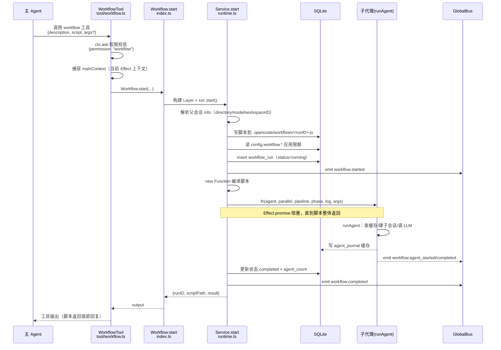
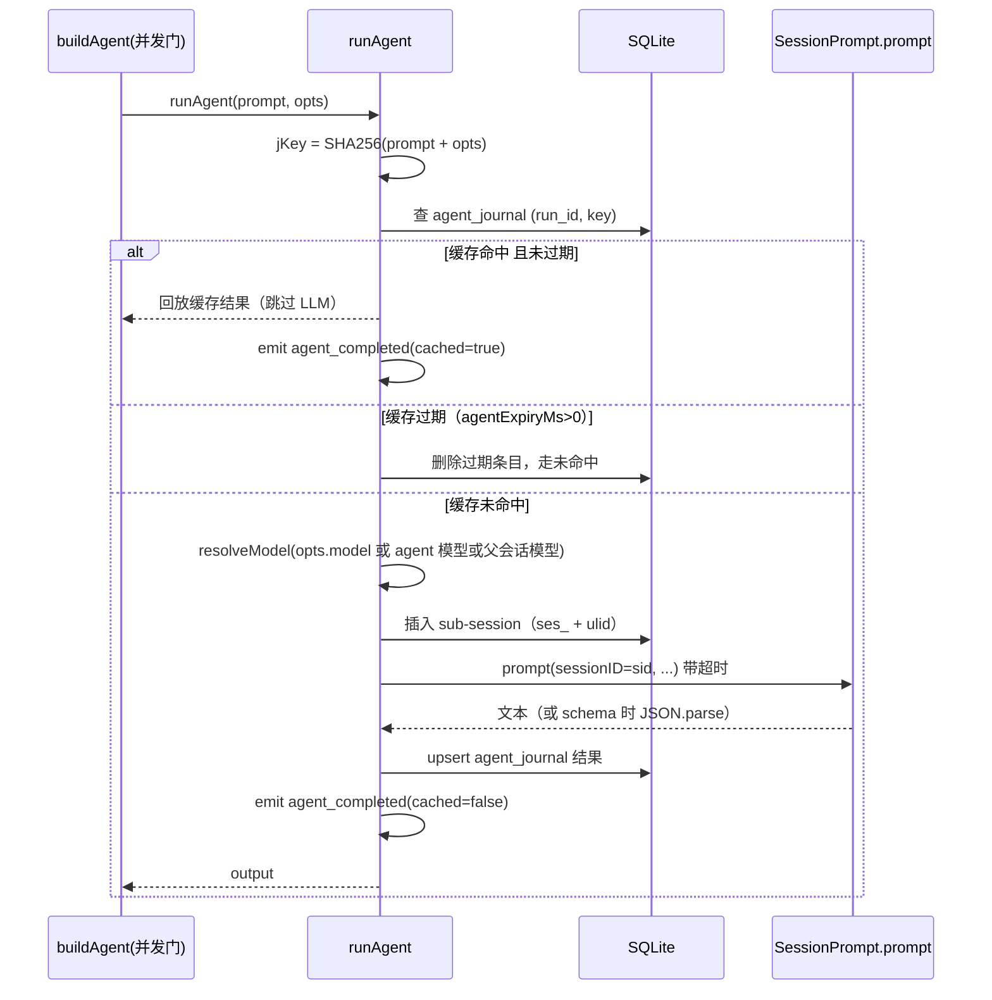
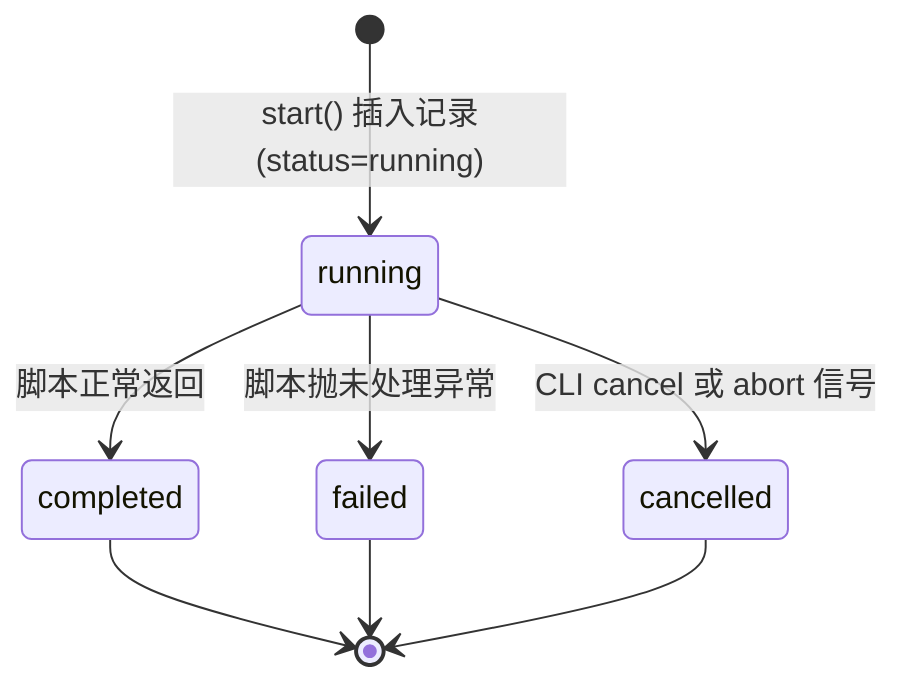

# Dynamic Workflow 特性描述

> 本文档分析 opencode（opencode fork，分支 `user/donghe/dev`）中 **Dynamic Workflow（动态工作流）** 特性的实现。
> 定位：让 LLM 在会话内用一段 **JavaScript 编排脚本** 大规模调度多个上下文隔离的子代理（sub-agent），
> 并通过**日志缓存（journal）**实现同会话断点续跑。
>
> 实现视角（它内部怎么工作）见第 1–8 节，使用视角（用户怎么用它）见第 9 节。

## 目录

1. [背景与动机](#1-背景与动机)
2. [高层设计](#2-高层设计)
3. [模块分解](#3-模块分解)
4. [核心流程](#4-核心流程)
5. [数据模型](#5-数据模型)
6. [接口定义](#6-接口定义)
7. [非功能性](#7-非功能性)
8. [测试策略](#8-测试策略)
9. [使用指南](#9-使用指南)

---

## 1. 背景与动机

### 痛点

在单个 agent 会话中，模型受限于上下文窗口与"单线对话"的心智模型，难以在一条消息里协调
几十上百个独立子任务。没有 Dynamic Workflow 之前，用户面对"大规模并行审计 / 批量迁移 /
多方对抗验证"这类需求时，只能：

- 由主 agent 串行地、一个个地调用工具或子代理，慢且容易被上下文窗口打断；
- 把编排逻辑散落在对话里，无法**重跑**、无法**断点续跑**；
- 任务规模一大，主 agent 的上下文很快耗尽。

### 目标

| 问题 | 表现 | 对应模块/子系统 |
|------|------|-----------------|
| 编排无法沉淀 | 编排逻辑只存在于对话，不可复现 | 脚本化执行引擎 `runtime.ts` |
| 单线对话串行慢 | 大规模任务无法并行 | 并发控制 `buildAgent` + `parallel`/`pipeline` |
| 上下文易耗尽 | 每个子任务都占用主会话上下文 | 上下文隔离子代理 `runAgent`（独立 sub-session） |
| 重跑成本高 | 失败后全部重来 | Journal 缓存（SHA256 去重） |
| 无法观测进度 | 执行过程黑盒 | 事件总线 + DB 状态 + CLI 查询 |

一句话：**把"多 agent 编排"从对话中抽离成一段可读、可重跑、可缓存的 JavaScript 脚本**，
由运行时注入 5 个原语（`agent` / `parallel` / `pipeline` / `phase` / `log`）来完成调度。

### 定位

- **被谁依赖**：AI 工具链（`tool/workflow.ts` 注册的 `workflow` 工具）、CLI（`workflows` 子命令）、
  会话系统提示词（`session/prompt/workflow.txt`）。
- **依赖谁**：`Agent`（子代理定义）、`Session`/`SessionPrompt`（子会话与 LLM 调用）、
  `Database`（Drizzle + SQLite）、`GlobalBus`（事件）、`Config`/`Flag`（开关与限额）。
- **范围声明**：本特性只负责**编排与调度**。脚本本身**不能**直接访问文件系统或 shell
  （`tool/workflow.txt:27-28`），所有"干活"的副作用都必须经由子代理完成。工作区隔离
  （`opts.isolation: "worktree"`）仅在 schema 与提示词中声明，**当前未实现**（见 §7.4 缺口）。

---

## 2. 高层设计

### 2.1 架构图

```text
宿主（opencode 主会话）
  主 Agent ──调用──▶ workflow 工具 ──start()──▶ 引擎
  系统提示词注入 · workflows CLI（list/status/cancel）

Workflow 引擎（packages/opencode/src/workflow/）
  index.ts（公共 API）
    └─▶ runtime.ts（执行引擎 / Effect Service）
          ├─▶ journal.ts（结果缓存）────▶ SQLite
          ├─▶ events.ts（事件常量）────▶ GlobalBus 事件总线
          └─▶ workflow.sql.ts（表定义）─▶ SQLite
                │  runAgent 派发（并发、上下文隔离）
        ┌───────┼───────┐
        ▼       ▼       ▼
  sub-session#1  #2  …  #N（子代理）
        └───── LLM 调用 ─────┘
```

```mermaid
flowchart TB
    subgraph Host["宿主（opencode 主会话）"]
        AI["主 Agent<br/>（LLM 决策）"]
        TOOL["workflow 工具<br/>tool/workflow.ts"]
        SYS["系统提示词注入<br/>session/system.ts"]
        CLI["workflows CLI<br/>cli/cmd/workflows.ts"]
    end

    subgraph Engine["Workflow 引擎（packages/opencode/src/workflow/）"]
        API["index.ts<br/>公共 API 封装"]
        RT["runtime.ts<br/>执行引擎 / Effect Service"]
        JRN["journal.ts<br/>结果缓存"]
        SCH["schema.ts<br/>Zod 类型"]
        EVT["events.ts<br/>事件常量"]
        SQL["workflow.sql.ts<br/>Drizzle 表定义"]
    end

    subgraph Sub["子代理（上下文隔离）"]
        SA1["sub-session #1"]
        SA2["sub-session #2"]
        SAn["sub-session #N"]
    end

    DB[(SQLite<br/>workflow_run / agent_journal)]
    BUS[GlobalBus 事件总线]

    SYS -->|注入触发词提示| AI
    AI -->|调用 workflow 工具| TOOL
    TOOL -->|start()| API
    CLI -->|list/status/cancel| API
    API --> RT
    RT --> JRN
    RT --> EVT
    RT --> SQL
    RT -->|runAgent 派发| SA1
    RT -->|runAgent 派发| SA2
    RT -->|runAgent 派发| SAn
    SA1 -->|LLM 调用| RT
    JRN --> DB
    SQL --> DB
    EVT --> BUS
```

关键架构思想：

1. **Effect 服务封装**：引擎核心是 `Context.Service("@opencode/Workflow")`（`runtime.ts:72`），
   `getLayer()` 懒加载构建一次并缓存，把 `Agent` / `Session` / `SessionPrompt` / `Database` /
   `Ripgrep` 全部注入（`runtime.ts:83-526`）。
2. **脚本即配置**：用户/AI 提供的编排逻辑是一段 JS **函数体**，运行时用 `new Function` 动态编译，
   并注入 5 个原语参数（`runtime.ts:190`）。脚本不落库为 AST，而是**原样文本**存进 `workflow_run.script`。
3. **结果缓存（journal）**：每个 `agent(prompt, opts)` 调用按 `SHA256(prompt + opts)` 去重，
   命中缓存直接回放、跳过 LLM 调用，支撑"同会话断点续跑"。

### 2.2 核心设计模式

| 模式 | 说明 | 落点 |
|------|------|------|
| **Effect Service + Layer** | 用 `Context.Service` 组织引擎，依赖注入通过 `Layer` 完成 | `runtime.ts:72, 93-525` |
| **脚本解释执行** | `new Function(...)` 动态编译注入原语的函数体 | `runtime.ts:190, 205` |
| **队列并发控制** | 自实现信号量（`running` 计数 + `queue` 数组 + `max` 上限） | `runtime.ts:419-435` |
| **内容寻址缓存** | SHA256 摘要作缓存 key，同 prompt+opts 幂等回放 | `journal.ts:18-21` |
| **事件驱动（发布订阅）** | 通过 `GlobalBus.emit("event", ...)` 广播生命周期事件 | `events.ts` + `runtime.ts:104-105` |
| **幂等写（upsert）** | journal 写入先查后插/更新，避免并发重复 | `journal.ts:34-61` |
| **管道 / 扇出** | `pipeline`（每项串行过阶段）、`parallel`（并发屏障）两种组合原语 | `runtime.ts:440-454` |

### 2.3 文件职责矩阵

| 文件 | 行数 | 职责 | 关键导出 |
|------|------|------|----------|
| `packages/opencode/src/workflow/runtime.ts` | 528 | 执行引擎：Effect 服务、`start()`、`runAgent`、并发控制、取消/查询 | `Service`, `getLayer`, `wfLog`, `isEnabled` |
| `packages/opencode/src/workflow/index.ts` | 116 | 公共 API：`start/cancel/status/list/all` 便捷封装 | `Workflow`, `Service`, `getLayer` |
| `packages/opencode/src/workflow/journal.ts` | 114 | 子代理结果缓存：key 生成、upsert/get、状态更新 | `Journal` |
| `packages/opencode/src/workflow/schema.ts` | 54 | Zod 类型：Status / AgentOpts / PhaseInfo / Run / JournalEntry | `WorkflowSchema` |
| `packages/opencode/src/workflow/workflow.sql.ts` | 54 | Drizzle 表定义（workflow_run / agent_journal） | `WorkflowRunTable`, `AgentJournalTable` |
| `packages/opencode/src/workflow/events.ts` | 23 | 生命周期事件名常量 | `WorkflowEvent` |
| `packages/opencode/src/tool/workflow.ts` | 70 | 注册 `workflow` AI 工具，权限校验 + 调用引擎 | `WorkflowTool` |
| `packages/opencode/src/cli/cmd/workflows.ts` | 124 | CLI 子命令：list / status / cancel | `WorkflowCommand` |
| `packages/core/src/config.ts` | 232 | `workflow.*` 配置 schema | `Info`（workflow 字段） |
| `packages/core/src/flag/flag.ts` | 80 | 实验特性开关 | `Flag.OPENCODE_EXPERIMENTAL_WORKFLOW` |
| `packages/core/src/database/migration/20260703150000_add_workflow.ts` | 40 | 建表迁移 | 迁移 `up(tx)` |

### 2.4 提示词 / 配置类文件

| 文件 | 用途 |
|------|------|
| `packages/opencode/src/tool/workflow.txt` | `workflow` 工具的 description，教模型 5 个原语的用法、约束、6 种编排模式 |
| `packages/opencode/src/session/prompt/workflow.txt` | 注入主会话的 "ULTRA-WORKFLOW ACTIVATION" 提示，定义触发词（`ultracode` 等）与强制行为 |

---

## 3. 模块分解

### 3.1 目录结构

```
packages/opencode/src/workflow/
├── index.ts          # 公共 API 封装（Effect 层构建 + runPromise 包装）
├── runtime.ts        # 执行引擎（Service、start、runAgent、并发控制、取消/查询）
├── journal.ts        # 子代理结果缓存（SHA256 寻址）
├── schema.ts         # Zod 类型定义
├── events.ts         # 事件名常量
└── workflow.sql.ts   # Drizzle 表定义
```

配套（在 workflow 目录外）：

```
packages/opencode/src/tool/workflow.ts      # workflow AI 工具
packages/opencode/src/tool/workflow.txt     # 工具提示词
packages/opencode/src/session/prompt/workflow.txt  # 会话级激活提示词
packages/opencode/src/cli/cmd/workflows.ts  # workflows CLI 子命令
packages/core/src/config.ts                 # workflow 配置 schema
packages/core/src/flag/flag.ts              # 特性开关
packages/core/src/database/migration/...add_workflow.ts  # 建表迁移
```

### 3.2 类/模块单一职责清单

| 模块/类 | 单一职责 | 位置 | 关键方法 |
|----------|----------|------|----------|
| `Service` | 工作流执行/查询的服务接口 | `runtime.ts:72` | `start/cancel/getStatus/list/all` |
| `getLayer()` | 懒加载、缓存地构建 Effect 依赖层 | `runtime.ts:83-526` | — |
| `start()` | 从脚本到执行结果的主入口（落盘→建记录→编译→执行→收尾） | `runtime.ts:111-286` | — |
| `runAgent` | 派发一个子代理：查缓存→建子会话→调 LLM→写缓存 | `runtime.ts:304-414` | — |
| `buildAgent` | 队列式并发控制器（注入给脚本的 `agent`） | `runtime.ts:419-435` | — |
| `buildParallel` | 并发屏障（注入给脚本的 `parallel`） | `runtime.ts:440-442` | — |
| `buildPipeline` | 逐项串行过阶段（注入给脚本的 `pipeline`） | `runtime.ts:448-454` | — |
| `Journal` | 结果缓存：key 生成、upsert/get、run 状态更新 | `journal.ts` | `key/upsert/get/getAgentCount/updateRunStatus` |
| `Workflow`（namespace） | 对外便捷 API（Effect 层 + runPromise） | `index.ts:20-116` | `start/cancel/status/list/all` |
| `WorkflowTool` | AI 侧工具：权限校验 + 捕获 mainContext + 调引擎 | `tool/workflow.ts:28-69` | `execute` |

> 客观指出：`runtime.ts` 承担了执行引擎、并发控制、模型解析、子会话创建、缓存读写、日志
> 多重职责（528 行），是该特性中单一职责最弱的一处——但这些职责强耦合于一次执行的生命周期，
> 拆分收益有限，仅作为观察记录。

---

## 4. 核心流程

### 4.1 主流程：AI 触发一次 workflow（工具路径）

```text
主Agent ──调用 workflow 工具──▶ WorkflowTool
                                  │ ctx.ask 权限校验
                                  │ 捕获 mainContext
                                  ▼
                            Workflow.start()
                                  │ 构建 Effect Layer
                                  ▼
                            Service.start（runtime.ts）
                                  │ ① 解析父会话 info（directory/model/workspaceID）
                                  │ ② 写脚本到 .opencode/workflows/<runID>.js
                                  │ ③ 读 config.workflow.* 应用限额
                                  │ ④ insert workflow_run(status=running)   → SQLite
                                  │ ⑤ emit workflow.started                → GlobalBus
                                  │ ⑥ new Function 编译脚本
                                  │ ⑦ fn(agent,parallel,pipeline,phase,log,args) 执行（阻塞）
                                  ▼
                            子代理 runAgent
                                  │ 查缓存 / 建子会话 / 调 LLM
                                  │ 写 agent_journal 缓存                  → SQLite
                                  │ emit agent_started/completed           → GlobalBus
                                  ▼
                            更新 completed + agent_count                   → SQLite
                            emit workflow.completed                        → GlobalBus
                                  │ 返回 {runID, scriptPath, result}
                                  ▼
                            WorkflowTool ──工具输出──▶ 主 Agent（脚本返回值即回复）
```



关键点：

- **阻塞语义**：工具路径用 `Effect.promise` 包裹整个脚本执行，让脚本"跑完才返回"，
  同时保持父 Effect scope 存活、避免 DB 连接中途被关闭（`runtime.ts:199-201`）。
- **mainContext 注入**：工具执行时把当前 Effect 上下文（含带正确 Bun chunk tag 的 DB 连接）
  传给引擎，规避 DB 连接与 Bun 线程标签不匹配的问题（`tool/workflow.ts:46-57`、`runtime.ts:117`）。

### 4.2 子代理派发流程（runAgent 的缓存命中/未命中）

```text
buildAgent.runAgent(prompt, opts)
  ├─ jKey = SHA256(prompt + opts)
  ├─ 查 agent_journal(run_id, jKey)
  │
  ├─[命中且未过期] ──▶ 回放缓存结果（跳过 LLM）
  │                    emit agent_completed(cached=true)
  │
  ├─[命中但过期(agentExpiryMs>0)] ──▶ 删除过期条目，继续往下
  │
  └─[未命中]
       ├─ resolveModel(opts.model / agent 模型 / 父会话模型)
       ├─ 插入 sub-session（id = ses_ + ulid）
       ├─ SessionPrompt.prompt(sid, 带超时 timeoutMs)
       ├─ 提取文本（opts.schema 时 JSON.parse）
       ├─ upsert agent_journal 结果
       └─ emit agent_completed(cached=false)
  └─ return output
```



### 4.3 状态机：workflow run 生命周期

```text
[*] ──▶ running : start() 插入记录(status=running)
running ──▶ completed : 脚本正常返回
running ──▶ failed : 脚本抛未处理异常
running ──▶ cancelled : CLI cancel 或 abort 信号
completed ──▶ [*]
failed ──▶ [*]
cancelled ──▶ [*]
```



> 注：`Status` 枚举含 `pending`（`schema.ts:8`），但 `start()` 直接以 `running` 落库（`runtime.ts:168`），
> `pending` 实际从未被写入，属于枚举与实现的不一致。

### 4.4 关键流程文字说明

- **前置条件**：特性开关或配置开启（见 §6.4）；父会话存在；脚本为合法 JS 函数体。
- **失败路径**：脚本抛错 → `catch` 内把 run 置为 `failed` 并记 `error`（`runtime.ts:262-282`），
  同时 emit `workflow.failed`；若取消信号已置位则置 `cancelled`。
- **幂等性**：`agent` 调用幂等——同 `(runID, prompt, opts)` 只调一次 LLM，后续命中缓存。
- **取消语义**：`cancel()` 只 `AbortController.abort()`（`runtime.ts:458-463`），
  脚本内的 `cancelRequested()` 检查点位于 `buildAgent` 入队时与脚本返回后（`runtime.ts:227-239`）；
  正在执行的 LLM 调用本身不会被强杀，仅在下一检查点收尾。

---

## 5. 数据模型

### 5.1 数据库表结构

存储介质：SQLite（Drizzle ORM，`workflow.sql.ts`），迁移见 `20260703150000_add_workflow.ts`。

```sql
-- 一次 workflow 调用一行
CREATE TABLE workflow_run (
  id                TEXT PRIMARY KEY,          -- ulid
  session_id        TEXT NOT NULL,             -- FK -> session.id, ON DELETE CASCADE
  parent_message_id TEXT NOT NULL,             -- 触发本次 workflow 的消息 ID
  script            TEXT NOT NULL,             -- 原始 JS 编排脚本
  script_sha        TEXT NOT NULL,             -- SHA256(script)，完整性校验
  status            TEXT NOT NULL,             -- running | completed | failed | cancelled
  agent_count       INTEGER NOT NULL DEFAULT 0,
  agent_limit       INTEGER NOT NULL DEFAULT 1000,
  phases            TEXT,                      -- JSON: [{title, startedAt}]
  error             TEXT,                      -- 失败信息
  time_created      INTEGER NOT NULL,
  time_updated      INTEGER NOT NULL,
  time_finished     INTEGER                    -- 终态时写入
);
-- 索引：session_id, status

-- 子代理结果去重缓存，一行 = 一次 agent() 调用
CREATE TABLE agent_journal (
  id           TEXT PRIMARY KEY,               -- ulid
  run_id       TEXT NOT NULL,                  -- FK -> workflow_run.id, ON DELETE CASCADE
  key          TEXT NOT NULL,                  -- SHA256(prompt + opts)
  prompt       TEXT NOT NULL,
  agent_opts   TEXT,                           -- JSON: 传给 agent() 的 opts
  result       TEXT NOT NULL,                  -- JSON: 缓存的 LLM 输出
  time_created INTEGER NOT NULL
);
-- 索引：(run_id, key)
```

字段含义与设计理由：

- **`script` 原样存文本**：脚本既是执行体也是审计对象，保留原始文本便于复现与回溯。
- **`script_sha`**：脚本内容寻址摘要，`getStatus` 返回 `sha:` 前缀供 CLI 显示（`cli/cmd/workflows.ts:76`）。
- **`phases` 以 JSON 整体存储**：阶段列表随执行追加，量级小，无需拆行。
- **`agent_journal` 按 `(run_id, key)` 唯一寻址**：缓存粒度 = 一次 `agent()` 调用，
  命中即回放、不调 LLM，实现同会话 resume。

### 5.2 缓存 / 去重策略

| Key 模式 | 示例 | TTL | 用途 |
|----------|------|-----|------|
| `SHA256(JSON.stringify({prompt, opts}))` | `run_id` + key 联合寻址 | 默认不过期；`agentExpiryMs > 0` 时过期后删除重跑 | 子代理结果去重与断点续跑 |

- **失效策略**：`runAgent` 命中缓存时若 `agentExpiryMs > 0` 且超过年龄，则删除条目并重新执行
  （`runtime.ts:318-335`）；默认 `0` 表示永不过期。
- **一致性**：journal 写入采用"先查后插/更新"的 upsert（`journal.ts:34-61`、`runtime.ts:390-402`）。

### 5.3 文件系统布局

```
<sessionDir>/.opencode/workflows/
└── <runID>.js        # 脚本落盘，头部附加注释（Workflow/描述、Session、Run、Created）
```

脚本落盘路径 `path.join(sessionDir, ".opencode", "workflows", `${runID}.js`)`
（`runtime.ts:135-137`）；文件头为四行注释元数据（`runtime.ts:138-145`）。此为审计/复现留档，
执行本身用内存中的 `new Function`，不依赖该文件。

### 5.4 粒度与序列化策略

- **脚本**：整体存为单个 TEXT，不拆行。
- **子代理结果**：每个 `agent()` 调用一行 `agent_journal`，`result` 以 JSON 字符串整体存储；
  `opts.schema` 存在时，输出在落库前先 `JSON.parse` 成结构化对象（`runtime.ts:387`）。
- **阶段进度**：`phases` 用一条 JSON 数组承载 `{title, startedAt}`，通过 SQL `json_insert` 追加
  （`runtime.ts:212`）。

---

## 6. 接口定义

### 6.1 AI 工具

| 工具 | 参数 | 出参 | 说明 |
|------|------|------|------|
| `workflow` | `description`(string), `script`(string), `args`(unknown, 可选) | `Workflow <runID>\n\n<脚本返回值>` | 阻塞执行，脚本返回值即回复 |

定义于 `tool/workflow.ts:7-15`；执行前先 `ctx.ask({ permission: "workflow", ... })` 权限校验
（`tool/workflow.ts:37-42`）。

### 6.2 Effect 服务接口

`Service` 接口（`runtime.ts:60-70`）：

```ts
interface Interface {
  start(input: { sessionID; parentMessageID; script; description; args?; parentDirectory?; parentProjectID? }): Effect<{ runID; scriptPath; result }>
  cancel(runID): Effect<boolean>
  getStatus(runID): Effect<RunStatus | undefined>
  list(sessionID): Effect<RunStatus[]>
  all(limit?): Effect<RunStatus[]>
}
```

对外便捷 API（`index.ts:35-115`）：`Workflow.start / cancel / status / list / all`，
均构建 `getLayer()` 后在全新 Effect scope 中 `runPromise`。

### 6.3 CLI 命令

| 命令 | 描述 | 说明 |
|------|------|------|
| `opencode workflows list` | 列出最近 50 条 run | `svc.all(50)` |
| `opencode workflows status <runID>` | 查看单条详情（状态/agent 数/sha/时间/phases/error） | `svc.getStatus` |
| `opencode workflows cancel <runID>` | 取消运行中的 run | `svc.cancel` |

定义于 `cli/cmd/workflows.ts:9-108`；CLI 路径用 `effectCmd` 的 AppRuntime 提供 DB，
规避与工具路径的 DB 连接 chunk tag 差异（`cli/cmd/workflows.ts:24-33`）。

### 6.4 特性开关（两处联动）

| 开关 | 位置 | 生效范围 |
|------|------|----------|
| 环境变量 `OPENCODE_EXPERIMENTAL_WORKFLOW`（或 `OPENCODE_EXPERIMENTAL`） | `flag.ts:52` | 工具注册 + 提示词注入 + `isEnabled` |
| 配置 `workflow.enabled` | `config.ts:111-117` | 工具注册 + 提示词注入（**不进** `isEnabled`） |

注册逻辑：`CoreFlag.OPENCODE_EXPERIMENTAL_WORKFLOW || cfg.workflow?.enabled` 时注入 `workflow` 工具
（`tool/registry.ts:245`）与系统提示词（`session/system.ts:131-137`）。

### 6.5 配置项

配置文件：`opencode.jsonc`（`config.ts:153` 候选名 `config.json / opencode.json / opencode.jsonc`）。

```jsonc
{
  "workflow": {
    "enabled": true,             // 是否启用（默认 false，需显式开启或置 flag）
    "maxConcurrentAgents": 16,   // 单次运行最大并发子代理数
    "maxAgentsPerRun": 1000,     // 单次运行子代理总数上限
    "agentTimeoutMs": 300000,    // 单个子代理超时（默认 5 分钟）
    "agentExpiryMs": 0           // 缓存过期时间；0 = 永不过期
  }
}
```

每个 key 的类型/默认值/含义：

| Key | 类型 | 默认值 | 含义 |
|-----|------|--------|------|
| `workflow.enabled` | boolean | 无（需开启） | 启用动态工作流编排 |
| `workflow.maxConcurrentAgents` | number | 16 | 单次运行并发上限 |
| `workflow.maxAgentsPerRun` | number | 1000 | 单次运行总 agent 上限 |
| `workflow.agentTimeoutMs` | number | 300000 | 单 agent 超时 |
| `workflow.agentExpiryMs` | number | 0（不过期） | agent 缓存过期时间 |

运行时读取与默认值落点：`runtime.ts:35-37`（默认常量）、`runtime.ts:148-163`（读配置并应用）、
`runtime.ts:160`（`maxQueueSize = min(maxAgents, floor(maxAgents * 0.5))`）。

---

## 7. 非功能性

### 7.1 性能

- **并发受限**：`maxConcurrentAgents`（默认 16）限制同时运行的 LLM 调用，避免资源耗尽。
- **队列背压**：超出并发上限的 `agent()` 进入等待队列，队列满（`maxQueueSize`）则直接 reject
  （`runtime.ts:431-433`），提供确定性的失败而非无限堆积。
- **缓存加速**：命中 journal 的 agent 跳过 LLM 调用（`runtime.ts:326-335`），重跑/续跑时
  显著降低 token 与延迟成本。
- **惰性加载**：引擎 Layer 首次使用时才构建并缓存（`runtime.ts:83-85`）；重依赖（agent/session/prompt/ripgrep）
  通过动态 `import` 引入，避免启动期循环依赖与启动开销（`runtime.ts:87-92`）。
- **聚合查询**：agent 计数用 SQL `COUNT(*)` 而非拉全量行（`journal.ts:84-95`）。

### 7.2 并发

- **信号量排队**：`buildAgent` 用 `concurrency.running` 计数 + `queue` 数组实现有界并发
  （`runtime.ts:419-435`）；`parallel`/`pipeline` 虽用 `Promise.all` 直接展开，但每个 thunk
  最终仍经注入的 `agent`（即 `buildAgent`）进入同一信号量，故并发上限全局有效。
- **活跃运行表**：`activeRuns: Map<runID, AbortController>`（`runtime.ts:40`）支持跨调用取消，
  取消后 `activeRuns.delete` 清理（`runtime.ts:236/255/280`）。
- **journal 幂等**：缓存写入 upsert，规避并发写冲突（`runtime.ts:390-402`）。

### 7.3 错误处理

- **超时**：`Effect.timeout(timeoutMs)` + `catchTag("TimeoutException")` 把超时转成可读错误
  （`runtime.ts:374-382`）。
- **失败归类**：脚本异常在 catch 中区分 `cancelled` / `failed` 落库并 emit 对应事件
  （`runtime.ts:262-282`）。
- **降级兜底**：`wfLog` 的文件追加失败被 `.catch(() => {})` 吞掉，日志失效不影响主流程
  （`runtime.ts:28`）；`phase` 落库失败同样仅记日志不中断（`runtime.ts:216`）。
- **模型缺省兜底**：`resolveModel` 对无 `/` 的模型串回退到父会话 provider / `anthropic`
  （`runtime.ts:291-299`）；无可用模型则显式 fail（`runtime.ts:345`）。

### 7.4 监控埋点

- **事件总线**：9 个生命周期事件（`events.ts:5-22`）经 `GlobalBus.emit("event", ...)` 广播。
- **结构化文件日志**：`wfLog` 写 `opencode.log`（`key=value` 格式，`source=workflow`）
  （`runtime.ts:16-28`）；非 TTY 时同步回显到 stderr。
- **Effect 日志**：`Effect.logInfo` 记录 config applied / run created / compiling / executing /
  agent started/completed/cached 等关键节点（`runtime.ts:161-196, 328-407`）。

**已发现的缺口 / 不一致（客观记录）**：

1. **`opts.isolation: "worktree"` 未实现**：schema（`schema.ts:16`）与提示词
   （`tool/workflow.txt:15`）声明了工作区隔离，但 `runAgent` 全程未引用 `isolation`。
2. **`isEnabled()` 只认 flag**：`runtime.ts:44-47` 的 `isEnabled()` 仅检查
   `Flag.OPENCODE_EXPERIMENTAL_WORKFLOW`，而工具注册与提示词注入是"flag 或 config.enabled"，
   三者对"仅配置开启"场景的判定不一致。
3. **`all()` 无排序**：`runtime.ts:497-498` 的 `all()` 仅 `.limit(50)`，未 `order by time_created desc`，
   "最近"语义依赖 SQLite 默认插入序。
4. **`phase` 落库用内联 SQL**：`runtime.ts:212` 用原始 `json_insert` 字符串，而非 Drizzle 构造器。
5. **无事件消费 UI**：事件已广播，但本仓库中未发现 TUI/UI 端消费 `workflow.phase/log` 等事件的组件
   （子代理以 sub-session 形式出现在会话列表，但阶段进度无专属可视化）。
6. **`pending` 状态从未写入**（见 §4.3）。

---

## 8. 测试策略

### 8.1 现状

在 `packages/opencode/src/workflow/` 及其配套文件中**未发现任何测试文件**。仓库内
`grep` 命中 `workflow` 的测试（`revert-compact.test.ts`、`gitlab-duo.test.ts`、
`cf-ai-gateway-e2e.test.ts`）均与该特性无关。

### 8.2 单元测试（建议）

| 被测对象 | 测什么 | 隔离方式 |
|----------|--------|----------|
| `Journal.key` | SHA256 对 prompt/opts 的确定性 | 纯函数，直接断言 |
| `resolveModel` | `provider/model` 拆分、父会话回退、默认 provider | 抽出后单测（当前内嵌于 `start`，需先提取） |
| `WorkflowSchema` | Status/AgentOpts/Run 的校验边界 | Zod 直接校验 |
| `buildParallel` / `buildPipeline` | 阶段顺序、并发展开、错误传播 | 用桩 thunk 断言顺序 |
| `buildAgent` 信号量 | 并发上限、队列满 reject、取消信号 | 桩 `runAgent`，注入小 `max` |

### 8.3 集成测试（建议）

- **journal 缓存回路**：真实临时 SQLite 上跑两次相同 `agent()`，断言第二次命中缓存、`agent_count` 只计一次。
- **端到端 workflow**：在临时目录建会话，用一个小脚本（如 `pipeline([...], stage)` 扇出 2 个子代理）
  验证 `workflow_run` 状态迁移（running→completed）、`agent_journal` 落库、事件序列。
- **取消链路**：运行一个含 `phase`/长循环的脚本，中途 `cancel()`，断言状态为 `cancelled`。

### 8.4 边界场景（清单）

- [ ] 空脚本 / 仅注释的脚本 → 编译执行是否安全返回
- [ ] `args` 缺省 / 非法 JSON 结构
- [ ] 脚本同步抛错、异步 reject、返回非 JSON 值
- [ ] `maxAgentsPerRun` 为 0 或极小值时的队列行为
- [ ] 并发超过 `maxConcurrentAgents`、队列满（> `maxQueueSize`）
- [ ] `agentExpiryMs > 0` 的过期删除与重跑
- [ ] 取消后仍在途的 LLM 调用的收尾（当前只在检查点生效，需验证不泄漏资源）
- [ ] 父会话不存在 / 无模型可解析 → 错误路径
- [ ] `opts.schema` 下 LLM 返回非法 JSON → `JSON.parse` 失败被吞（`runtime.ts:387` 的 `catch {}`）

> 上表均**未覆盖**；其中"无模型可解析"已有显式 fail（`runtime.ts:345`），其余需补用例。

---

## 9. 使用指南

### 9.1 解决什么问题（一句话版）

**Dynamic Workflow**：把"几十上百个上下文隔离的子代理协作"写成一段可读、可重跑、可断点续跑的
JavaScript 脚本，由 5 个注入原语（`agent` / `parallel` / `pipeline` / `phase` / `log`）编排。

### 9.2 如何开启

任选其一（二者任一生效即可注册工具并注入提示词）：

1. **环境变量**：`OPENCODE_EXPERIMENTAL_WORKFLOW=1`（或 `OPENCODE_EXPERIMENTAL=1` 批量开启实验特性）。
2. **配置文件** `opencode.jsonc`：

```jsonc
{
  "workflow": {
    "enabled": true,           // 开启动态工作流
    "maxConcurrentAgents": 16,
    "maxAgentsPerRun": 1000,
    "agentTimeoutMs": 300000,
    "agentExpiryMs": 0
  }
}
```

**首次使用自动行为**：引擎执行时自动创建 `<sessionDir>/.opencode/workflows/` 目录并落盘脚本
（`runtime.ts:136-137`）；数据库表由 core 迁移自动创建（`20260703150000_add_workflow.ts`），无需手动建表。

### 9.3 自动行为（无需用户操作）

| 动作 | 触发时机 |
|------|----------|
| 注入 "ULTRA-WORKFLOW ACTIVATION" 提示词 | 每次构建系统提示词时（flag/config 开启后） |
| 脚本落盘到 `.opencode/workflows/<runID>.js` | 每次 `start()` |
| 写入 `workflow_run` / `agent_journal` 记录 | 每次 run 及其子代理调用 |
| 广播 9 个生命周期事件 | run 及每个子代理的起止 |
| 写 `opencode.log` 结构化日志 | 每个关键节点（config/compile/agent/收尾） |

### 9.4 手动命令与工具

**CLI**：

```bash
opencode workflows list               # 最近 50 条 run
opencode workflows status <runID>     # 单条详情
opencode workflows cancel <runID>     # 取消运行中的 run
```

**AI 工具** `workflow`：

| 参数 | 类型 | 说明 |
|------|------|------|
| `description` | string | 3–5 词概括 |
| `script` | string | JS 编排脚本**函数体**（不要自己包 `async () => {}`） |
| `args` | unknown（可选） | 传入脚本的 `args` 参数 |

脚本内可用的注入原语（`tool/workflow.txt:14-25`）：

| 原语 | 签名 | 说明 |
|------|------|------|
| `agent` | `agent(prompt, opts?)` | 派发一个上下文隔离子代理；opts: `{agentType, model, schema, isolation, label, timeoutMs}` |
| `parallel` | `parallel(thunks)` | 并发屏障，返回结果数组 |
| `pipeline` | `pipeline(items, ...stages)` | 每项串行过各阶段；所有项并发；**默认优先** |
| `phase` | `phase(title)` | 在 UI 中分组进度 |
| `log` | `log(msg)` | 发一条可见日志 |

### 9.5 使用示例

> **示例 1：关键词触发（ultracode）**
> 用户说："ultracode，帮我审计这个仓库里所有 SQL 注入风险。"
> → 系统命中触发词，主 agent 只调 `workflow` 工具，写一段脚本：`pipeline(files, audit, verify, synthesize)`
> 把文件列表流经"审计→复核→汇总"三阶段子代理。
> → 脚本跑完，返回的汇总报告即回复用户。

> **示例 2：扇出-合并（fan-out-and-synthesize）**
> 脚本：`const parts = await parallel([async () => agent("分析模块A"), async () => agent("分析模块B")]);
> return await agent("合并以下结论：" + JSON.stringify(parts))`。
> → 两个子代理并行分析，屏障合并后交给第三个子代理汇总，一次性返回完整结论。

> **示例 3：对抗式验证（adversarial verification）**
> 脚本：`const claim = await agent("给出迁移方案"); const challenge = await agent("挑出该方案的漏洞：" + claim);
> return { claim, challenge }`。
> → worker 产出方案，skeptic 子代理挑刺，两者结果一起返回，用户直接看到"方案 + 反方质疑"。

> **示例 4：断点续跑**
> 用户第一次运行一个 50 个文件的迁移 workflow，跑到一半中断。
> → 同一会话内重跑相同脚本，journal 按 `SHA256(prompt+opts)` 命中已完成子代理，直接回放结果、
> 只补跑缺失部分，token 与时间成本大幅下降。

> **示例 5：查看/取消**
> 用户在另一个终端 `opencode workflows list` 看到 `● running` 的 run，
> 执行 `opencode workflows cancel <runID>` 将其取消；`status <runID>` 查看 phases 与 error 详情。

---

## 附录：关键常量速查表

| 常量 | 值 | 位置 | 说明 |
|------|-----|------|------|
| `MAX_CONCURRENT_DEFAULT` | 16 | `runtime.ts:35` | 默认并发上限 |
| `MAX_AGENTS_PER_RUN_DEFAULT` | 1000 | `runtime.ts:36` | 默认单次运行总 agent 上限 |
| `DEFAULT_TIMEOUT_MS` | 300_000 | `runtime.ts:37` | 默认单 agent 超时（5 分钟） |
| `agentExpiryMs` 默认 | 0 | `runtime.ts:157` | 0 = 缓存永不过期 |
| `maxQueueSize` | `min(maxAgents, floor(maxAgents*0.5))` | `runtime.ts:160` | 等待队列上限 |
| `LOG_FILE` | `opencode.log` | `runtime.ts:16` | workflow 文件日志路径 |
| 脚本落盘目录 | `.opencode/workflows/` | `runtime.ts:135` | 脚本持久化目录 |
| 子会话 ID 前缀 | `ses_` | `runtime.ts:339` | sub-session 必须以 `ses_` 开头 |
| Status 枚举 | pending/running/completed/failed/cancelled | `schema.ts:8` | `pending` 实际未写入 |
| 事件前缀 | `workflow.*`（9 个） | `events.ts:5-22` | started/phase/log/agent_started/agent_completed/completed/failed/cancelled |
| 工具名 | `workflow` | `tool/workflow.ts:29` | AI 工具 ID |
| 迁移 ID | `20260703150000_add_workflow` | 迁移文件 | 建 workflow_run / agent_journal |
