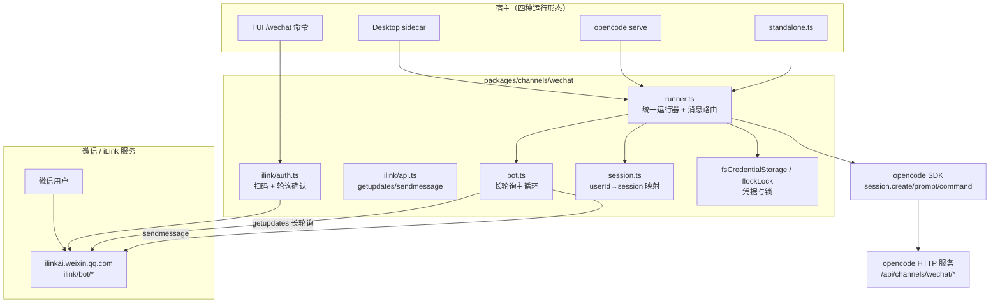
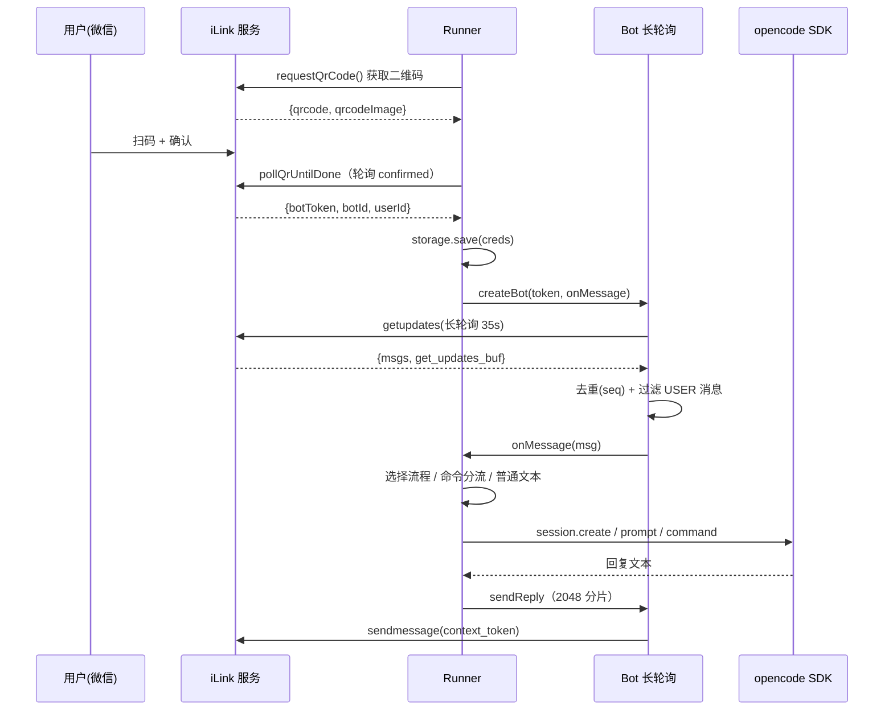
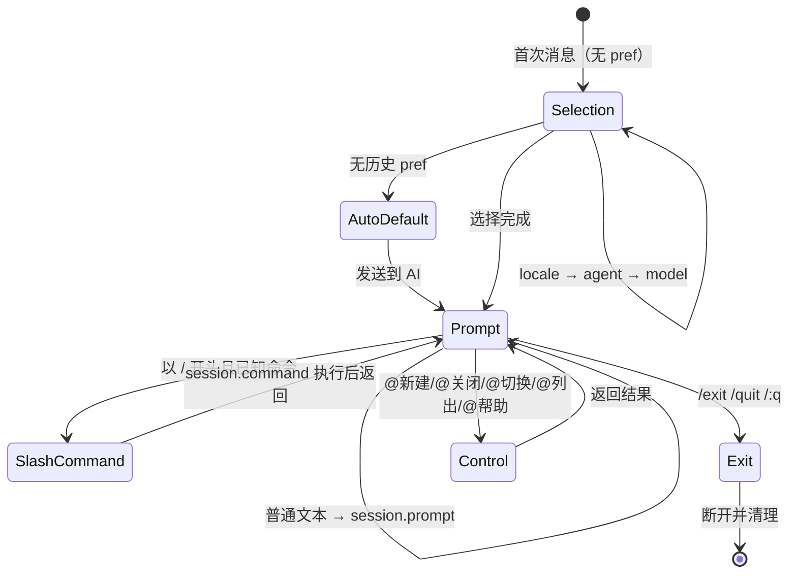

# WeChat 接入 特性描述

> 本文档分析 opencode（opencode fork，分支 `user/donghe/dev`）中 **WeChat 接入（微信通道）** 特性的实现。
> 定位：基于微信官方的 **iLink Bot 协议**（`ilinkai.weixin.qq.com`），让用户用微信扫码连接 bot，
> 在微信里直接跟 opencode 的 agent 对话——消息经长轮询拉取，路由到 opencode 的 session（create/prompt/command），
> 回复再通过 `sendmessage` 发回微信。

## 目录

1. [背景与动机](#1-背景与动机)
2. [高层设计](#2-高层设计)
3. [模块分解](#3-模块分解)
4. [核心流程](#4-核心流程)
5. [数据模型](#5-数据模型)
6. [接口定义](#6-接口定义)
7. [非功能性](#7-非功能性)
8. [测试策略](#8-测试策略)
9. [使用指南](#9-使用指南)

---

## 1. 背景与动机

### 痛点

用户不在电脑前时无法使用 opencode；而微信是最高频的 IM。若能把 opencode 接到微信：

- 用户随时随地发消息即可驱动 agent 干活；
- 无需额外装 App，扫码即连；
- 长任务跑完在微信里直接收结果。

### 目标

| 问题 | 表现 | 对应模块 |
|------|------|----------|
| 无法离开桌面使用 | 只能在 TUI/Desktop 操作 | 通道运行器 `runner.ts` |
| 连接配置繁琐 | 需要 API key | 扫码登录 `ilink/auth.ts` |
| 多端同时运行冲突 | 多个进程抢同一 token | 进程锁 `flockLock` |
| 无会话管理 | 微信对话与 session 无法映射 | `session.ts` |
| 消息易重复 | iLink 会重复投递同一 seq | 去重 `seenMessages` |

一句话：**通过 iLink Bot 协议扫码把微信变成 opencode 的远程客户端。**

### 定位

- **被谁依赖**：TUI（`/wechat` 命令）、Desktop（sidecar 自动探测 + 设置面板）、
  `opencode serve`（自动探测）、standalone CLI。
- **依赖谁**：iLink Bot HTTP API（`ilinkai.weixin.qq.com`）、opencode SDK（session create/prompt/command）、
  微信二维码。
- **范围声明**：本通道只做**消息桥接与路由**，agent 的实际执行完全复用 opencode 的 session 机制；
  语音/图片/文件等富媒体类型已定义协议类型但当前只处理文本与语音转文字。

---

## 2. 高层设计

### 2.1 架构图

```text
微信 / iLink 服务（ilinkai.weixin.qq.com/ilink/bot/*）
  微信用户

packages/channels/wechat（通道核心）
  ilink/auth.ts（扫码 + 轮询确认）
  ilink/api.ts（getupdates / sendmessage）
  bot.ts（长轮询主循环）
  runner.ts（统一运行器 + 消息路由）──▶ session.ts（userId→session 映射）
                                     └─▶ fsCredentialStorage / flockLock（凭据与锁）

宿主（四种运行形态）
  TUI /wechat 命令 · Desktop sidecar · opencode serve · standalone.ts

数据流：
  bot ──getupdates 长轮询──▶ iLink
  bot ──sendmessage───────▶ iLink
  宿主 ──▶ runner ──▶ opencode SDK（session.create/prompt/command）
                       ──▶ opencode HTTP 服务（/api/channels/wechat/*）
```



关键架构思想：

1. **策略注入，一处实现四处运行**：`createWechatRunner` 把"凭据存储"与"进程锁"抽象成 `CredentialStorage` /
   `LockStrategy` 接口，standalone/TUI/worker/sidecar 各自注入不同实现（`runner.ts:8-12`）。
2. **长轮询 + 游标**：`getupdates` 带 `get_updates_buf` 游标阻塞式轮询（约 35s），返回消息和下一个游标
   （`api.ts:79-91`）。
3. **消息去重**：iLink 会重复投递同一 `seq`，用 `Set` 记录已见 seq，容量 5000 按插入序淘汰最旧
   （`runner.ts:206-208, 311-319`）。

### 2.2 核心设计模式

| 模式 | 说明 | 落点 |
|------|------|------|
| **策略注入** | 凭据存储 / 进程锁可插拔 | `runner.ts:73-84` |
| **长轮询 + 指数退避** | 轮询失败后 1s→2s→…→60s 退避 | `bot.ts:76-109` |
| **状态机（选择流程）** | locale→agent→model 三步选择 | `runner.ts:494-549` |
| **命令分流** | `@` 控制命令 vs `/` 斜杠命令 vs 普通文本 | `session.ts` + `runner.ts:374-445` |
| **事件驱动** | 凭据更新经 `process.emit("wechat-creds-updated")` 通知 sidecar | `server.ts:236, 248` |

### 2.3 文件职责矩阵

| 文件 | 行数 | 职责 | 关键导出 |
|------|------|------|----------|
| `packages/channels/wechat/src/runner.ts` | 740 | 统一运行器：QR 认证、消息路由、选择流程、去重 | `createWechatRunner`, `fsCredentialStorage`, `flockLock` |
| `packages/channels/wechat/src/bot.ts` | 227 | 长轮询主循环、消息分发、回复（分片） | `createBot` |
| `packages/channels/wechat/src/ilink/auth.ts` | 240 | 扫码登录 + 状态轮询 + token 校验 + 终端二维码 | `requestQrCode`, `pollQrUntilDone`, `pollQrStatus`, `validateToken`, `generateTerminalQr` |
| `packages/channels/wechat/src/ilink/api.ts` | 160 | iLink HTTP API 封装 | `getUpdates`, `sendMessage`, `getConfig`, `sendTyping` |
| `packages/channels/wechat/src/ilink/types.ts` | 145 | iLink 协议类型定义 | `QrSession`, `BotCredentials`, `WeixinMessage` 等 |
| `packages/channels/wechat/src/session.ts` | 146 | userId→sessionId 映射 + 控制命令解析 | `createSessionStore`, `parseControlCommand`, `HELP_TEXT` |
| `packages/channels/wechat/src/i18n.ts` | 102 | 中英文案 | `createI18n` |
| `packages/channels/wechat/src/standalone.ts` | 103 | 独立 CLI 入口 | — |
| `packages/channels/wechat/src/sdk.ts` | 50 | 浏览器端 HTTP 客户端（连 server 端点） | `WechatChannelClient` |
| `packages/channels/wechat/src/log.ts` | 39 | 文件日志 | `wechatLog` |
| `packages/channels/wechat/src/index.ts` | 22 | barrel 导出 | — |

### 2.4 宿主侧 wiring

| 文件 | 职责 |
|------|------|
| `opencode/src/server/routes/instance/httpapi/server.ts` | wechat HTTP 端点（qrcode/status/disconnect） |
| `opencode/src/cli/cmd/serve.ts` | `serve` 时的自动探测 |
| `opencode/src/cli/tui/worker.ts` | TUI 进程内 runner |
| `desktop/src/main/sidecar.ts` | Desktop 侧车自动探测（10s 轮询凭据） |
| `tui/src/feature-plugins/system/wechat-channel.tsx` | TUI `/wechat` 扫码命令 |
| `app/src/components/settings-wechat.tsx` | Desktop 设置面板（扫码/断开/状态） |

---

## 3. 模块分解

### 3.1 目录结构

```
packages/channels/wechat/
├── package.json          # @opencode-ai/wechat-channel，唯一依赖 qrcode
└── src/
    ├── index.ts          # barrel 导出
    ├── runner.ts         # 统一运行器（核心）
    ├── bot.ts            # 长轮询主循环
    ├── session.ts        # 会话映射 + 控制命令
    ├── sdk.ts            # 浏览器端客户端
    ├── standalone.ts     # CLI 入口
    ├── log.ts            # 文件日志
    ├── i18n.ts           # 中英文案
    └── ilink/
        ├── types.ts      # iLink 协议类型
        ├── auth.ts       # 扫码认证
        └── api.ts        # HTTP API 封装
```

### 3.2 类/模块单一职责清单

| 模块/类 | 单一职责 | 关键方法 |
|----------|----------|----------|
| `createWechatRunner` | 编排认证→bot→消息路由 | `start/stop/status`、`doQrAuth`、`onMessage`、`sendToAI` |
| `createBot` | 只做长轮询与收发，不含 SDK 依赖 | `pollLoop`、`processMessage`、`sendReply` |
| `QrSession` | 一次二维码登录会话 | `poll`、`cancel` |
| `WechatClient`（接口） | 抽象 opencode SDK 的最小契约 | `session.create/prompt/command`、`command.list`、`app.agents`、`config.providers` |
| `CredentialStorage` | 凭据持久化策略 | `load/save/delete` |
| `LockStrategy` | 单实例锁策略 | `acquire/release` |
| `createSessionStore` | 内存中 userId→session 映射 | `getActive/setActive/list/remove/updateToken` |

---

## 4. 核心流程

### 4.1 扫码登录 + 消息处理

```text
Runner ── requestQrCode() ──▶ iLink 服务
Runner ◀── {qrcode, qrcodeImage}
用户  ── 扫码 + 确认 ──▶ iLink 服务
Runner ── pollQrUntilDone（轮询 confirmed）──▶ iLink 服务
Runner ◀── {botToken, botId, userId}
Runner storage.save(creds)
Runner ── createBot(token, onMessage) ──▶ Bot 长轮询
Bot ── getupdates(长轮询 35s) ──▶ iLink 服务
Bot ◀── {msgs, get_updates_buf}
Bot 去重(seq) + 过滤 USER 消息
Bot ── onMessage(msg) ──▶ Runner
Runner 选择流程 / 命令分流 / 普通文本
Runner ── session.create / prompt / command ──▶ opencode SDK
Runner ◀── 回复文本
Runner ── sendReply（2048 分片）──▶ Bot
Bot ── sendmessage(context_token) ──▶ iLink 服务
```



### 4.2 状态机：消息处理分流

```text
[*] ──▶ Selection : 首次消息（无 pref）
Selection ──▶ Selection : locale → agent → model
Selection ──▶ AutoDefault : 无历史 pref
AutoDefault ──▶ Prompt : 发送到 AI
Selection ──▶ Prompt : 选择完成
Prompt ──▶ Prompt : 普通文本 → session.prompt
Prompt ──▶ SlashCommand : 以 / 开头且已知命令
SlashCommand ──▶ Prompt : session.command 执行后返回
Prompt ──▶ Exit : /exit /quit /:q
Exit ──▶ [*] : 断开并清理
Prompt ──▶ Control : @新建/@关闭/@切换/@列出/@帮助
Control ──▶ Prompt : 返回结果
```



### 4.3 关键流程文字说明

- **首次自动默认**：新用户无偏好时自动取第一个 agent（`build` 优先）与第一个模型，附带"设置 可更改"提示
  （`runner.ts:346-361`）。
- **控制命令**：`@新建/@关闭/@切换 <N>/@列出/@帮助`（`session.ts:102-144`）；斜杠命令（`/new` 等）走
  `session.command` 转发到 opencode 命令系统（`runner.ts:399-445`）。
- **token 过期**：`getupdates` 返回 `-14` 或 401/403 时判定过期，触发 `re-login` 流程：停 bot、删凭据、释放锁
  （`bot.ts:100-105` + `runner.ts:588-593`）。
- **失败路径**：消息处理异常 → 回复 "Sorry, an error occurred: …"（`bot.ts:151-155`）。

---

## 5. 数据模型

### 5.1 凭据存储（文件）

`fsCredentialStorage`（`runner.ts:621-673`）把凭据存为 JSON：

```
~/.local/share/opencode/ilink_token.json
{ "botToken": "...", "botId": "...", "userId": "...", "baseUrl": "https://ilinkai.weixin.qq.com" }
```

- 写入 `mode: 0o600`（仅属主可读写）。
- `XDG_DATA_HOME` 优先，否则 `~/.local/share`。

### 5.2 进程锁（目录锁）

`flockLock`（`runner.ts:679-739`）用 `mkdir` 实现单实例锁：

```
~/.local/share/opencode/locks/ilink-channel/   # 存在即被占用
```

- 心跳每 5s 更新目录 mtime（`LOCK_STALE_MS = 15s`），超时视为陈旧锁可抢占。

### 5.3 内存状态

| 结构 | 说明 |
|------|------|
| `sessions: Map<userId, UserSession[]>` | 每用户的会话列表 |
| `active: Map<userId, sessionId>` | 每用户当前活动会话 |
| `userPrefs: Map<userId, {locale, agent, model}>` | 每用户偏好 |
| `seenMessages: Set<seq>` | 去重，容量 5000 |
| `selecting: Map<userId, step>` | 选择流程状态 |

---

## 6. 接口定义

### 6.1 iLink Bot API（外部）

| 端点 | 方法 | 用途 |
|------|------|------|
| `/ilink/bot/get_bot_qrcode?bot_type=3` | GET | 获取二维码 |
| `/ilink/bot/get_qrcode_status?qrcode=` | GET | 轮询扫码状态 |
| `/ilink/bot/getupdates` | POST | 长轮询消息（带游标） |
| `/ilink/bot/sendmessage` | POST | 发送回复（需 context_token） |
| `/ilink/bot/getconfig` | POST | 获取 typing_ticket |
| `/ilink/bot/sendtyping` | POST | 发送"正在输入" |

公共请求头（`api.ts:23-31`）：`AuthorizationType: ilink_bot_token`、`Authorization: Bearer <token>`、
`X-WECHAT-UIN`（随机 uint32 base64）；每个 body 带 `base_info.channel_version`。

### 6.2 opencode HTTP 端点（服务端暴露给浏览器）

| 方法 | 路径 | 用途 |
|------|------|------|
| `GET` | `/api/channels/wechat/qrcode` | 获取二维码（含 SVG data URL） |
| `GET` | `/api/channels/wechat/qrcode/status?token=` | 轮询扫码状态（确认时保存凭据 + emit 事件） |
| `POST` | `/api/channels/wechat/disconnect` | 删除凭据 + emit 事件 |
| `GET` | `/api/channels/wechat/status` | 查询连接状态 |

（`httpapi/server.ts:200-260`）

### 6.3 `WechatClient` 契约（runner 依赖的 opencode SDK 抽象）

```ts
interface WechatClient {
  session: { create({title}); prompt({id, parts, agent, model}); command({id, command, arguments}) }
  command: { list() }
  app: { agents() }
  config: { providers() }
}
```

### 6.4 TUI 命令

| 命令 | 说明 |
|------|------|
| `/wechat`（别名 `wx`） | 扫码连接 |
| `wechat.connect` | TUI 内显示二维码并轮询 |
| `wechat.disconnect` | 删除凭据断开 |

---

## 7. 非功能性

### 7.1 性能

- **长轮询**：单连接阻塞 35s，超时返回空并继续（`api.ts:35-71`）。
- **消息去重**：`Set` + 容量 5000 上限，插入序淘汰（`runner.ts:214, 311-319`）。
- **回复分片**：微信单条上限 2048 字符，`splitText` 分片发送（`bot.ts:158-176, 220-226`）。

### 7.2 并发

- **单实例锁**：`flockLock` 保证一台机器只有一个进程持有 bot（`runner.ts:556-561`）。
- **轮询去重**：同一 seq 投递两次只处理一次。

### 7.3 错误处理

- **指数退避**：轮询失败 1s→2s→…→60s（`bot.ts:66-67, 107-109`）。
- **token 过期自愈**：过期 → 停 bot → 删凭据 → 释放锁 → 等待下次重连（`runner.ts:588-593`）。
- **静默失败兼容**：iLink 返回 `200 + "{}"` 视为空结果（`api.ts:58-59`）；长轮询超时（AbortError）视为正常
  （`api.ts:62-66`）。
- **二维码过期/超时**：`QrExpiredError` / `QrTimedOutError` 类型化错误，runner 自动重试（`runner.ts:287-291`）。

### 7.4 监控埋点

- **文件日志**：`wechatLog` 写 `~/.local/share/opencode/logs/wechat.log`（`log.ts:17`），
  INFO/WARN/ERROR 三级。
- **宿主日志**：sidecar/serve/worker 用 `console.log("[wechat] …")` + `parentPort.postMessage` 上报状态。

**已发现的缺口 / 不一致（客观记录）**：

1. **富媒体未落地**：`ilink/types.ts` 定义了 image/voice/file/video 五种消息类型，但 `bot.ts` 只提取
   `type===1`（text）与 `type===3`（voice 转文字）（`bot.ts:122-128`）。
2. **`playSound` / `sendTyping` 未实现**：`getConfig`/`sendTyping` API 已封装但无调用点；声音播放无。
3. **双份 wechat 路由**：`server/server.ts:237-346` 与 `httpapi/server.ts:200-260` 各有一份 wechat 端点，
   存在重复实现（后者是当前生效的 HttpApi 版本）。

---

## 8. 测试策略

### 8.1 现状

`packages/channels/wechat/` **无测试**。仓库内无相关 `*.test.ts`。

### 8.2 单元测试（建议）

| 被测对象 | 测什么 |
|----------|--------|
| `parseControlCommand` | `@新建/@关闭/@切换 N/@列出/@帮助` 及英文别名、非法输入 |
| `parseSlash` | `/command args` 拆解、边界空格 |
| `isExitText` | `/exit /quit :q` 大小写 |
| `splitText` | 2048 分片、恰好整除边界 |
| `createSessionStore` | getActive/setActive/remove/updateToken 的状态一致性 |
| `isTokenExpiredError` | `-14`/401/403/token expired 匹配 |
| `isZipEntrySafe`（如迁移） | 路径穿越防护 |

### 8.3 集成测试（建议）

- mock iLink HTTP 端点，跑 `pollQrUntilDone` 全流程（wait→scanned→confirmed / expired）。
- mock `WechatClient`，验证 `sendToAI` 的 create/prompt/command 分流。

### 8.4 边界场景（清单）

- [ ] 重复 seq 去重（含容量 5000 溢出淘汰）
- [ ] 无历史 pref 时的 auto-default（agents/models 为空）
- [ ] token 过期 → 重新扫码
- [ ] 长轮询超时 / `{}` 响应 / 非 JSON 响应
- [ ] 消息超 2048 分片
- [ ] flock 锁陈旧抢占
- [ ] 凭据文件损坏 → `load` 返回 null
- [ ] 微信富媒体（图片/文件）消息被忽略

---

## 9. 使用指南

### 9.1 解决什么问题（一句话版）

**WeChat 接入**：扫码把微信变成 opencode 的远程客户端，在微信里发消息即可驱动 agent 并接收结果。

### 9.2 如何开启

任选一种运行形态：

1. **TUI**：输入 `/wechat`，终端显示二维码，微信扫码确认。
2. **Desktop**：设置 → Channels → WeChat，点 Connect 扫码。
3. **serve**：`opencode serve` 启动时自动探测凭据并拉起 bot。
4. **standalone**：`bun run --cwd packages/channels/wechat src/standalone.ts`（需 `OPENCODE_SERVER_URL` 指向运行中的 serve）。

### 9.3 自动行为

| 动作 | 触发时机 |
|------|----------|
| 凭据保存到 `ilink_token.json` | 扫码 confirmed 时 |
| sidecar 探测并拉起 bot | 凭据存在 + 每 10s 轮询（`sidecar.ts:240-241`） |
| 凭据更新即重连 | `process.emit("wechat-creds-updated")`（`server.ts:236`） |
| 首条消息自动配置默认 agent/模型 | 新用户无偏好时 |

### 9.4 手动命令

微信内发：

| 命令 | 说明 |
|------|------|
| `@新建` / `@new` | 新对话 |
| `@关闭` / `@close` | 关闭当前对话 |
| `@切换 <N>` / `@switch <N>` | 切到第 N 个对话 |
| `@列出` / `@list` | 列出所有对话 |
| `@帮助` / `@help` | 帮助 |
| `/new` 等斜杠命令 | 转发到 opencode 命令系统 |
| `设置` | 进入语言/agent/模型选择流程 |
| `/exit` / `/quit` | 断开 |

### 9.5 使用示例

> **示例 1：扫码连接**
> 用户在 TUI 输入 `/wechat` → 终端渲染二维码 → 微信扫一扫确认 →
> 显示 "WeChat connected!" → 在微信发"帮我看下这个项目的测试"即可。

> **示例 2：多会话切换**
> 用户在微信发 `@新建` 开新会话，发 `@切换 2` 切回之前的会话，`@列出` 查看全部。

> **示例 3：桌面端连接**
> 用户在 Desktop 设置 → Channels → WeChat 点 Connect → 面板显示二维码 → 手机扫码 → 状态变 Connected。

---

## 附录：关键常量速查表

| 常量/字段 | 值/位置 | 说明 |
|------|-----|------|
| iLink base | `https://ilinkai.weixin.qq.com` | `ilink/auth.ts:16` |
| channel_version | `1.0.4` | `ilink/api.ts:19` |
| BOT_TYPE | 3 | `ilink/auth.ts:17` |
| 长轮询超时 | 35s | `bot.ts:65` / `api.ts:39` |
| 退避 | 1s → 60s | `bot.ts:66-67` |
| 回复分片 | 2048 字符 | `bot.ts:160` |
| 去重容量 | 5000 | `runner.ts:214` |
| 凭据路径 | `~/.local/share/opencode/ilink_token.json` | `runner.ts:629` |
| 锁路径 | `~/.local/share/opencode/locks/ilink-channel` | `runner.ts:689` |
| 锁陈旧阈值 | 15s | `runner.ts:680` |
| token 过期码 | `-14` | `bot.ts:215-217` |
| 消息类型 | 1=text 2=image 3=voice 4=file 5=video | `ilink/types.ts:40` |
