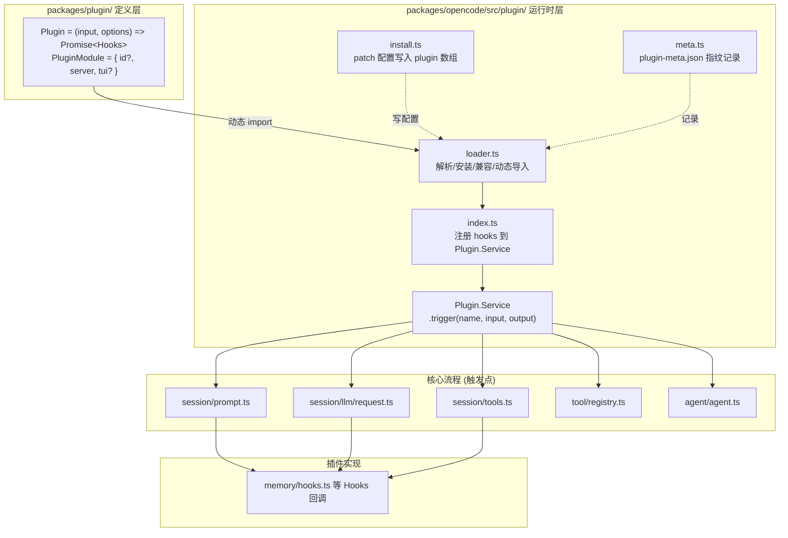
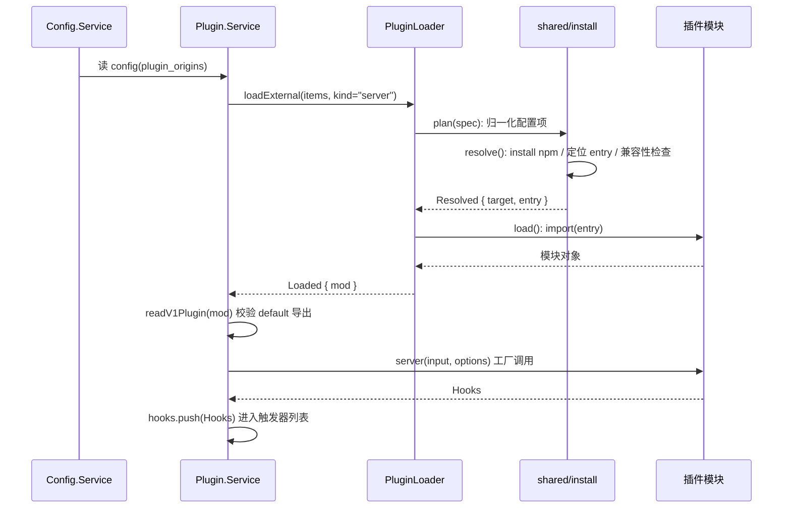
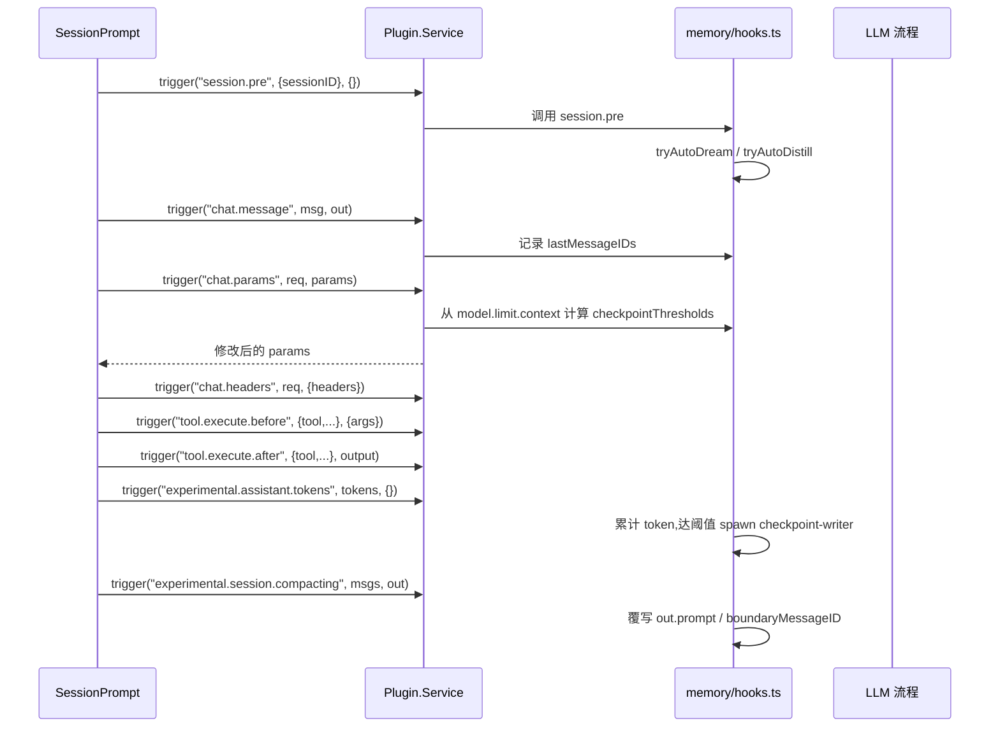
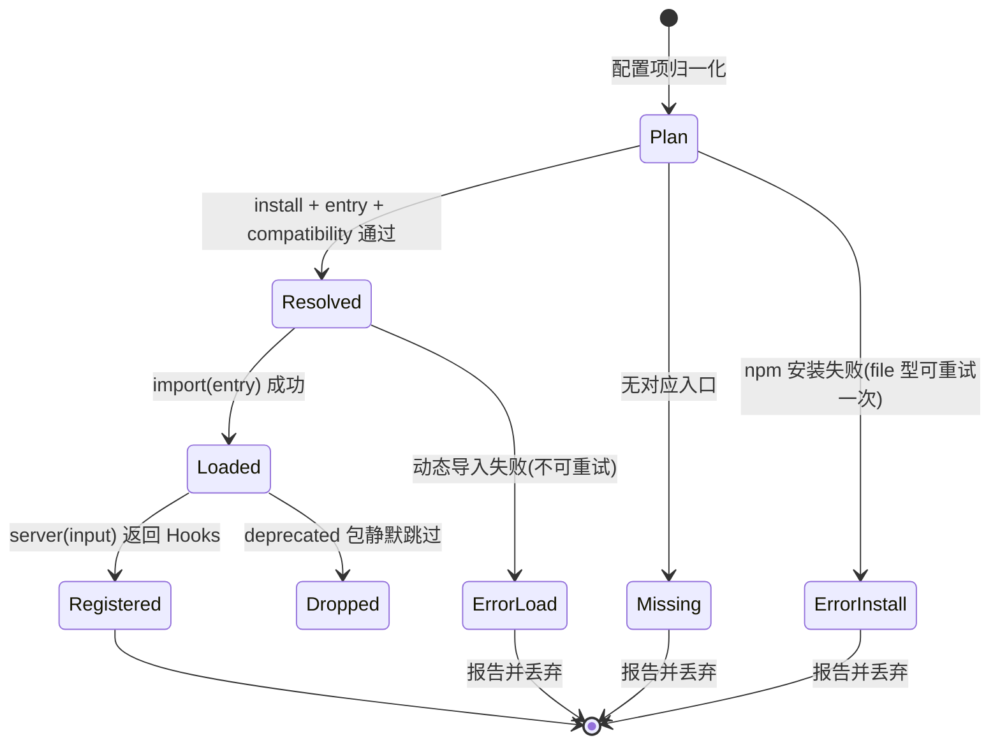

# opencode 插件系统特性描述

> 本文从代码视角自上而下梳理 opencode 的插件系统:插件如何被定义(`@opencode-ai/plugin` 类型契约)、如何被加载与注册(`src/plugin/loader.ts` / `src/plugin/index.ts`)、以及注册后的 hooks 如何渗透进 opencode 的核心会话/工具/LLM 流程。
>
> 代码库位置:`packages/plugin/`(定义) + `packages/opencode/src/plugin/`(运行时) | 所有结论均带 `文件:行号` 依据。

## 目录

1. [背景与动机](#1-背景与动机)
2. [高层设计](#2-高层设计)
3. [模块分解](#3-模块分解)
4. [核心流程](#4-核心流程)
5. [数据模型](#5-数据模型)
6. [接口定义](#6-接口定义)
7. [非功能性](#7-非功能性)
8. [测试策略](#8-测试策略)
9. [使用指南](#9-使用指南)

---

## 1. 背景与动机

**痛点**:opencode 是一个自带多种模型认证方式(OpenAI Codex、Copilot、Azure、XAI、Cloudflare 等)的 agent 工具。若所有能力都硬编码进核心,会导致:

| 问题 | 表现 | 对应模块 |
|------|------|----------|
| 认证方式爆炸 | 每个 provider 的 OAuth/API-key 流程各不相同,核心代码无法穷举 | `src/plugin/*.ts` 认证插件 |
| 会话流程不可定制 | 无法在 LLM 请求前改写 system prompt、无法在工具执行前后拦截 | `Plugin.trigger` 钩子系统 |
| 状态持久化无接口 | 跨会话记忆、压缩边界控制没有挂载点 | `src/plugin/memory/` 内存插件 |

**目标**:用一套统一的"插件契约 + 钩子触发"机制,把核心流程的**可扩展点**暴露给外部,同时保持核心与扩展解耦。插件既能以 npm 包形式独立分发,也能以文件形式内联进配置。

**定位**:插件系统横跨两层——

- **定义层** `packages/plugin/src/index.ts`:纯类型契约(`Plugin`、`PluginModule`、`Hooks`),是插件作者看到的全部 API;
- **运行时层** `packages/opencode/src/plugin/`:加载器、注册器、安装器、元数据、TUI 运行时,是核心启动时消费插件的地方。

**范围声明**:
- 在范围内:server 端插件的定义 → 加载 → 注册 → 触发全链路。
- 不在范围内:TUI 插件的运行时细节(`src/plugin/tui/runtime.ts` 另属一套 API)、插件生态的具体业务。

---

## 2. 高层设计

### 2.1 架构图

**ASCII 版**(纯文本可读):

```text
┌──────────────────────────────────────────────────────────────────────┐
│                        packages/plugin/ (定义层)                     │
│   Plugin = (input, options) => Promise<Hooks>                        │
│   PluginModule = { id?, server, tui? }   ← 插件默认导出              │
│   Hooks: chat.params / tool.execute.before / event / ...            │
└───────────────┬──────────────────────────────────────────────────────┘
                │ 动态 import(loadExternal)
                ▼
┌──────────────────────────────────────────────────────────────────────┐
│                  packages/opencode/src/plugin/ (运行时层)            │
│                                                                      │
│  ┌────────────┐   ┌──────────────┐   ┌───────────────────────────┐   │
│  │ loader.ts  │──▶│  index.ts    │──▶│ Plugin.Service (Effect)   │   │
│  │ 解析/安装/  │   │ 注册 hooks   │   │  .trigger(name,in,out)    │   │
│  │ 兼容/导入   │   │  internal+ext│   └───────────┬───────────────┘   │
│  └────────────┘   └──────┬───────┘               │                   │
│         ▲                │                       ▼                   │
│         │                │        ┌─────────────────────────────┐    │
│  ┌──────┴──────┐         │        │  核心流程 (触发点)           │    │
│  │ install.ts  │         │        │  session/prompt.ts          │    │
│  │ 写入配置     │         │        │  session/llm/request.ts    │    │
│  │ patch config│         │        │  session/tools.ts           │    │
│  └─────────────┘         │        │  tool/registry.ts           │    │
│  ┌─────────────┐         │        │  agent/agent.ts             │    │
│  │ meta.ts     │◀────────┘        └─────────────┬───────────────┘    │
│  │ plugin-meta │                               │                     │
│  │ 指纹/版本   │                               ▼                     │
│  └─────────────┘                    ┌──────────────────────────┐     │
│                                     │ 插件实现的 Hooks 回调     │     │
│                                     │ (如 memory/hooks.ts)     │     │
│                                     └──────────────────────────┘     │
└──────────────────────────────────────────────────────────────────────┘
```

**Mermaid 版**:



### 2.2 核心设计模式

- **插件钩子(Hook)模式** — 插件返回一个 `Hooks` 对象,核心在固定生命周期点用 `trigger(name, input, output)` 同步调用同名回调,回调可**就地修改 `output`** 来影响流程。定义在 `packages/plugin/src/index.ts:222-394`,`trigger` 实现于 `src/plugin/index.ts:282-295`。
- **工厂 + 惰性导入** — 每个插件是一个工厂函数 `server(input, options) => Promise<Hooks>`,在 `Plugin.Service` 层 `InstanceState.make` 时统一调用(`src/plugin/index.ts:168-177`),外部插件通过 `import()` 惰性加载(`loader.ts:136-145`)。
- **管道化解析(resolve 三段式)** — 插件加载被拆成 install → entry → compatibility 三段(`loader.ts:86-133`),任一段失败都有明确的 `stage` 归因,便于报告与重试。
- **事件驱动(补充通道)** — 除显式 `trigger` 外,插件还通过 `events.listen` 接收全量 session 事件(`src/plugin/index.ts:253-261`),如 `session.idle` / `session.deleted`,用于异步收尾。

### 2.3 文件职责矩阵

| 文件 | 行数 | 职责 | 关键导出 |
|------|------|------|----------|
| `packages/plugin/src/index.ts` | 394 | 插件类型契约:Plugin/PluginModule/Hooks/PluginInput/WorkspaceAdapter | `Plugin`, `Hooks`, `PluginModule` |
| `src/plugin/index.ts` | 318 | Plugin.Service:注册内置+外部插件、trigger 分发、事件转发 | `layer`, `defaultLayer`, `node` |
| `src/plugin/loader.ts` | 237 | 插件解析/安装/兼容检查/动态导入/并行加载 | `PluginLoader.loadExternal` |
| `src/plugin/shared.ts` | 323 | spec 解析、入口解析、版本兼容、V1 插件读取 | `readV1Plugin`, `resolvePluginId` |
| `src/plugin/install.ts` | 439 | 安装 npm 包、把插件写进 opencode.jsonc/tui 配置 | `installPlugin`, `patchPluginConfig` |
| `src/plugin/meta.ts` | 188 | plugin-meta.json:插件指纹/版本/加载计数 | `touchMany`, `list` |
| `src/config/plugin.ts` | 79 | 配置层插件来源(Origin)归一化与去重 | `ConfigPlugin.deduplicatePluginOrigins` |
| `src/plugin/memory/hooks.ts` | 740 | 真实插件示例:注册 agent/command/tool/checkpoint 钩子 | `memoryHooks` |

---

## 3. 模块分解

### 3.1 目录结构

```
packages/plugin/src/                 # 定义层(纯类型)
├── index.ts                         # Plugin / PluginModule / Hooks 契约
├── tool.ts                          # ToolDefinition
└── shell.ts                         # BunShell 类型

packages/opencode/src/plugin/        # 运行时层
├── index.ts                         # Plugin.Service:注册 + trigger 分发
├── loader.ts                        # loadExternal 并行加载管线
├── shared.ts                        # spec/入口/兼容/readV1Plugin
├── install.ts                       # npm 安装 + 配置写入
├── meta.ts                          # plugin-meta.json 元数据
├── azure.ts / cloudflare.ts / xai.ts / ...   # 内置认证插件
├── tui/                             # TUI 插件运行时(runtime.ts 1130 行)
└── memory/                          # 记忆系统插件(独立 WIP)
    ├── hooks.ts                     # 插件入口:注册全部钩子
    ├── fts5.ts / sqlite*.ts         # 全文索引与 SQLite 适配
    ├── checkpoint.ts / checkpoint-validator.ts
    ├── dream-distill.ts / injection.ts / agent.ts / memory-tool.ts
    └── prompt/                      # checkpoint-writer.txt / dream.txt / distill.txt
```

### 3.2 模块单一职责清单

| 模块 | 单一职责 | 位置 | 关键方法 |
|------|----------|------|----------|
| `Plugin.Service` | 持有全部已注册 hooks,按名分发触发 | `index.ts:125-316` | `trigger()`, `list()`, `init()` |
| `PluginLoader` | 把配置项解析为可导入的模块(不执行插件逻辑) | `loader.ts:15-237` | `resolve()`, `load()`, `loadExternal()` |
| `shared.ts` | 纯函数:解析 spec、定位入口、校验 V1 形状 | `shared.ts` | `readV1Plugin`, `resolvePluginId` |
| `install.ts` | 安装 npm 包并回写配置文件 | `install.ts` | `installPlugin`, `patchPluginConfig` |
| `PluginMeta` | 持久化插件加载指纹,驱动增量变更检测 | `meta.ts` | `touchMany`, `list` |
| `memoryHooks` | 一个真实插件的全部钩子实现 | `memory/hooks.ts` | 见 §4.3 |

> 注:`src/plugin/index.ts` 同时承担"注册编排"与"触发分发"两个职责,但它属于 Effect Service 层的聚合点,符合该文件作为模块入口的定位,不算违规。

---

## 4. 核心流程

### 4.1 流程一:插件从配置到注册(启动期)

**ASCII 时序图**:

```text
Config.Service      Plugin.Service      PluginLoader      shared/install    插件模块(npm/file)
     │                   │                   │                 │                │
     │ 读 config         │                   │                 │                │
     │──────────────────▶│                   │                 │                │
     │  plugin_origins   │                   │                 │                │
     │◀──────────────────│                   │                 │                │
     │                   │ loadExternal()   │                 │                │
     │                   │─────────────────▶│                 │                │
     │                   │                   │ plan(spec)      │                │
     │                   │                   │────────────────▶│                │
     │                   │                   │  resolve():     │                │
     │                   │                   │  install npm     │──▶ npm add ──▶ │
     │                   │                   │  检查入口(entry) │                │
     │                   │                   │  兼容性(engines) │                │
     │                   │                   │◀────────────────│                │
     │                   │                   │ load():import()  │                │
     │                   │                   │─────────────────────────────────▶│
     │                   │                   │                  │       返回模块 │
     │                   │                   │◀────────────────────────────────│
     │                   │◀──────────────────│ (Loaded: mod)    │                │
     │                   │                   │                  │                │
     │                   │ readV1Plugin(mod)│                  │                │
     │                   │ server(input,opt)│                  │                │
     │                   │─────────────────────────────────────────────────────▶│
     │                   │                  │                  │       返回 Hooks│
     │                   │◀────────────────────────────────────────────────────│
     │                   │ hooks.push(Hooks)│                  │                │
```

**Mermaid 版**:



**文字说明**:

1. **前置**:`Config.Service` 合并各配置文件后产出 `plugin_origins: Origin[]`,每个 Origin 携带 `spec` + `source`(声明文件)+ `scope`(`config/config.ts:111-115`, `config/plugin.ts:7-16`)。
2. **加载**:`Plugin.Service` 调用 `PluginLoader.loadExternal`(`index.ts:184-216`),对每个候选并行执行 `attempt`(`loader.ts:149-192`)。
3. **解析**:`resolve()` 三段检查——`resolvePluginTarget` 负责 npm 安装或路径解析(`shared.ts:207-213`)、`createPluginEntry` 定位 `./server` / `./tui` 入口(`shared.ts:224-236`)、npm 插件再过 `checkPluginCompatibility` 校验 `engines.opencode` 版本(`shared.ts:194-205`)。
4. **导入**:`load()` 动态 `import(entry)`(`loader.ts:136-145`)。
5. **注册**:`applyPlugin` 用 `readV1Plugin` 读取 default 导出(`shared.ts:272-304`),调用 `server(input, options)` 得到 `Hooks`,`hooks.push(...)`(`index.ts:112-123`)。
6. **失败路径**:missing 入口走 `missing` 回调;install/entry/compatibility/load 错误走 `report.error`,文件型插件在 `wait` 场景下可重试一次(`loader.ts:215-230`)。`deprecated` 包(如 `opencode-openai-codex-auth`)被静默忽略(`loader.ts:161`)。
7. **幂等**:Bun 缓存失败的动态导入,重试只发生在动态导入**之前**的安装阶段(`loader.ts:222-225`)。

### 4.2 流程二:trigger 分发(运行期,一次 LLM 回合)

以"用户发一条消息"为例,展示 hooks 如何在一次回合中被多次触发:

**ASCII 时序图**:

```text
SessionPrompt         Plugin.Service      memory/hooks.ts         LLM 流程
     │                      │                  │                    │
     │ runLoop 启动          │                  │                    │
     │─────────────────────▶│                  │                    │
     │ "session.pre"         │                  │                    │
     │─────────────────────▶│─────────────────▶│ auto dream/distill  │
     │                      │                  │                    │
     │ "chat.message"        │                  │ 记录 lastMessageID  │
     │─────────────────────▶│─────────────────▶│                    │
     │                      │                  │                    │
     │ LLM 请求准备          │                  │                    │
     │  "chat.params"        │                  │ 解析上下文窗口→     │
     │◀─────────────────────│◀─────────────────│ 计算 checkpoint 阈值│
     │  "chat.headers"       │                  │                    │
     │◀─────────────────────│◀─────────────────│                    │
     │                      │                  │                    │
     │ 工具执行前            │                  │                    │
     │ "tool.execute.before" │                  │                    │
     │◀─────────────────────│◀─────────────────│                    │
     │ 工具执行后            │                  │                    │
     │ "tool.execute.after"  │                  │                    │
     │◀─────────────────────│◀─────────────────│                    │
     │                      │                  │                    │
     │ "experimental.assistant.tokens"          │ 累计 token→        │
     │◀─────────────────────│◀─────────────────│ 达阈值→spawn writer │
     │                      │                  │                    │
     │ "experimental.session.compacting" (超限) │ 覆盖压缩 prompt/    │
     │◀─────────────────────│◀─────────────────│ boundary            │
```

**Mermaid 版**:



**文字说明**:

- 触发点散落在核心流程各处:`session/prompt.ts`(回合主循环)、`session/llm/request.ts`(请求准备)、`session/tools.ts`(工具执行)、`tool/registry.ts`(工具定义)、`agent/agent.ts`(system prompt)。
- **output 就地修改**是 hooks 影响流程的方式:如 `experimental.chat.system.transform` 向 `out.system` push 记忆上下文(`memory/hooks.ts:513-527`),`experimental.session.compacting` 覆写 `out.prompt` 与 `out.boundaryMessageID`(`memory/hooks.ts:545-565`)。
- 关键调用点(已核实的 `文件:行号`):`chat.params`/`chat.headers`/`system.transform` 在 `session/llm/request.ts:69,114,134`;`tool.execute.before/after` 在 `session/tools.ts:102,117`;`session.pre` 在 `session/prompt.ts:1191`;`session.llm.request` 在 `session/llm.ts:279`;`tool.definition` 在 `tool/registry.ts:299`;`shell.env` 在 `pty-environment.ts:18`。

### 4.3 状态机:插件加载状态

**ASCII 状态迁移清单**:

```text
[*] ──▶ Plan  : 配置项归一化(plan())
Plan ──▶ Resolved      : resolve() 通过 install+entry+compatibility
Plan ──▶ Missing       : 无对应 kind 入口(走 missing 回调)
Plan ──▶ Error-install : npm 安装失败(可重试,file 型+wait)
Resolved ──▶ Loaded    : import(entry) 成功
Resolved ──▶ Error-load : 动态导入失败(不可重试,Bun 缓存失败)
Loaded ──▶ Registered  : server(input) 返回 Hooks 且 push 成功
Loaded ──▶ Dropped     : deprecated 包被静默跳过
Registered ──▶ [*]
Error-* ──▶ [*] : 报告后丢弃该候选
```

**Mermaid 版**:



**文字说明**:整个管线是"串行阶段、并行候选"——候选之间用 `Promise.all` 并行(`loader.ts:211-214`),但每个候选内部严格按 Plan→Resolved→Loaded→Registered 推进,任一阶段失败即终止并丢弃,不阻塞其他插件。

---

## 5. 数据模型

### 5.1 配置文件(`opencode.jsonc`)

插件通过顶层 `plugin` 数组声明,支持字符串或 `[spec, options]` 元组(`packages/plugin/src/index.ts:70-72`, `core/v1/config/plugin.ts`):

```jsonc
{
  "plugin": [
    "my-npm-plugin",                        // npm 包名,自动 @latest
    ["my-plugin@1.2.3", { "key": "value" }] // 带版本 + options
  ]
}
```

- 路径型 spec(以 `.`、`/`、`file://` 开头)在配置加载时即被解析为绝对 file URL(`config/plugin.ts:42-60`),防止后续合并时被误判相对路径。
- 合并后产出的 `plugin_origins` 是**派生状态**,不落盘(`config/config.ts:111-115`),按插件身份去重、保留获胜 Origin(`config/plugin.ts:64-77`)。

### 5.2 插件包元数据(`package.json`)

插件包通过 `exports` 声明入口,通过 `engines` 声明兼容版本(`shared.ts:89-114,194-205`):

```json
{
  "name": "my-plugin",
  "exports": {
    "./server": "./dist/server.js",
    "./tui": "./dist/tui.js"
  },
  "engines": { "opencode": "^1.0.0" }
}
```

### 5.3 运行时元数据(`plugin-meta.json`)

存储于 `Global.Path.state/plugin-meta.json`(`meta.ts:48-50`),键为插件 id,值结构如下(`meta.ts:20-34`):

| 字段 | 类型 | 含义 |
|------|------|------|
| `source` | `"file" \| "npm"` | 插件来源 |
| `spec` / `target` | string | 原始 spec 与解析目标 |
| `version` | string? | npm 插件实际安装版本 |
| `fingerprint` | string | file→`target\|mtime`,npm→`target\|requested\|version`(`meta.ts:108-111`) |
| `first_time` / `last_time` / `time_changed` | number | 首次/最近/变更时间戳 |
| `load_count` | number | 累计加载次数 |
| `themes` | Record | TUI 主题文件映射(如有) |

- 写入受 `Flock` 文件锁保护(`meta.ts:147`),避免并发触碰竞态。
- `state` 三态 `first/updated/same` 由指纹比对得出(`meta.ts:124-140`),供上层做增量处理。

---

## 6. 接口定义

### 6.1 插件契约(定义层,`packages/plugin/src/index.ts`)

**Plugin 工厂**:`Plugin = (input: PluginInput, options?) => Promise<Hooks>`(`index.ts:74`)。

**PluginInput**(`index.ts:56-66`):

| 字段 | 说明 |
|------|------|
| `client` | opencode SDK 客户端(可调用 server API) |
| `project` / `directory` / `worktree` | 项目与目录上下文 |
| `experimental_workspace.register(type, adapter)` | 注册 workspace 适配器 |
| `serverUrl` | server URL |
| `$` | Bun Shell |

**Hooks 全表**(`index.ts:222-394`)——所有钩子均为 `(input, output) => Promise<void>`,可改 `output`:

| 钩子名 | 触发时机 | 核心用途 |
|--------|----------|----------|
| `dispose` | 插件/会话销毁 | 清理资源 |
| `event` | 任意 session 事件 | 异步收尾(会话 idle/deleted) |
| `config` | 配置就绪后 | 注入 agent/command/读插件配置 |
| `tool` | 注册期 | 暴露新工具(`memory_search` 等) |
| `auth` / `provider` | 认证/Provider 解析 | 认证流程定制 |
| `chat.message` | 收到新消息 | 记录消息水位 |
| `chat.params` | LLM 请求前 | 修改 temperature/options 等参数 |
| `chat.headers` | LLM 请求前 | 追加请求头 |
| `permission.ask` | 权限询问 | 改判 allow/deny/ask |
| `command.execute.before` | 斜杠命令执行前 | 拦截/记录命令 |
| `tool.execute.before` | 工具执行前 | 改写参数 |
| `tool.execute.after` | 工具执行后 | 改写输出 |
| `shell.env` | shell 环境构造 | 注入环境变量 |
| `tool.definition` | 工具定义生成 | 改写描述/参数 schema |
| `experimental.chat.system.transform` | 请求准备 | 向 system 追加内容(记忆注入) |
| `experimental.chat.messages.transform` | 消息发送前 | 改写消息列表 |
| `experimental.session.compacting` | 压缩开始前 | 定制压缩 prompt/boundary |
| `experimental.compaction.autocontinue` | 压缩完成后 | 决定是否自动 continue |
| `experimental.assistant.tokens` | 每轮 assistant 完成 | token 统计(触发 checkpoint) |
| `session.llm.request` | 每次 LLM 请求 | trajectory 存档/审计 |
| `session.pre` | runLoop 启动时 | 会话级初始化 |

### 6.2 配置项

```yaml
plugin:                # 插件列表(字符串或 [spec, options] 元组)
  - "my-plugin"
dream:
  auto: false          # memory 插件:是否自动 dream(默认 false)
  interval_days: 7
distill:
  auto: false          # 自动 distill 间隔(默认 30 天)
  interval_days: 30
checkpoint:
  thresholds: ["40%"]  # 压缩阈值("40%" / "100K" / 绝对数字)
  search_score_floor: 0.15
```

### 6.3 memory 插件注册的 agent / command / tool(`memory/hooks.ts`)

| 名称 | 类型 | 隐藏 | 权限 |
|------|------|------|------|
| `checkpoint-writer` | subagent | 是 | read/write/edit/apply_patch/glob/grep/task/memory_write/memory_edit |
| `dream` | subagent | 是 | 上述 + bash/memory_search/trajectory_search |
| `distill` | subagent | 是 | 同 dream |
| `/dream` | command | 否 | 内联运行(`subtask: false`) |
| `/distill` | command | 否 | 内联运行 |
| `memory_search(query, scope?, type?, limit?)` | tool | - | 搜索记忆库 |
| `trajectory_search(operation, ...)` | tool | - | 查询轨迹库(opencode.db) |
| `memory_write(path, content)` | tool | - | 写记忆文件(限 `.opencode/memory/`) |
| `memory_edit(path, old_str, new_str)` | tool | - | 编辑记忆文件 |

---

## 7. 非功能性

### 7.1 性能

- **并行加载**:所有插件候选用 `Promise.all` 同时 attempt(`loader.ts:211-214`),单个插件失败不阻塞整体。
- **惰性导入**:外部插件只在注册阶段 `import()`(`loader.ts:139`),且注册发生在 `InstanceState.make` 的实例作用域内,每个工作区一次。
- **Bun 缓存**:失败的动态导入被 Bun 进程级缓存,避免重复尝试无效依赖(`loader.ts:222-225`)。

### 7.2 并发

- **配置写入串行化**:`patchOne` 用 `Flock.acquire("plug-config:<file>")` 文件锁(`install.ts:347`),多个插件并发安装时不会互相覆盖。
- **元数据写入串行化**:`touchMany` / `setTheme` 均 `Flock.withLock`(`meta.ts:147,171`)。
- **hook 触发串行**:`trigger` 遍历 hooks 是顺序 `await`(`index.ts:288-293`),保证 hook 副作用次序确定(注释明确:保持注册与执行顺序确定,`index.ts:220-221`)。

### 7.3 错误处理

- **阶段归因**:resolve 的三种失败(install/entry/compatibility)+ load 失败分别上报不同 `stage`(`loader.ts:49-57`),调用方 `Plugin.Service` 按 stage 决定日志与用户提示(`index.ts:187-214`)。
- **单插件容错**:插件工厂抛错会被捕获、记日志并 `Effect.option` 跳过,不影响其他插件(`index.ts:169-177`);触发阶段每个 hook 独立 try/catch(`index.ts:222-239`)。
- **重试策略**:仅 file 型插件在安装阶段的"缺 package.json/index"错误可重试一次(`loader.ts:71-74,215-230`);导入后失败视为永久。
- **降级**:deprecated 包静默跳过;版本不兼容的 npm 插件报 `Plugin requires opencode X but running Y`(`shared.ts:202-203`)。

### 7.4 监控埋点

- 统一结构化日志,如 `"failed to load internal plugin"`(`index.ts:173`)、`"failed to load plugin"`(`index.ts:229`)、memory 插件的 `Log.info("checkpoint", "checkpoint_saved", ...)`(`memory/hooks.ts:699`)。
- 插件错误通过 `Session.Event.Error` 事件发布给前端(`index.ts:137-139`)。

---

## 8. 测试策略

### 8.1 单元测试

| 测试文件 | 覆盖点 |
|----------|--------|
| `test/config/plugin.test.ts` | 配置层:Origin 归并、去重、spec 解析 |
| `test/cli/tui/plugin-loader.test.ts` | loader:入口解析、加载结果 |
| `test/cli/tui/plugin-loader-entrypoint.test.ts` | `./server` / `./tui` 入口选择 |
| `test/cli/tui/plugin-loader-pure.test.ts` | `--pure` 模式禁用插件 |
| `test/plugin/cloudflare.test.ts` | 具体认证插件行为 |

### 8.2 集成测试

| 测试文件 | 覆盖点 |
|----------|--------|
| `test/cli/tui/plugin-install.test.ts` | 安装 npm 包并 patch 配置 |
| `test/cli/tui/plugin-add.test.ts` | `/plugin add` 命令端到端 |
| `test/cli/tui/plugin-toggle.test.ts` | 启停插件 |
| `test/cli/tui/plugin-lifecycle.test.ts` | 完整生命周期 |
| `test/cli/plugin-auth-picker.test.ts` | 认证插件选择器 |

### 8.3 边界场景(覆盖标注)

- ✅ 缺失入口(only-tui 包在 server 场景)→ `missing` 分支(`loader.ts:167-175`)
- ✅ 版本不兼容 → `compatibility` 报错(`shared.ts:194-205`)
- ✅ 空模块 / 空导出 → `load` 层报错(`loader.ts:143`)
- ✅ 目录型 vs 文件型 spec → `isPathPluginSpec` 分支(`shared.ts:171-173`)
- ⚠️ **未覆盖**:并发安装同一插件(多进程竞争 `Flock`);hook 抛错时其余 hooks 继续执行的确切顺序;超大插件包安装超时。
- ⚠️ **未覆盖**:`memory` 插件自身(checkpoint/dream)缺少 `*.test.ts`,属 WIP。

---

## 9. 使用指南

### 9.1 解决什么问题(一句话版)

- **插件系统**:让 opencode 的核心流程(会话、LLM、工具、认证)可以通过统一的钩子契约被扩展,无需改核心。
- **Memory 插件**:跨会话长期知识库 + 自动压缩边界控制,让新会话"想起"项目背景。

### 9.2 如何开启

- 内置插件(`memoryHooks` 等)随 `Plugin.Service` **自动加载**(`internalPlugins`, `index.ts:66-84`),无需配置;`--disable-default-plugins` 可关闭。
- 外部插件:在 `opencode.jsonc` 的 `plugin` 数组声明,首次启动自动 `npm add`(`shared.ts:211`)。
- TUI 侧 `/plugin add <spec>` 命令会自动安装并回写配置(`install.ts`)。

### 9.3 自动行为(无需用户操作)

- 每次新会话注入项目记忆上下文(触发:`experimental.chat.system.transform`, `memory/hooks.ts:513-527`)。
- token 越过阈值时后台 fork `checkpoint-writer` 子代理写检查点(触发:`experimental.assistant.tokens`, `memory/hooks.ts:571-605`)。
- 会话空闲/删除时校验检查点,失败自动重试(≤3 次)或回滚备份(触发:`event`, `memory/hooks.ts:607-734`)。

### 9.4 手动命令与工具

| 命令/工具 | 签名 | 用途 |
|-----------|------|------|
| `/dream` | 可带 `$ARGUMENTS` 约束 | 手动记忆整合 |
| `/distill` | 可带 `$ARGUMENTS` 约束 | 手动工作流沉淀 |
| `memory_search(query, scope?, type?, limit?)` | `scope: global\|projects\|sessions`, `type: memory\|checkpoint\|notes\|progress\|free`, `limit` 默认 10 | 搜索记忆库 |
| `memory_write(path, content)` | path 必须位于 `.opencode/memory/` | 写记忆文件 |
| `memory_edit(path, old_str, new_str)` | 同上 | 编辑记忆文件 |

### 9.5 使用示例

> **示例 1:让新会话记住项目规则**
> 用户说:"这个项目所有 DB 字段用 snake_case。"
> → 会话开始时 `experimental.chat.system.transform` 钩子把记忆库内容(含该规则)push 进 `out.system`
> → 后续任意新会话的 LLM system prompt 自动包含该规则,agent 无需再问。

> **示例 2:长会话自动压缩**
> 用户连续多轮提问,累计 token 越过 `checkpoint.thresholds`(默认按上下文窗口 20/40/60/80% 递增)
> → `experimental.assistant.tokens` 钩子累计计数达阈值,`trySpawnCheckpointWriter` fork 子代理
> → 压缩前 `experimental.session.compacting` 钩子覆写压缩 prompt 与 boundary,保留 `actor/task/skill/memory` 等关键工具结果。

> **示例 3:编写一个最小插件**
> 用户写一个本地文件插件并加到 `plugin` 配置:
> ```ts
> // ./my-plugin.ts
> export default {
>   id: "my-plugin",
>   server(input) {
>     return {
>       "chat.params": async (_inp, out) => { out.temperature = 0.1 },
>     }
>   },
> }
> ```
> → 启动时 `readV1Plugin` 校验通过 → `server(input)` 返回 Hooks → 每次 LLM 请求前 `chat.params` 被触发,强制低温采样。

---

## 附录:关键常量速查表

| 常量 | 值 | 位置 | 说明 |
|------|-----|------|------|
| `DEPRECATED_PLUGIN_PACKAGES` | `["opencode-openai-codex-auth","opencode-copilot-auth"]` | `shared.ts:10` | 已内置的旧包名,加载时静默跳过 |
| `INDEX_FILES` | `["index.ts","index.tsx","index.js","index.mjs","index.cjs"]` | `shared.ts:54` | 目录型插件的入口探测顺序 |
| `MAX_RETRIES` | 3 | `memory/hooks.ts:77` | checkpoint 校验失败最大重试次数 |
| `CHECKPOINT_RESERVED` | 13_000 | `memory/hooks.ts:116` | 阈值安全缓冲,保证上下文窗口余量 |
| `COMPACTABLE_TOOLS` | read/bash/grep/glob/... | `memory/hooks.ts:130-133` | 压缩时可截断为 `[compact: N tokens]` 的工具 |
| `PRUNE_PROTECTED_TOOLS` | actor/task/question/skill/memory/... | `memory/hooks.ts:139` | 压缩时必须保留完整结果的关键工具 |

---

## 交付自检清单

- [x] 九段齐全
- [x] 目录 + 锚点可跳转
- [x] 架构图 / 时序图 / 状态机均为 ASCII + Mermaid 双格式
- [x] 关键结论均带 `文件:行号` 依据
- [x] 数据模型含配置文件、包元数据、运行时元数据
- [x] 接口含 Hooks 全表、配置项、agent/command/tool 清单
- [x] 测试策略含单元/集成/边界,标注了覆盖缺口
- [x] 使用指南含开启方式、自动行为、命令工具、可复现示例
