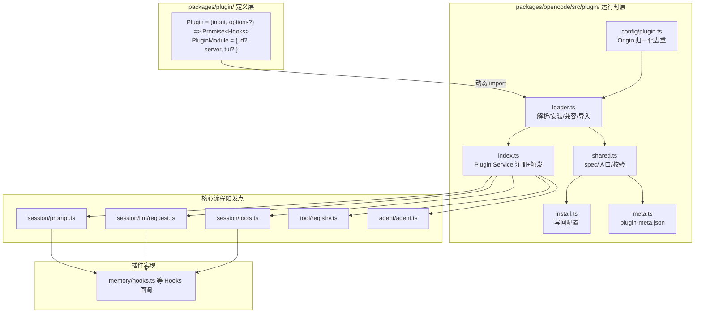
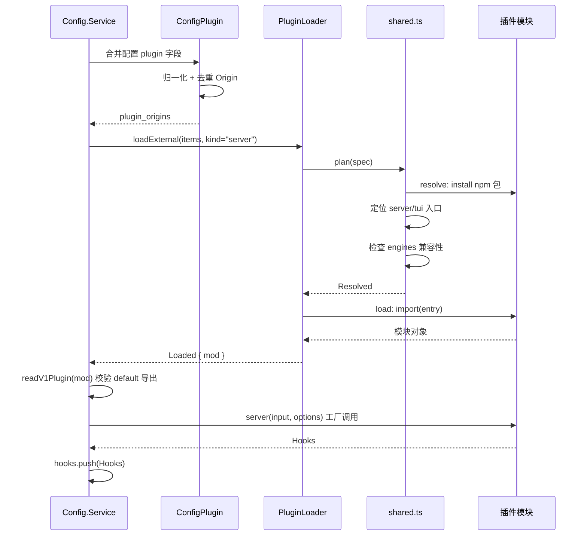
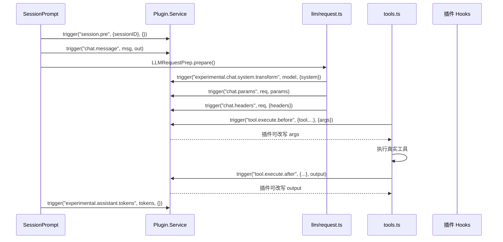
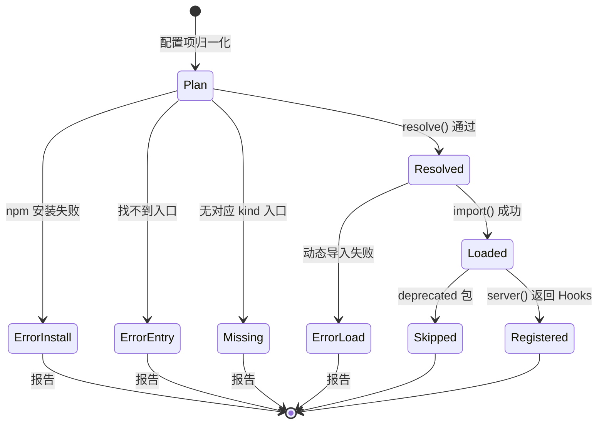

# opencode 插件系统特性描述

> 本文从代码视角自上而下梳理 opencode 的插件系统:从**插件的定义**(`@opencode-ai/plugin` 类型契约)、**插件的注册**(配置声明 → 加载器解析 → `Plugin.Service` 装配),到注册后的 hooks 如何通过 `trigger` 渗透进 opencode 的核心流程(会话、LLM 请求、工具执行)。
>
> 范围:服务端插件(`kind="server"`)的完整生命周期;TUI 插件(`kind="tui"`)仅提及,不做深挖。
> 依据:所有关键结论均标注 `文件:行号`。

## 目录

1. [背景与动机](#1-背景与动机)
2. [高层设计](#2-高层设计)
3. [模块分解](#3-模块分解)
4. [核心流程](#4-核心流程)
5. [数据模型](#5-数据模型)
6. [接口定义](#6-接口定义)
7. [非功能性](#7-非功能性)
8. [测试策略](#8-测试策略)
9. [使用指南](#9-使用指南)

---

## 1. 背景与动机

**痛点**:opencode 是一个多 provider 的编码 agent 工具。若所有能力都硬编码进核心,会导致:

| 问题 | 表现 | 对应模块 |
|------|------|----------|
| 认证方式爆炸 | 每个 provider 的 OAuth/API-key 流程都不同,核心无法穷举 | `src/plugin/*.ts` 认证插件(azure/xai/cloudflare…) |
| 会话流程不可定制 | 无法在 LLM 请求前改写 system prompt、无法拦截工具调用 | `Plugin.trigger` 钩子系统 |
| 记忆/压缩策略写死 | 跨会话记忆、压缩边界控制无法按项目定制 | `src/plugin/memory/` 记忆插件 |

**目标**:把"可扩展点"从核心代码中剥离出来,统一为**钩子(hooks)**契约,让第三方可以:
- 用 npm 包或本地文件的形式注册自定义行为;
- 在**不修改核心代码**的前提下,插入/改写会话与工具流程。

**定位**:插件系统横跨两个包——
- `packages/plugin/`(定义层):纯类型契约,`@opencode-ai/plugin` 是插件作者看到的全部 API;
- `packages/opencode/src/plugin/`(运行时层):加载器、安装器、注册器、元数据、TUI 运行时,是插件实际被消费的地方。

**范围声明**:
- 在范围内:server 插件的定义 → 加载 → 注册 → 触发全链路;配置声明方式;内置认证插件与 memory 插件作为实例。
- 不在范围内:TUI 插件的运行时细节(`tui/runtime.ts` 的 slot/theme 机制)、插件生态的具体业务实现。

---

## 2. 高层设计

### 2.1 架构图

**ASCII 版**:

```text
┌───────────────────────────────────────────────────────────────────────┐
│                        packages/plugin/ (定义层)                     │
│   Plugin = (input, options?) => Promise<Hooks>                        │
│   PluginModule = { id?, server, tui? }   ← 插件默认导出形状          │
│   Hooks: chat.params / tool.execute.before / event / config …        │
└───────────────────────────────┬───────────────────────────────────────┘
                                │ 动态 import(运行时)
                                ▼
┌───────────────────────────────────────────────────────────────────────┐
│                    packages/opencode/src/plugin/ (运行时层)          │
│                                                                       │
│  ┌──────────────┐    ┌───────────────┐    ┌───────────────────────┐   │
│  │ config/      │───▶│ loader.ts     │───▶│ index.ts             │   │
│  │ plugin.ts    │    │ 解析/安装/     │    │ Plugin.Service        │   │
│  │ Origin 归一化 │    │ 兼容/导入      │    │ 注册+trigger 分发     │   │
│  └──────────────┘    └───────┬───────┘    └──────────┬────────────┘   │
│                              │                       │                │
│  ┌──────────────┐    ┌───────┴───────┐               │                │
│  │ install.ts   │◀───│ shared.ts     │               │                │
│  │ 写回配置      │    │ spec/入口/校验 │               │                │
│  └──────────────┘    └───────────────┘               ▼                │
│  ┌──────────────┐                      ┌─────────────────────────┐    │
│  │ meta.ts      │                      │ 核心流程触发点           │    │
│  │ plugin-meta  │                      │ session/prompt.ts       │    │
│  │ 指纹/版本    │                      │ session/llm/request.ts  │    │
│  └──────────────┘                      │ session/tools.ts        │    │
│                                        │ tool/registry.ts        │    │
│                                        │ agent/agent.ts          │    │
│                                        └───────────┬─────────────┘    │
│                                                    ▼                  │
│                                        ┌─────────────────────────┐    │
│                                        │ 插件实现的 Hooks 回调     │    │
│                                        │ (memory/hooks.ts 等)    │    │
│                                        └─────────────────────────┘    │
└───────────────────────────────────────────────────────────────────────┘
```

**Mermaid 版**:



### 2.2 核心设计模式

1. **插件钩子(Plugin-Hook)模式** — 插件本质上是一个"返回钩子集合的函数"(`packages/plugin/src/index.ts:74`),核心在关键节点通过 `Plugin.trigger(name, input, output)` 同步调用同名钩子(`src/plugin/index.ts:282-295`)。钩子通过**就地修改 `output` 对象**来影响流程,这是插件影响 opencode 行为的唯一通道(另有 `event` 钩子走事件总线旁路)。
2. **分阶段解析管道(Stage Pipeline)** — 加载器把"解析一个插件"拆成 `resolve(install → entry → compatibility) → load(import)` 四个阶段(`src/plugin/loader.ts:86-145`),每阶段失败都有明确 `stage` 归因,便于错误报告与定向重试。
3. **工厂 + 惰性导入** — 外部插件用 `import()` 动态加载(`loader.ts:139`),只有注册成功后才把 `Hooks` 推入服务状态;内置插件则在 `internalPlugins()` 中静态导入(`index.ts:66-84`)。
4. **事件总线旁路** — 除显式 `trigger` 外,`Plugin.Service` 订阅了 `EventV2Bridge` 的会话事件流,并逐个派发给各插件的 `event` 钩子(`index.ts:253-261`),用于会话生命周期收尾。

### 2.3 文件职责矩阵

| 文件 | 行数 | 职责 | 关键导出 |
|------|------|------|----------|
| `packages/plugin/src/index.ts` | 394 | 插件类型契约(Plugin/PluginModule/Hooks/PluginInput) | `Plugin`, `Hooks`, `PluginModule` |
| `src/plugin/index.ts` | 318 | Plugin.Service:注册 hooks、trigger 分发、事件转发 | `layer`, `defaultLayer`, `node` |
| `src/plugin/loader.ts` | 237 | 插件解析/安装/兼容/导入的完整管线 | `PluginLoader.loadExternal`, `resolve`, `load` |
| `src/plugin/shared.ts` | 323 | spec 解析、入口定位、兼容性检查、V1 插件读取 | `readV1Plugin`, `resolvePluginId` |
| `src/plugin/install.ts` | 439 | 安装 npm 插件并把配置写回 opencode.jsonc | `installPlugin`, `patchPluginConfig` |
| `src/plugin/meta.ts` | 188 | plugin-meta.json 元数据(指纹/版本/加载计数) | `touchMany`, `list` |
| `src/config/plugin.ts` | 79 | 配置层:Origin 归一化与去重 | `ConfigPlugin.deduplicatePluginOrigins` |
| `src/plugin/memory/hooks.ts` | 740 | memory 插件:注册 checkpoint/记忆/命令等钩子 | `memoryHooks` |

---

## 3. 模块分解

### 3.1 目录结构

```
packages/plugin/src/            # 定义层(纯类型)
├── index.ts                    # 核心契约:Plugin / PluginModule / Hooks / PluginInput
├── tool.ts                     # ToolDefinition 工具定义
└── shell.ts                    # BunShell 类型

packages/opencode/src/plugin/   # 运行时层
├── index.ts                    # Plugin.Service:注册 + trigger 分发 + 事件转发
├── loader.ts                   # 加载管线:Plan → Resolved → Loaded
├── shared.ts                   # 纯函数工具:spec/入口/兼容/V1 读取
├── install.ts                  # 安装 + 配置回写
├── meta.ts                     # plugin-meta.json 元数据
├── azure.ts / cloudflare.ts / digitalocean.ts / xai.ts / snowflake-cortex.ts
│                               # 内置认证插件(provider 登录流程)
├── github-copilot/ openai/ tui/
│                               # Copilot/Codex 认证、TUI 插件运行时
├── pty-environment.ts          # shell.env 钩子的服务端实现
└── memory/                     # memory 插件(记忆/检查点/压缩)
    ├── hooks.ts                # 插件入口:返回全部 Hooks
    ├── fts5.ts / sqlite*.ts    # 全文索引与 SQLite 适配
    ├── checkpoint*.ts          # 检查点写入/校验
    ├── dream-distill.ts        # 记忆整合/工作流沉淀
    ├── injection.ts            # 记忆上下文注入
    └── prompt/                 # checkpoint-writer / dream / distill 提示词
```

### 3.2 类/模块单一职责清单

| 模块/类 | 单一职责 | 位置 | 关键方法 |
|----------|----------|------|----------|
| `Plugin.Service` | 只做"注册 hooks + 按名触发",不做插件业务 | `src/plugin/index.ts` | `trigger()`, `list()`, `init()` |
| `PluginLoader` | 只做"把配置项变成可导入模块",不执行业务 | `src/plugin/loader.ts` | `resolve()`, `load()`, `loadExternal()` |
| `shared.ts` | 纯函数:解析 spec、定位入口、校验形状 | `src/plugin/shared.ts` | `readV1Plugin()`, `resolvePluginId()` |
| `install.ts` | 只做"安装 + 改配置文件",不加载 | `src/plugin/install.ts` | `installPlugin()`, `patchPluginConfig()` |
| `PluginMeta` | 只做元数据持久化与指纹 | `src/plugin/meta.ts` | `touchMany()`, `list()` |
| `memoryHooks` | 插件实例:把记忆能力注册为 hooks/tools/agents | `src/plugin/memory/hooks.ts` | 返回的 `Hooks` 对象 |

> 职责观察:`loader.ts` 同时承担了"解析"与"导入"两类事,但它通过 `resolve/load/attempt` 细分了函数边界,属于合理的管道式分层,不算职责混杂。

---

## 4. 核心流程

### 4.1 时序图:从配置声明到插件注册(启动期)

**ASCII 版**:

```text
Config.Service    ConfigPlugin     PluginLoader     shared.ts      插件模块(npm/file)
     │                 │                │               │              │
     │ 合并配置         │                │               │              │
     │────────────────▶│                │               │              │
     │                 │ 归一化 Origin   │               │              │
     │                 │───────┐        │               │              │
     │                 │◀──────┘        │               │              │
     │  plugin_origins │                │               │              │
     │◀────────────────│                │               │              │
     │                 │                │               │              │
     │ Plugin.Service  加载外部插件       │               │              │
     │ loadExternal(items)             │               │              │
     │────────────────────────────────▶│               │              │
     │                 │                │ plan(spec)    │              │
     │                 │                │──────────────▶│              │
     │                 │                │  resolve():   │              │
     │                 │                │  ① install npm│─────────────▶│
     │                 │                │  ② 找入口      │              │
     │                 │                │  ③ 兼容检查    │              │
     │                 │                │◀──────────────│              │
     │                 │                │ load():import │              │
     │                 │                │─────────────────────────────▶│
     │                 │                │                │   返回模块   │
     │                 │                │◀─────────────────────────────│
     │                 │                │  Loaded        │              │
     │                 │◀───────────────│                │              │
     │ readV1Plugin + server(input)     │                │              │
     │────────────────────────────────────────────────────────────────▶│
     │                 │                │                │  返回 Hooks  │
     │                 │◀───────────────────────────────────────────────│
     │ hooks.push(Hooks)               │                │              │
```

**Mermaid 版**:



### 4.2 时序图:hook 触发如何影响一次 LLM 回合(运行期)

以"用户发一条消息 → LLM 响应"为例,展示插件钩子如何渗透:

**ASCII 版**:

```text
SessionPrompt        Plugin.Service       LLM request.ts      tools.ts        插件 Hooks
     │                      │                   │               │              │
     │  runLoop 启动         │                   │               │              │
     │─────────────────────▶│                   │               │              │
     │  session.pre          │                   │               │              │
     │─────────────────────▶│───────────────────────────────────────────────▶│
     │                      │                   │               │              │
     │  chat.message         │                   │               │              │
     │─────────────────────▶│───────────────────────────────────────────────▶│
     │                      │                   │               │              │
     │  构建请求             │                   │               │              │
     │  prepare()            │                   │               │              │
     │─────────────────────▶│                   │               │              │
     │                      │ system.transform   │               │              │
     │                      │◀──────────────────│               │              │
     │                      │───────────────────────────────────────────────▶│
     │                      │                   │ chat.params    │              │
     │                      │◀──────────────────│               │              │
     │                      │───────────────────────────────────────────────▶│
     │                      │                   │ chat.headers   │              │
     │                      │◀──────────────────│               │              │
     │                      │───────────────────────────────────────────────▶│
     │                      │                   │               │              │
     │  执行工具             │                   │               │              │
     │                      │                   │               │ 调用 execute │
     │                      │                   │               │─────────────▶│
     │                      │ tool.execute.before────────────────────────────▶│
     │                      │                   │               │ 实际执行      │
     │                      │ tool.execute.after ────────────────────────────▶│
     │                      │                   │               │              │
     │  回合结束             │                   │               │              │
     │  assistant.tokens     │                   │               │              │
     │─────────────────────▶│───────────────────────────────────────────────▶│
```

**Mermaid 版**:



### 4.3 状态机:单个插件的加载状态

**ASCII 版**:

```text
[*] ──▶ Plan             : 配置项归一化 (loader.ts:77)
Plan ──▶ Resolved        : resolve() 通过 install/entry/compatibility 三关
Plan ──▶ Error-install   : npm 安装失败(可重试一次,file 型)
Plan ──▶ Error-entry     : 找不到 server/tui 入口
Plan ──▶ Missing         : 包存在但没有对应 kind 入口(走 missing 回调)
Resolved ──▶ Loaded      : import() 成功
Resolved ──▶ Error-load  : 动态导入失败(Bun 缓存,不可重试)
Loaded ──▶ Registered    : server(input) 返回 Hooks 并 push
Loaded ──▶ Skipped       : deprecated 包被静默跳过 (loader.ts:161)
Error-* / Missing ──▶ [*] : 报告错误后丢弃该候选
Registered ──▶ [*]
```

**Mermaid 版**:



### 4.4 关键流程文字说明

**注册流程**(`loader.ts` 全篇 + `index.ts:112-240`):
1. **前置**:`Config.Service` 合并多份配置后产出 `plugin_origins: Origin[]`,每个 Origin 携带 `spec + source + scope`(`config/plugin.ts:12-16`),保证后续能知道插件来自哪个文件、全局还是本地。
2. **解析**:`PluginLoader.resolve()` 依次执行——① `resolvePluginTarget` 安装 npm 包或定位本地路径(`shared.ts:207-213`);② `createPluginEntry` 从 `exports["./server"]` / `main` / index 文件定位入口(`shared.ts:224-236`);③ npm 插件再过 `checkPluginCompatibility` 校验 `engines.opencode` 版本(`shared.ts:194-205`)。
3. **导入**:`load()` 用 `import(row.entry)` 加载(`loader.ts:136-145`);file 型插件的安装失败可 `wait` 重试一次(`loader.ts:215-230`)。
4. **注册**:`Plugin.Service` 的 `applyPlugin` 调用 `readV1Plugin` 校验默认导出形状(`shared.ts:272-304`),随后 `resolvePluginId` 确定插件 id(`shared.ts:306-323`),最后调用 `server(input, options)` 得到 `Hooks` 并 `hooks.push(...)`(`index.ts:112-123`)。内置插件走 `internalPlugins()` 直接静态导入(`index.ts:66-84`)。
5. **幂等性**:`meta.ts` 记录指纹(`target|mtime` 或 `target|requested|version`,`meta.ts:108-111`),用于判断 `first/updated/same`。

**触发流程**(`index.ts:282-295`):
- `trigger(name, input, output)` 遍历 `state.hooks`,对每个插件调用 `hook[name]?.(input, output)`;钩子**就地修改 output**,`trigger` 最终返回修改后的 output。因此插件影响流程的方式是"改写传给下游的数据"。
- 旁路通道:会话事件流 → 每个插件的 `event` 钩子(`index.ts:253-261`),如 memory 插件用 `session.idle` 触发检查点校验(`memory/hooks.ts:607-734`)。

---

## 5. 数据模型

### 5.1 配置声明(`opencode.jsonc`)

插件通过顶层 `plugin` 数组声明,每项是**字符串**或 **[spec, options] 元组**(`packages/plugin/src/index.ts:70-72`):

```jsonc
{
  "plugin": [
    "opencode-plugin-example",              // npm 包名,@latest
    ["my-plugin@^2.0", { "key": "value" }], // 带版本约束 + options
    "./local-plugin.ts"                     // 本地文件/目录(file:// 或相对路径)
  ]
}
```

### 5.2 插件包契约(`package.json`)

```json
{
  "name": "my-plugin",
  "exports": {
    "./server": "./dist/server.js",
    "./tui": "./dist/tui.js"
  },
  "main": "./dist/server.js",
  "engines": { "opencode": "^1.0.0" }
}
```

- 入口解析优先级:`exports["./server"]` → `main` → 目录 index 文件(`shared.ts:103-114`)。
- `engines.opencode` 声明支持的 opencode 版本范围(`shared.ts:194-205`)。

### 5.3 运行时元数据(`plugin-meta.json`)

存储于 `Global.Path.state/plugin-meta.json`(`meta.ts:48-50`),按插件 id 索引:

| 字段 | 类型 | 含义 |
|------|------|------|
| `id` | string | 插件标识(npm 包名或 file 插件的显式 id) |
| `source` | `"file" \| "npm"` | 来源 |
| `spec` / `target` | string | 声明与解析后的目标 |
| `requested` / `version` | string | 请求版本 / 实际安装版本(npm) |
| `modified` | number | 文件 mtime(file) |
| `fingerprint` | string | `target|modified` 或 `target|requested|version` |
| `first_time` / `last_time` / `time_changed` | number | 首次/最近/变更时间 |
| `load_count` | number | 累计加载次数 |
| `themes` | Record | TUI 主题文件映射(如有) |

### 5.4 粒度与序列化策略

- 配置以 JSONC 存储,`install.ts` 用 `jsonc-parser` 的 `modify/applyEdits` 做**最小化原地补丁**(`install.ts:168-179`),保留注释与格式。
- 元数据以 JSON 整体读写,受 `Flock` 文件锁保护(`meta.ts:147`),防止多进程并发写入。

---

## 6. 接口定义

### 6.1 插件作者 API(`packages/plugin/src/index.ts`)

| 类型 | 签名 | 行号 |
|------|------|------|
| `Plugin` | `(input: PluginInput, options?: PluginOptions) => Promise<Hooks>` | `74` |
| `PluginModule` | `{ id?: string; server: Plugin; tui?: never }` | `76-80` |
| `PluginInput` | `{ client, project, directory, worktree, experimental_workspace, serverUrl, $ }` | `56-66` |
| `PluginOptions` | `Record<string, unknown>` | `68` |
| `WorkspaceAdapter` | `{ name, description, configure, create, remove, target }` | `47-54` |

### 6.2 Hooks 全表(插件能注册的全部钩子)

| Hook 名 | input → output | 触发点 | 行号(定义) |
|---------|---------------|--------|------------|
| `config` | `Config → void` | 配置就绪后 | `225` |
| `event` | `{event} → void` | 会话事件流 | `224` |
| `dispose` | `→ void` | 会话销毁 | `223` |
| `tool` | `Record<string, ToolDefinition>` | 注册工具 | `226-228` |
| `auth` / `provider` | 认证钩子 | provider 登录 | `229-230` |
| `chat.message` | 新消息 → 输出 | `prompt.ts:1033` | `234-243` |
| `chat.params` | 请求 → 温度等参数 | `llm/request.ts:114` | `247-256` |
| `chat.headers` | 请求 → headers | `llm/request.ts:134` | `257-260` |
| `permission.ask` | 权限 → 裁决 | — | `261` |
| `command.execute.before` | 命令 → parts | `prompt.ts:1686` | `262-265` |
| `tool.execute.before` | 工具 → args | `tools.ts:102` | `266-269` |
| `shell.env` | cwd → env | `pty-environment.ts:18` | `270-273` |
| `tool.execute.after` | 工具 → 输出 | `tools.ts:117` | `274-281` |
| `experimental.chat.messages.transform` | → 消息列表 | `compaction.ts:365` | `282-290` |
| `experimental.chat.system.transform` | → system | `llm/request.ts:69` | `291-296` |
| `experimental.provider.small_model` | → 小模型 | — | `297` |
| `experimental.session.compacting` | → 压缩 prompt/boundary | `compaction.ts:349` | `314-329` |
| `experimental.compaction.autocontinue` | → 是否自动继续 | `compaction.ts:506` | `337-347` |
| `experimental.text.complete` | → 文本完成 | `processor.ts:810` | `348-351` |
| `experimental.assistant.tokens` | → token 统计 | `prompt.ts:1204,1367` | `357-364` |
| `session.llm.request` | → 轨迹存档 | `llm.ts:279` | `370-380` |
| `tool.definition` | → 工具定义改写 | `registry.ts:299` | `384` |
| `session.pre` | 会话启动 → void | `prompt.ts:1191` | `390-393` |

### 6.3 内置认证插件(运行时层注册)

| 插件 | 文件 | 提供能力 |
|------|------|----------|
| `CodexAuthPlugin` | `openai/codex.ts` | OpenAI Codex OAuth 登录 |
| `CopilotAuthPlugin` | `github-copilot/copilot.ts` | GitHub Copilot 认证 |
| `CloudflareWorkers/AG` | `cloudflare.ts` | Cloudflare AI Gateway / Workers |
| `AzureAuthPlugin` | `azure.ts` | Azure OpenAI |
| `DigitalOceanAuthPlugin` | `digitalocean.ts` | DigitalOcean |
| `SnowflakeCortexAuthPlugin` | `snowflake-cortex.ts` | Snowflake Cortex |
| `XaiAuthPlugin` | `xai.ts` | xAI |
| `memoryHooks` | `memory/hooks.ts` | 记忆/检查点/压缩 |

### 6.4 memory 插件注册的 agent/command/tool

| 名称 | 类型 | 隐藏 | 权限 |
|------|------|------|------|
| `checkpoint-writer` | subagent | 是 | read/write/edit/apply_patch/glob/grep/task/memory_write/memory_edit |
| `dream` | subagent | 是 | 同上 + bash/memory_search/trajectory_search |
| `distill` | subagent | 是 | 同上 |
| `/dream` `/distill` | command | 否 | 内联运行(subtask: false) |
| `memory_search(query, scope?, type?, limit?)` | tool | - | 记忆库全文检索 |
| `trajectory_search(...)` | tool | - | 查询轨迹数据库 |
| `memory_write(path, content)` | tool | - | 写记忆文件(限 `.opencode/memory/`) |
| `memory_edit(path, old, new)` | tool | - | 编辑记忆文件 |

> 配置注入方式:通过 `config` 钩子在 `cfg.agent` / `cfg.command` 中动态注册(`memory/hooks.ts:202-313`)。

---

## 7. 非功能性

### 7.1 性能

- **并行加载**:所有候选插件用 `Promise.all` 并行 `attempt`(`loader.ts:211-214`),互不阻塞。
- **惰性导入**:外部插件只在 `load()` 时 `import()`(`loader.ts:139`);内置认证插件在 `internalPlugins()` 中静态引用(`index.ts:66`)。
- **Bun 缓存副作用**:失败的动态导入会被 Bun 进程级缓存,因此失败视为永久,只有"导入前"的安装失败可重试(`loader.ts:222-225`)。

### 7.2 并发

- `install.ts` 配置写入用 `Flock.acquire("plug-config:...")` 文件锁(`install.ts:347`),避免多进程同时 patch 配置。
- `meta.ts` 元数据读写用 `Flock.withLock`(`meta.ts:147,171`)。
- 钩子触发是**顺序 await**(`index.ts:288-293`),保证插件执行次序确定,避免并发副作用。

### 7.3 错误处理

- **分阶段归因**:install/entry/compatibility/load 四类失败有独立 `stage`(`loader.ts:49-57`),`report.error` 按阶段给出用户可读消息(`index.ts:187-214`)。
- **单插件容错**:某个插件失败只记日志并跳过,不影响其他插件(`index.ts:222-239`);`readV1Plugin` 的形状校验错误会被 `errorMessage` 捕获(`index.ts:172-175`)。
- **deprecated 静默**:旧包名(`opencode-openai-codex-auth` 等)直接跳过(`loader.ts:161`,`shared.ts:10-14`)。
- **降级路径**:内置插件加载失败仅 `Effect.option` 跳过,不阻断服务启动(`index.ts:169-177`)。

### 7.4 监控埋点

- 结构化日志:`failed to load plugin {path, error}`、`failed to load internal plugin {name, error}`(`index.ts:173,229`)。
- 内存插件自建 `Log` 模块,输出 `hooks initialized / checkpoint_saved / watermark_advanced` 等关键事件(`memory/hooks.ts:190,699-698`)。
- 插件错误通过 `Session.Event.Error` 事件发布到前端(`index.ts:137-139`)。

---

## 8. 测试策略

### 8.1 单元测试

| 测试文件 | 覆盖点 |
|----------|--------|
| `test/config/plugin.test.ts` | Origin 归一化、去重、spec 解析 |
| `test/plugin/cloudflare.test.ts` | 内置认证插件的 OAuth 流程 |
| `test/cli/tui/plugin-loader*.test.ts` | 加载器入口解析、pure 模式、entrypoint |

### 8.2 集成测试

| 测试文件 | 覆盖点 |
|----------|--------|
| `test/cli/tui/plugin-install.test.ts` | 安装 + 配置回写 |
| `test/cli/tui/plugin-add.test.ts` | `/plugin add` 命令端到端 |
| `test/cli/tui/plugin-lifecycle.test.ts` | 插件全生命周期 |
| `test/cli/tui/plugin-toggle.test.ts` | 启停插件 |

### 8.3 边界场景(标注覆盖情况)

- ✅ **空输入/缺失入口**:`resolve` 返回 `Missing`,`report.missing` 处理(`loader.ts:167-175`)。
- ✅ **版本不兼容**:`checkPluginCompatibility` 抛错进 `compatibility` 阶段(`shared.ts:194-205`)。
- ✅ **损坏模块**:`load` 失败进 `Error-load`(`loader.ts:181-185`)。
- ✅ **并发写入**:`Flock` 文件锁(install.ts / meta.ts)。
- ⚠️ **未覆盖**:超大插件安装超时、导入期间的 hang、`wait` 重试与依赖就绪的竞态时序,未见专门测试。
- ⚠️ **未覆盖**:`event` 旁路与 `trigger` 主路径交错时的事件顺序。

---

## 9. 使用指南

### 9.1 解决什么问题(一句话版)

让 opencode 的核心会话/LLM/工具流程对第三方开放**钩子扩展点**,从而支持自定义认证、记忆持久化、压缩策略、工具拦截——全部无需改动核心代码。

### 9.2 如何开启

- **内置插件**:随 `Plugin.Service` 自动加载(`index.ts:66-84`),无需配置;`--disable-default-plugins` 可关闭(`index.ts:168`)。
- **外部插件**:在 `opencode.jsonc` 的 `plugin` 数组声明,首次启动自动 `npm add` 安装(`shared.ts:211`)。
- **本地开发**:用相对路径/绝对路径/file:// 声明,`isPathPluginSpec` 识别为 file 源(`shared.ts:171-173`)。

### 9.3 自动行为(无需用户操作)

- 每次启动:合并配置 → 归一化 Origin → 并行加载插件 → 注册 hooks(`loader.ts` + `index.ts`)。
- 每个会话:memory 插件自动注入记忆上下文(`experimental.chat.system.transform`,`memory/hooks.ts:513-527`)、按 token 阈值自动写检查点(`experimental.assistant.tokens`,`memory/hooks.ts:571-605`)。
- 会话收尾:通过 `event` 钩子做校验/重试(`memory/hooks.ts:607-734`)。

### 9.4 手动命令与工具

| 命令/工具 | 用途 |
|-----------|------|
| `/plugin add <spec>` | 安装插件并写回配置(`install.ts`) |
| `/dream` | 手动记忆整合(memory 插件) |
| `/distill` | 手动工作流沉淀(memory 插件) |
| `memory_search(query, scope?, type?, limit?)` | 搜索记忆库 |
| `memory_write(path, content)` | 写记忆文件 |
| `memory_edit(path, old_str, new_str)` | 编辑记忆文件 |

### 9.5 使用示例

> **示例 1:用本地文件写一个最小插件**
> 用户创建 `./my-plugin.ts`:
> ```ts
> import type { PluginModule } from "@opencode-ai/plugin"
> const plugin: PluginModule = {
>   id: "my-plugin",
>   server(input) {
>     return {
>       "chat.params": async (_inp, out) => { out.temperature = 0.1 },
>     }
>   },
> }
> export default plugin
> ```
> → 在 `opencode.jsonc` 声明 `"plugin": ["./my-plugin.ts"]`
> → 启动后每次 LLM 请求都强制低温采样。

> **示例 2:拦截工具执行(安全审计)**
> 用户注册 `tool.execute.before` 钩子,记录并放行 `bash`:
> → 每次工具执行前触发(`tools.ts:102`),钩子可改写 args;执行后 `tool.execute.after` 可审计输出。

> **示例 3:memory 插件如何让新会话"想起"项目背景**
> 用户提问:"这个项目 DB 字段命名规则是什么?"
> → 会话启动时 `experimental.chat.system.transform` 把记忆注入 system(`memory/hooks.ts:513-527`)
> → agent 直接从 system prompt 得到规则,无需再查。

---

## 附录:关键常量速查表

| 常量 | 值 | 位置 | 说明 |
|------|-----|------|------|
| `DEPRECATED_PLUGIN_PACKAGES` | `["opencode-openai-codex-auth","opencode-copilot-auth"]` | `shared.ts:10` | 已内置的旧包名,加载时静默跳过 |
| `INDEX_FILES` | `["index.ts","index.tsx","index.js","index.mjs","index.cjs"]` | `shared.ts:54` | 目录型插件入口候选 |
| `MAX_RETRIES` | 3 | `memory/hooks.ts:77` | 检查点校验失败最大重试次数 |
| `CHECKPOINT_RESERVED` | 13_000 | `memory/hooks.ts:116` | 阈值安全缓冲,防止压爆上下文 |
| `COMPACTABLE_TOOLS` | read/bash/grep/glob/... | `memory/hooks.ts:130-133` | 压缩时可截断为 `[compact: N tokens]` 的工具 |
| `PRUNE_PROTECTED_TOOLS` | actor/task/question/skill/memory/... | `memory/hooks.ts:139` | 压缩时必须保留完整结果的工具 |

---

## 交付自检清单

- [x] 九段齐全,每段非空
- [x] 目录 + 锚点可跳转
- [x] 架构图 / 时序图 / 状态机均为双格式(ASCII + Mermaid)
- [x] 关键结论均带 `文件:行号`
- [x] 数据模型含配置/包契约/运行时元数据/序列化策略
- [x] 接口含 Hooks 全表 + 认证插件 + 工具清单
- [x] 测试策略含单元/集成/边界,标注覆盖缺口
- [x] 使用指南含开启方式/自动行为/命令工具/示例
